# Variables and distributions

A variable is something that varies. In the social sciences, this is usually a characteristic or trait that varies from person-to-person. Anything that can be measured, counted, or categorized can be a variable: time, height, weight. Many psychological attributes can be measured: self-esteem, intelligence, or "the degree to which I feel like I have a sense of purpose in my life."

Variables can sometimes take on only a few values ("male, female, other" or "republican, democrat, independent"). Sometimes variables can take on infinitely many values, at least in theory. If you're studying weight loss, one participant in your study might start out weighing 250 pounds. Another participant might weigh 251 pounds. Another might weigh 251.5 or 251.000000005. Measuring weight to such a high level of precision probably isn't necessary, but the variable "weight" can theoretically take on any value, with many, many decimal places included in the number.

{fig-align="center" width="50%" fig-alt="The first four rows of a data set, with rows labeled as observations and columns labeled as variables"}

In the image above, we see the first 4 rows of a data set. Each row represents one observation (or "case" or "person"). Each column represents one variable characterizing each observation: their individual sex, age, self-esteem.

## Types of variables

Learning what types of variables you're working with helps you identify which statistical tests are appropriate to use on them. Suppose you wanted to know whether male and female students tended, on average, to have a different age. In this scenario, it would be appropriate to perform an independent samples *t*-test on these data. But suppose you wanted to know if a student's age is associated with some difference in a student's self-esteem? In this case, an independent samples *t*-test would make no sense. You'd want to perform a correlation (or regression) analysis instead.

An independent samples *t* test is used to examine whether two sample means are different from one another. A correlation (or regression) analysis is (usually) used to examine whether two continuous variables are associated with one another.

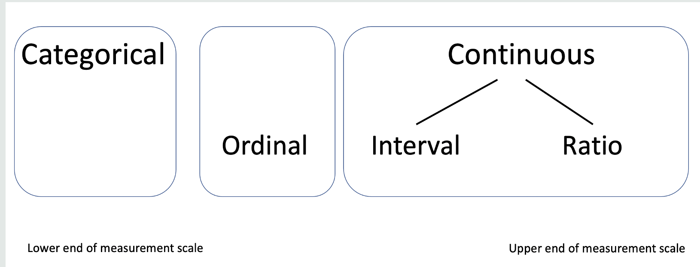{fig-align="center" width="50%" fig-alt="The levels of measurement arranged from categorical to ordinal to continuous, with continuous split into interval and ratio"}

In the image above, we see the lowest end of the measurement spectrum on the left: categorical variables. After that (to the right), ordinal variables have a little bit more measurement acuity compared to categorical variables. In other words, ordinal variables give more information compared to categorical variables. Finally, at the top of the measurement scale are continuous variables, which can be further subdivided into interval and ratio scales. Continuous variables give more information than ordinal and categorical variables.

### Categorical variables

Categorical variables are sometimes also called "nominal" variables. "Nominal" means "relating to names". This makes sense because nominal/categorical variables represent discrete characteristics of your observations (people). One example of a categorical variable would be "car manufacturer". Levels of this variable could be "Ford", "Chevrolet", "Toyota", etc. If I'm comparing parental wealth between business majors and non-business-majors, then one of my variables is categorical: category 1 = business major, category 2 = non-business major. (By the way, we would use an independent samples *t*-test to address this question.)

It's important to note that categories should be **mutually exclusive** (no one can be in multiple categories) and **mutually exhaustive** (all possible categories are considered). A demographic survey would fail to be mutually exclusive if it asked, "What is your religion, Christian, Catholic, Methodist, Buddhist, ..." This is because "Catholic" and "Methodist" are both types of "Christian". Thus, someone could be in multiple categories at once. They could be a Catholic AND a Christian at the same time. A demographic survey would fail to be mutually exhaustive if it asked, "What's your ethnicity, Black, White, or Asian?" What if your respondent is Indian, Middle Eastern, Native American, or identifies with multiple identities?

Categorical data like these are best presented as percentages, e.g., "The present sample was 54.10% business majors and 45.9% non-business majors."

**Also note that categorical variables have no inherent ordering to them.** One car manufacturer isn't necessarily "better than" another. "Business major" isn't "less than" or "above" non-business majors. Catholics are not in charge of Methodists, and Methodists are not in charge of Mormons. Categorical variables are **horizontal** in that sense: Differences between category members are not *hierarchical* differences, but more "apples vs. oranges" differences.

### Ordinal variables

Ordinal variables are a lot like categorical variables except that the different levels **do** have an inherent ordering. For instance, "Sophomore" comes after "Freshman" and "Senior" comes after "Junior". Thus, grade classification is an ordinal variable, not merely a categorical one.

Other ordinal variables include:

1. Rankings: LSU is #1 in the nation, Alabama is #2, Georgia is #3, and so on.
2. Positions in an organization: CEO > Vice President > Middle management, etc.

One thing to keep in mind about ordinal variables is that there is no measurable difference between category members. If my horse won 1st place in a race and yours won 2nd, this doesn't tell you ***by how much***. My horse could've beaten yours in a "photo finish", just barely eking out a win. Alternatively, my horse could've won by a landslide. If LSU is the #1 (football) school in the country, it might be "neck-and-neck" with Alabama, Georgia, and the other top teams. Or, LSU could be in a league of its own, greatly outclassing the other teams. In other words, ordinal variables convey only the order (from "highest" to "lowest") but not the actual "size" of these differences between them.

### Continuous variables

A continuous variable is a variable that can (theoretically) take on any value. Many variables are treated as if they are continuous even though, in practice, they aren't. Age, for instance, is almost always treated as if it is a continuous variable because it can take on many values: 18, 27, 38, 70. But no one is ever ***exactly*** 18 years old and zero seconds (or zero microseconds, and so on). You know how kids will say things like, "I'm 8 and a half" or "I'm 7 and 3 quarters"? In theory, you can be 35 years, 7 months, 3 weeks, 1 day, 3 hours, 23 minutes, 4 seconds, etc., years old. Suffice it to say, a continuous variable has many more levels than a categorical or ordinal variable, so much so that you might as well treat them as natural numbers.

### Interval and ratio continuous variables

::: {.callout-caution title="Challenge mode"}
There are two subtypes of continuous variable: interval and ratio. Interval variables are recorded as continuous numbers (e.g., 1.23, 3.5, 7). Despite appearances though, these numbers can't really be interpreted exactly like natural numbers. On an interval scale, the gap between "1.23" and "2.23" is not *necessarily* equivalent to the gap between "2.23" and "3.23".

On the Beck Depression Inventory (BDI), one person could score a 5 and another person might score a 10. Since the BDI is on an *interval* scale, we cannot say that the first person is half as depressed as the second person or that the second person is twice as depressed as the first one.

The interval scale could be thought of as a pseudo-continuous scale. The numbers themselves can take on a wide range of values, but those values aren't equally spaced from each other. You could think of an interval scale as being an ordinal scale with many, many levels.

A *ratio* scale, on the other hand, maintains many of the characteristics of natural numbers that we are familiar with. Someone who is 6 feet tall *really is* twice the height of someone who is 3 feet tall. The difference between people who weigh 200 pounds and 215 pounds *really is the same difference* as between people who weigh 215 pounds and 230 pounds.

Time is one of the most commonly used ratio variables in psychology (e.g., reaction time). If a person has a reaction time of zero, they did not react. If someone scored a 0 on the BDI, though, we cannot say they have zero depression. However, if one person has a reaction time of 500 milliseconds and another has a reaction time of 1000 milliseconds, we **are** able to say that the first person was twice as fast as the second person.
:::

### Working with continuous variables

Most variables that psychologists use in their research are treated as if they are continuous even though, technically, they aren't. The underlying mathematical assumptions/models are still usually appropriate though.

Psychologists traditionally present the mean and standard deviation for the continuous variables in their studies. (You'll learn what these are in detail later on.) If continuous variables are presented visually, then a histogram is usually appropriate.

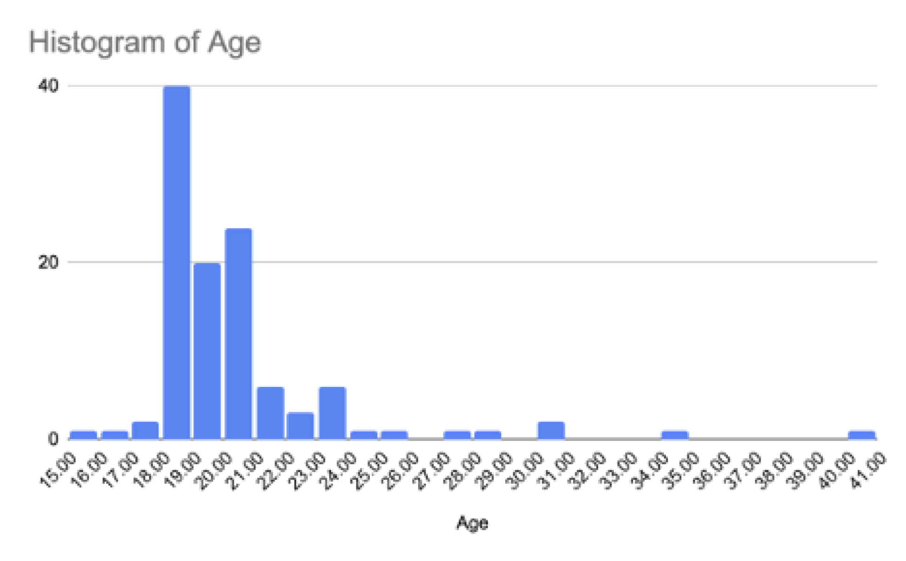{fig-align="center" width="50%" fig-alt="A histogram displaying the frequencies of different ages within a sample"}

In the figure above, the horizontal x-axis represents different values for age. The vertical y-axis represents how often people in the data had ages of specific values.

## Univariate distributions of continuous variables and statistics for describing them

Suppose we wanted to do some research and examine whether business majors come from more wealthy families compared to non-business majors.

We usually don't have access to the parental wealth of ALL business and non-business majors. That's why we draw random samples from the larger population and calculate *average* parental wealth for business majors and *average* parental wealth for non-business majors. When you randomly sample observations of a variable and record all the values, you end up with a "sample distribution" for that variable. Basically, the data have a certain "shape". We could also call this a "univariate, sample distribution" because it is the distribution of only one variable: ("uni" = 1) + ("variate" = variable).

{fig-align="center" width="40%" fig-alt="A stack of weights at a gym with different amounts of wear proportional to how often each weight is used"}

In the picture above, you can see that people use some weight settings a lot more than others. The most frequently used settings show more wear and tear. This is a naturally occurring representation of the distribution of settings people use on this machine. The amount of wear is proportional to the amount of times people use a particular setting on the machine. The histogram of ages within a sample is another example of a sample distribution. The visual gives you an idea of where most people's ages tend to cluster (around 18 to 21) and how spread out the ages were.

### Measures of central tendency

There are standard numbers we use to describe different aspects of a sample distribution (i.e., the shape of our sample data).

It's often useful to specify the "central tendency" (or "peak") of a distribution. You might be familiar with the mean, median, and mode from high school. If not, no big deal. I review them below.

The mode is the value in the data that occurs most frequently. In the hypothetical age data above, the mode would be 18. (Note: Sometimes there is no single value that occurs most often. Sometimes no value occurs more than once. That's why the mode can be a tricky thing to calculate.)

Median: If you order the data from the lowest to the highest value, then the median is either the value that occurs in the middle of the sequence (if there's an odd number of data points) or it's the average of the two data points that share the middle of a data set (if there's an even number of data points). In the hypothetical age data above, the median would be 19. Notice that the mode and the median are not the same, though they're close.

Finally, there is the average (or "arithmetic mean", or just "mean". Few people, including myself, consistently use the same name.) The average is the sum of all the data points divided by the number of data points. In the hypothetical example above, the mean would be 19.94. Again, we see that these different measures of central tendency are close, but not quite the same.

### Skew (the mean's only weakness!)

The reason different measures of central tendency aren't always quite the same has to do with skewness. When a distribution is perfectly symmetrical, the peak (or center) of the distribution has two equal slopes going down both sides of it (picture below, on the left). With a skewed distribution, these two slopes are uneven (like in the picture below on the right).

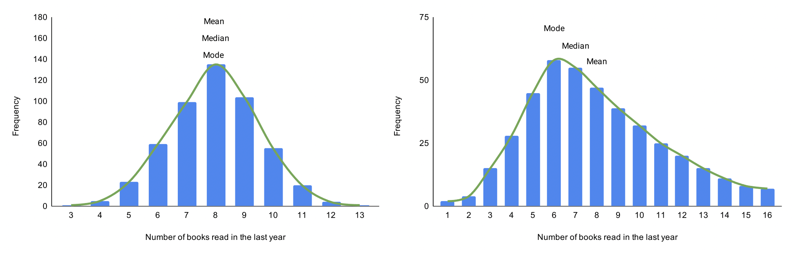{fig-align="center" fig-alt="Two distributions, one symmetrical and the other skewed to the right"}

When the slope on the right (on the higher, positive) side of the distribution is skewing the data, we call that "positively skewed" or "right skewed." Income and reaction time data tend to be positively skewed. Exam scores for a difficult test would be positively skewed as well.

When the slope on the left (the lower, negative) side of the distribution is skewing the data, we call that "negatively skewed" or "left skewed." Exam scores for an easy test would be negatively skewed.

The mean tends to follow the skew of a distribution. The mode is always at the peak (if there is only one mode) and the median usually falls somewhere between the two.

Most statistical analyses use the mean as its default measure of central tendency. In many cases, this is okay. However, if the data you are analyzing are heavily skewed, then the mean isn't really a good representative for the central tendency of the data.

### Outliers (The mean's *other* only weakness!)

It's tricky to define what *exactly* an "outlier" is. You could say it's a data point whose value is very different from the others. More than that, an outlier is often considered a data point that was not supposed to be in the data set because it was not sampled from the intended population.

For example, let's say you were hosting a support group for men who are trying to lose weight. Twelve men show up, but a young child also shows up. The two histograms below show the weight of each person who showed up, either including the child (left) or not (right).

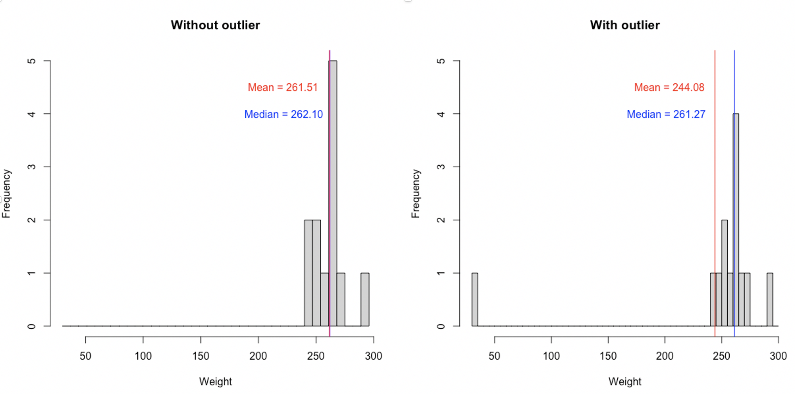{fig-align="center" fig-alt="Two histograms, one with an outlier and one without an outlier"}

The average weight of the support group is 261.51 pounds if you don't include the child, who is an outlier. If you **do** include the child, the average weight of the group is 244.08 pounds. That's a little more than a 17-pound difference hinging on whether you include the outlier or not. The median weight for just the men is 262.10 pounds. If you include the child, it's practically the same, 261.27. Not a very big difference.

That was a simplistic example, but it demonstrates a general point: data points that are very different from the others or ones that don't truly belong in your data set can substantially bias the mean. The mean will shrink (or inflate) depending on whether the outlier is lower (or higher) than the rest of the data points.

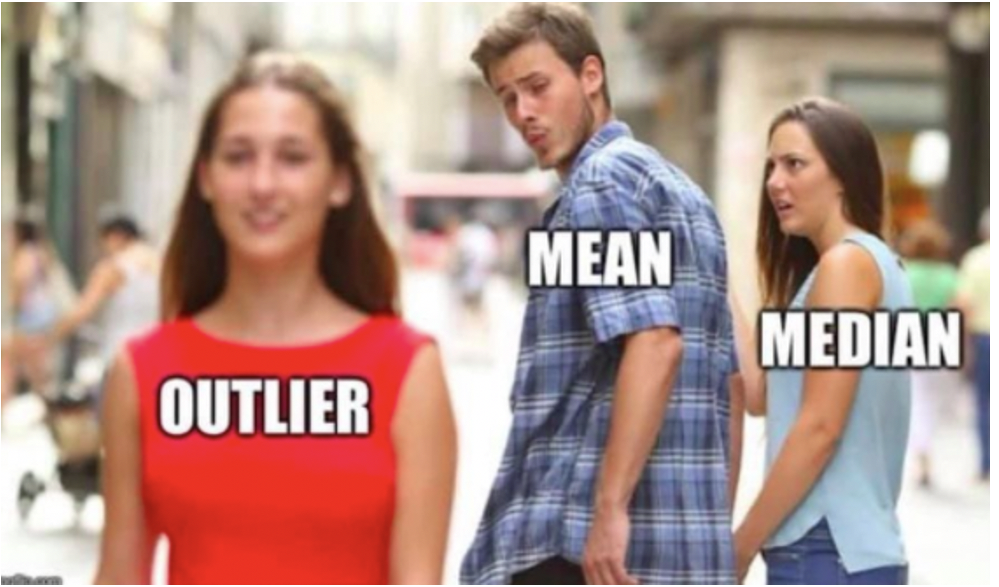{fig-align="center" width="50%" fig-alt="A meme where a man labelled \"mean\" is looking at a woman labelled \"outlier\" while another woman the man is with (labelled \"median\") looks upset that the man is paying attention to the \"outlier\"."}

## Multimodal distributions

If a distribution has only one "peak", it is called "unimodal" because it has only one mode. If a distribution has two "peaks", it is called "bimodal". More generally, if a distribution has multiple "peaks" (or modes), it is referred to as "multimodal". Multimodal data can belie some important aspects of your data. For instance, multiple modes might imply that there are sub-groups in your data. Which of the following products from Amazon in the figure below would you prefer to buy?

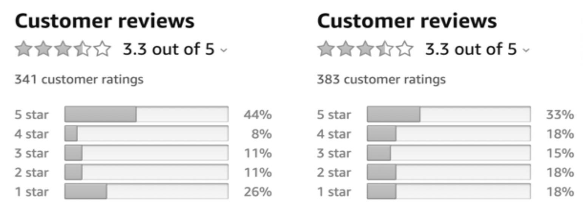{fig-align="center" width="70%" fig-alt="Two histograms showing the distribution of ratings given for two different products"}

Both of these products have the same average user rating (3.3). They both have roughly the same number of ratings. The option on the left, however, has this little extra clump of people who gave the product 1-star ratings. The option on the right is basically flat. For the product on the left, it seems like most people liked it, but there was maybe a small sub-group of people who hated it. It might be important to identify these people and understand if there's something unique about them that distinguishes them from the general population (or customer base).

Let's look at another example. Let's say I had a class with 100 "normal" students. They're about to take a statistics exam. However, right before the exam starts, 20 professional statisticians walk in and also take the exam. Below is a histogram of hypothetical grades that might result from this scenario.

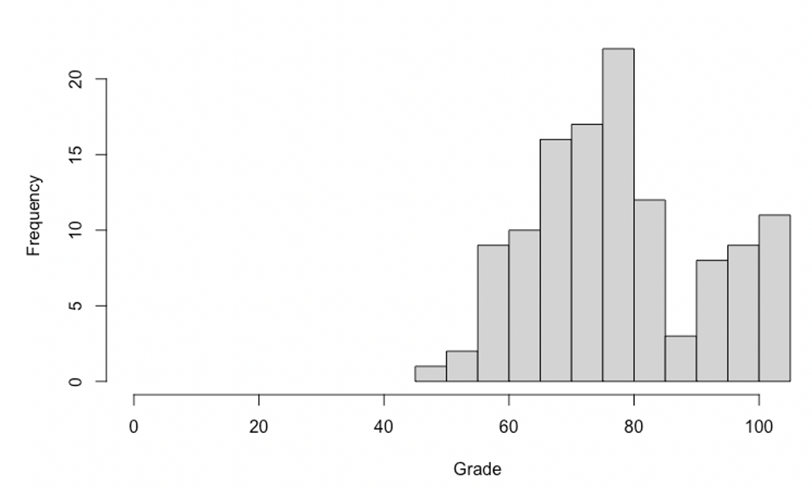{fig-align="center" width="70%" fig-alt="A distribution of grades with an odd shape"}

Can you see the two modes? It's like a mountain with two peaks. The main peak represents the 100 "normal" students. The second peak (the smaller one off to the right) represents the statisticians, who scored either a perfect score, close to perfect, or even got over 100 points in some cases.

### Measures of dispersion

It's important to know where the distribution of your data are centrally located. It's also important, though, to know how spread out (or "dispersed") the data are. When there is low dispersion in the data, then most of the data points are pretty similar to one another. If there is high dispersion, then the data points take a larger variety of values. Low dispersion means all the data's about the same. High dispersion means the data are "all over the place".

Imagine if you're trying to make purchases for an annual event based on data from previous years. If the annual costs were \$1,000, \$1,100, and \$900, you'd feel pretty confident in projecting this year's budget of "roughly \$1,000". But what if previous years cost \$300, \$3,500, and \$1,000? You'd feel a lot less confidence in projecting this year's budget!

If the data you're dealing with aren't very spread out, then your predictions and assessments can be made with much confidence. If the data are highly dispersed, though, then your predictions and assessments are going to be highly uncertain.

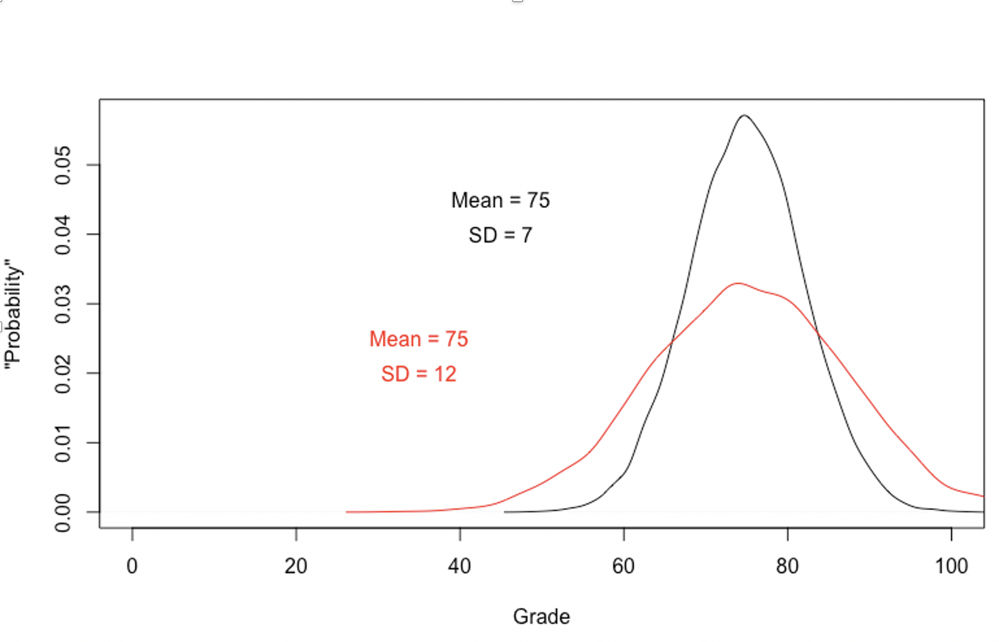{fig-align="center" width="70%" fig-alt="Two distributions of data, one with high dispersion and one with low dispersion"}

In the figure above, I have two different distributions of exam grades. Both distributions have the same central tendency: most students earned a 75 on the exam. However, the distributions have different levels of dispersion. The black distribution has a standard deviation ("SD") of 7 whereas the red distribution has an SD of 12. (We're going to learn more about SDs soon). Students in the first class tend to get scores that are pretty close to the average (75). Students in the red class also tend to get scores around 75, but there is a lot more variation in scores.

Which exam would you rather take?

There are quite a few ways to quantify the amount of dispersion in a variable. I cover 2 of them in this book. The simpler one is called "spread" (sometimes called the "range"). Spread is just the highest data value minus the lowest data value. So, in a small data set like [10, 20, 30, 40], the spread would be 40 - 10 = 30. It's just the difference between the highest and the lowest data value.

The most common measure of dispersion is the "standard deviation". For now, I'm only going to give a verbal "gist" of what a standard deviation is. I'm going to cover the actual math further down and introduce some special notation (try to contain your excitement). The standard deviation can roughly be defined as "the average distance between each data point and the mean." That's not *literally* what it is but it's not a bad definition to start off with. We'll also see in subsequent chapters that standard deviations are useful for conducting statistical tests.

## Sigma notation

So far I have been giving what might be called "verbal equations" for certain concepts. Examples include, "the mean of a variable is the sum of all the data points divided by the number of data points." Verbal descriptions like these are okay when we're dealing with very simple concepts, but they'll quickly become a nuisance. That's why it's ultimately better to use symbols and equations. This will require a small investment of effort up front, but learning the following notation will pay enormous dividends as we get further into the book.

Take a look at this equation for the mean:

$$
\bar{x} = \frac{\sum x}{N}
$$

This might look a bit strange, but if we break it down into its parts, it's very simple. $\bar{x}$ represents the sample mean. $\sum{}$ is the capital Greek letter "sigma". This is where the term "sigma notation" comes from. "$\sum{}$" means "Add up everything to the right of me". $x$ represents every element in a set, where that set is called "x". Let's say, your data are...

$$
x = [1, 2, 3, 4]
$$

Therefore, $\sum{x}$ would be equal to...

$$
1 + 2 + 3 + 4 = 10
$$

Therefore, $\sum{x} = 10$.

This notation becomes handy if you are performing the same operation on each data point and adding them as you go. For instance, many calculations in statistics involve the "sum of squares". This is where you square each data point and add up all these "squared points" together.

$$
\begin{aligned}
\sum{x^2} &= 1^2+2^2+3^2+4^2 \\
&= 1+4+9+16 = 30
\end{aligned}
$$

Therefore, $\sum{x^2}$ is equal to 30.

## Calculating a standard deviation

To calculate the standard deviation, we are going to calculate the difference between each data point and the mean, $\bar{x}$. If we wanted to "add up the differences between each data point and the mean", we'd write this as

$$
\sum{(x-\bar{x})}
$$

Each distance between a data point and its mean is a "deviation". Since the mean of [1, 2, 3, 4] is 2.5, then $\bar{x}$ is equal to 2.5. Therefore, $\sum{(x-\bar{x})}$ is equal to

$$
(1-2.5) + (2-2.5) + (3-2.5) + (4-2.5) = 0
$$

Fun fact: $\sum{(x-\bar{x})}$ will ***ALWAYS*** add up to 0. In other words, if you add up all the deviations in a data set, you will always get 0. This is because some deviations are positive and some are negative. The positive and negative deviations end up cancelling each other out every time and summing to 0. That's why we add up the "squared deviations":

$$
(1-2.5)^2 + (2-2.5)^2 + (3-2.5)^2 + (4-2.5)^2 = 5
$$

By squaring each deviation, we force all the numbers to be positive. Remember, "a positive times a positive is positive" and "a negative times a negative is positive". This sum of squared deviations is often referred to as the "sum of squares". If your data doesn't contain any sub-groups, and we just want the overall "sum of squares", we can denote this as $SS_{Total}$. This is also called the "sum of squares total" or "total sum of squares". So remember:

$$
SS_{Total} = \sum(x-\bar{x})^2
$$

Do you know what puts the "standard" in "standard deviation"? It's the fact that we want the *average* deviation. So, like with other averages, we divide by N:

$$
\frac{SS_{Total}}{N}
$$

We're almost done. I swear! The equation above gives us the average ***squared*** deviation, but we want the average deviation (***not*** squared). In fact, what we have so far is its own statistic: **the variance**. The variance is symbolized with a $\sigma^2$ for the population and a $s^2$ for samples. Notice that they both have a "$^2$" in them? The variance really is the squared version of what we actually want, $\sigma$ by itself or $s$ by itself.

We need to "unsquare" what we have "squared". To do this, you take the square root of the whole thing:

$$
\sqrt{\frac{SS_{Total}}{N}}
$$

There it is! Our final equation for the standard deviation. Isn't it beautiful?

The standard deviation for [1, 2, 3, 4], then, is:

$$
\sqrt{\frac{(1-2.5)^2 + (2-2.5)^2 + (3-2.5)^2 + (4-2.5)^2}{4}}
$$

N is equal to 4 because there are 4 data points in [1, 2, 3, 4]. Since we also know (from our above calculations) that the numerator ($SS_{Total}$) is equal to 5, we get...

$$
\sqrt{\frac{5}{4}} = 1.118
$$

The "standard" deviation from the mean in [1, 2, 3, 4], then, is about 1.118 (I did some rounding). It's not literally an "average" deviation, but with some mathematical trickery we've gotten something ***like*** an average deviation.

There **is** something beautiful about how the equation for the standard deviation is put together. Each piece is helping us get what we really want: "The average deviation from the mean". I have some bad news though. Two pieces of bad news, actually:

1. You're probably never going to calculate this by hand. Your computer will probably be calculating all of your standard deviations for you and you might even start to forget about this beautiful equation. (I have some tissues if you need them.)
2. There are actually two different formulas for the standard deviation.

Technically, you only divide by N if you are calculating the population standard deviation. The population standard deviation is the standard deviation of ***all*** the possible data that exist within a specific population. In most cases, we don't have the entire population of data, just a sample from that population.

The population standard deviation is denoted as "$\sigma$", the lowercase Greek letter for "sigma". Therefore,

$$
\sigma = \sqrt{\frac{SS_{Total}}{N}}
$$

If you are calculating a ***sample*** standard deviation, we denote this as *s* and we divide by "N - 1" instead of "N". Therefore,

$$
s = \sqrt{\frac{SS_{Total}}{N-1}}
$$

This term (N - 1) is referred to as "degrees of freedom". I'm going to do you a favor (for now) and not elaborate on why it's called that. Just know for now that you divide by N for a population SD ($\sigma$) and by (N - 1), aka "degrees of freedom", for a sample SD ($s$).

## Sample statistics versus population parameters

Let me give you two scenarios:

* You want to know the average height of the New Orleans Saints
* You want to know the average height of a "brony" (i.e., a male, adult fan of the show "My Little Pony")

In the first instance, you can just look up the Saints' roster online and calculate the population mean based on the entire roster's data. In the second scenario, however, you probably don't have access to each and every "brony" in existence (if you do, then I'm kind of terrified of your power...). You'd probably have to do some work and find a sub-sample of the overall population of bronies.

In the first scenario, you can calculate the population mean, which is denoted as $\mu$, the Greek letter "mu" (pronounced like "Mew", the pink feline Pokemon). Again, that's because you can find EVERY height for EVERY Saints player, the entire population of them. For the bronies, though, you can probably only find a random sample from the larger population of bronies. When you calculate the average height from your *sample* of bronies, you have a sample mean, which hopefully is pretty close to the population height. We denote the sample mean as $\bar{x}$.

For the Saints, you can calculate the population SD ($\sigma$) via

$$
\sigma = \sqrt{\frac{\sum(x-\mu)^2}{N}}
$$

For the bronies, you'd calculate a sample SD (*s*) via

$$
s = \sqrt{\frac{\sum(x-\bar{x})^2}{N-1}}
$$

The population standard deviation ($\sigma$) and the sample standard deviation ($s$) are two different things, so they have two different equations. $\sigma$ is the true population-level parameter. It's the standard deviation of the ***entire*** population. Sample statistics are used to ***estimate*** or ***approximate*** the population parameters. Thus, $s$ is an estimation/approximation of $\sigma$.

The equation for $\sigma$ has you dividing by N, the total number of observations in the population. By contrast, the sample statistic $s$ has you dividing by "N - 1". This "N - 1" is called "degrees of freedom". I won't get too deep into why it's called that, mostly because "degrees of freedom" is a more general concept that goes far beyond our present goals. I will say this, though: When estimating $\sigma$, we can't use the population mean $\mu$ to determine how much each observation deviates from the mean. Oftentimes, you don't know what $\mu$ is! You have to estimate $\mu$ with $\bar{x}$. So, when you're calculating a sample standard deviation, you're "double-dipping": You're using one sample statistic ($\bar{x}$) to estimate another sample statistic ($s$). This "double-dipping" introduces bias into the estimate, and dividing by degrees of freedom (N - 1) instead of N helps to mitigate this bias.

## Bivariate distributions

So far, we've only been looking at one variable in isolation. Characteristics of a single variable **can** be interesting: "A surprisingly large percentage of gamers are women". That basically amounts to saying, "You'd be surprised at how this one variable is distributed."

Most interesting scientific findings, however, involve more than just one variable. For instance, have you ever wondered if there's some sort of association between a man's height and the size of his vehicle?

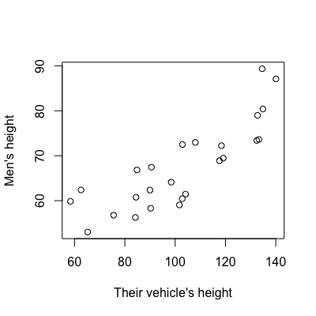{fig-align="center" fig-alt="A scatterplot showing a positive correlation between men's height and the height of their vehicle"}

In the figure above, I've plotted some fake data representing the relationship between men's height and the height of their vehicle. Each dot represents one man in the sample. The height of that dot (vertical, up-down, y-axis) represents how tall that man is. Each dot also appears at a horizontal (left-right, x-axis) location. The further to the left each dot is, the shorter that man's vehicle is. The further to the right each dot is, the taller their vehicle is. This kind of plot is called a scatter plot. It's one of the best ways to visualize the relationship (or lack thereof) between two continuous variables.

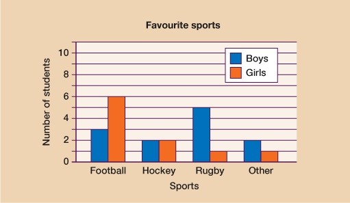{fig-align="center" fig-alt="A bar chart showing how many students like different sports"}

The above chart is called a bar plot. Bar plots are a good way to display the value of a continuous variable across different levels of a categorical variable. In this plot, we're shown how many students consider a certain sport to be their favorite. One of the variables (sport) has 4 levels: football, hockey, rugby, and "Other". The number of "favorites" is also broken down by sex/gender: "Boys" and "Girls". (There should really be a third level for "non-binary" or something like that, but if there are no data in a category, they're often omitted from graphs.)

## Independent and dependent variables (IVs and DVs)

When you read a headline about a new scientific study, there's usually an implied statement of causality. "Research shows that eating chocolate actually reduces risk of cancer!" There are two variables here: The degree to which people eat chocolate and the degree to which someone has cancer (or just whether they have cancer or not). When conducting a statistical analysis, we need to make the implied direction of causality explicit. Which variable is the outcome that supposedly changes ***depending on*** the other variable? Which variable is the implied pre-cursor, the one doing the changing? In the hypothetical headline above, eating chocolate is the independent variable (IV) and cancer risk is the dependent variable (DV).

The dependent variable (DV) is the implied outcome. If someone said they always do better on tests when they drink a cup of coffee beforehand, test performance is the DV. Test performance is something that supposedly changes (or depends on) some other variable. The coffee in this example would be the independent variable (IV). The independent variable is the variable that is supposedly making a difference in the dependent variable. There's usually an insinuation that the independent variable (IV) causes the dependent variable (DV) to change. Sometimes people use more cautious language. For instance, they'll refer to the IV as the "predictor variable". After all, maybe drinking coffee doesn't ***cause*** you to do better on your exams, but it might ***correlate*** with you doing better on your exams.

### Correlational (or observational) vs. Experimental research designs

Does playing violent video games cause kids to become violent? Some studies have shown that kids indeed show a positive association (or "positive correlation") between the amount of hours they spend playing violent video games and how violent they are. In this scenario "hours spent playing violent video games" is the independent variable and "level of violent behavior" is the dependent variable. The violent behavior of the kids (the DV) supposedly "depends on" or "changes depending on" how much time they spend playing violent video games (the IV). Conversely, how much time they spend playing violent video games (the IV) supposedly causes a change in how violent the kids are (the DV).

But really, you could flip things around and say that kids who were already violent tend to also enjoy violent video games. You could say, "Violent kids tend to play more violent video games." Now, the phrasing makes it sound like "time spent playing violent video games" is the DV and "level of (pre-existing) violence" is the IV. One of the most common mistakes I see researchers make is to assume an IV is causing changes in a DV simply because someone designated one variable as the IV and the other as the DV. They could've flipped things around though. The data don't ***by themselves*** tell you which direction causation is moving in. You'll have to read the study more carefully to see if there are justifications for causal inferences like these.

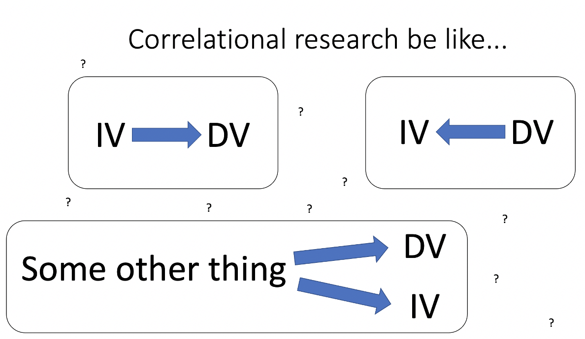{fig-align="center" width="50%" fig-alt="A picture showing the different directions and difficulties inherent to correlational research"}

This illustrates an important point: In the kind of research described above (correlational/observational research), the dependent variable (DV) in a statistical analysis is more like a focal variable. It's something we're choosing to focus on. Differences in the IV aren't necessarily **causing** differences in the DV. The IV could be causing the DV, the DV could be causing the IV, or some third variable could be causing both.

This is called a confounder: a variable that causes differences in two other variables, and these two other variables are correlated with each other but not caused by each other. For instance, ice cream sales and drownings are correlated with each other, but they don't cause each other. They are both caused by time of year. In the summer, people tend to eat more ice cream and, coincidentally, go swimming more often. The more swimming people are doing, the more they're rolling the dice with drowning.

Correlational/observational research is fundamentally different from experimental research. There are all kinds of variables that might cause children to behave more violently: their genes, their upbringing at home, social factors at school, and even the kinds of media they consume outside of video games. If you find a kid at random to participate in your study, they could be all over the place on any of these different spectrums.

However, you can control how much (or whether) they play a violent video game. It'd be really inconvenient, but it is possible. You could randomly assign children in your study to play violent video games for a few hours and have the rest of the kids play non-violent video games. If you measure aggression after this random assignment has occurred, then you can infer that playing violent (vs. non-violent) video games **caused** changes in aggressive behavior (if there is any). That's because all the other variables (genes, upbringing, etc.) should wash out through the process of random assignment.

In a correlational (or observational) study, you passively record characteristics of people without experimental manipulation or intervention. How violent are they? About how many hours per week do they spend playing violent video games? There are always more variables you could collect, but if you don't experimentally control any of these variables, you are merely observing data.

### Multiple IVs?

Usually, there is only one DV in a study. There are techniques for analyzing multiple DVs at the same time, but most people just focus on one. It is very common, though, for people to have multiple IVs. Let's say you're interested in the effects of being in honors on peoples' GPA. You expect students in honors to have higher GPAs compared to students who aren't in honors. In this scenario, college GPA is the DV and whether someone's in honors or not is the IV. You don't have to stop there though. You could also ask whether the "effects" of being in honors on GPA are the same for men, women, or other gender identities. In this scenario, there are two IVs: (1) whether a student is in honors and (2) whether they are male, female, or some other gender identity.
