# Probability distributions and hypothesis testing

A data set has a certain "shape" or "distribution". "Descriptive statistics" are used to describe and summarize the main characteristics of this shape. Examples of descriptive statistics include measures of central tendency (e.g., mean, median, mode) and dispersion (e.g., range, variance, standard deviation). "Inferential statistics", on the other hand, are used to make generalizations from samples of data about the broader population these data were drawn from. They're used for evaluating hypotheses. We're going to introduce one inferential statistic during this chapter, the *p*-value.

To really sink our teeth into what "inferential statistics" are, we first have to talk about "probability distributions".

## Probability distributions

A probability distribution is a mathematical function that gives the probability of all possible outcomes that could occur from a random process. These probabilities have to add up to 100%, no more and no less.

I'll start with two simple examples of probability distributions. First, a fair coin: The probability of flipping a fair coin and getting heads is 50%. The probability of flipping tails is also 50%. In this probability distribution, every possible outcome (all two of them: heads and tails) are given a probability. The probability of every outcome adds up to 100%.

Here's a **slightly** more complex example: Rolling a 6-sided die. Each outcome, 1 through 6, has a probability of 1/6 (or about 16.67%) of being on top after rolling the die. Again, every possible outcome has a probability assigned to it, and adding all the probabilities for each outcome sums to 100%.

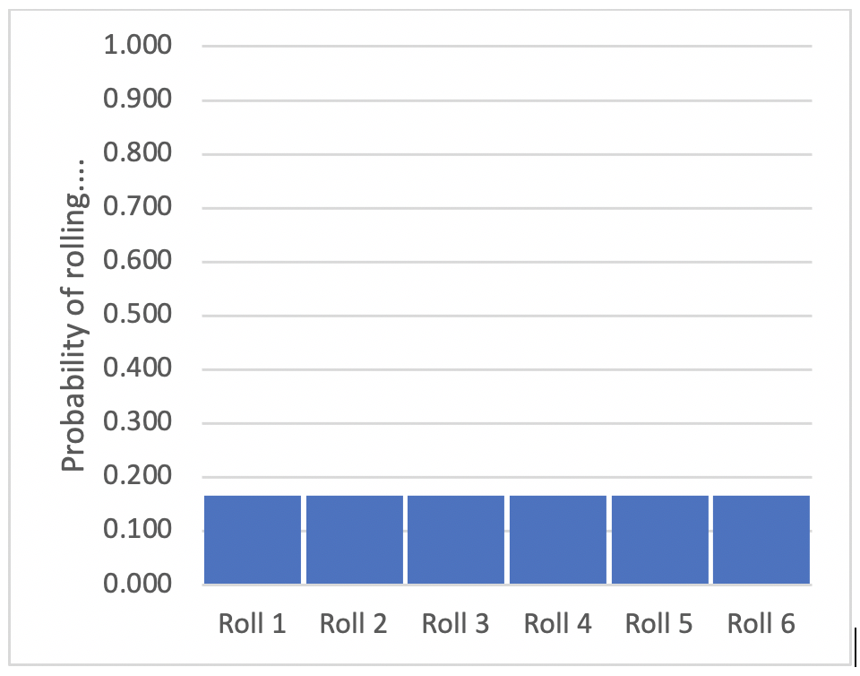{fig-align="center" width="50%" fig-alt="The probability distribution for different outcomes when rolling a 6-sided die"}

One of the most important aspects of inferential statistics is the idea of an "interval of outcomes." An "interval of outcomes" is a subset of possible outcomes. For instance, what's the probability of rolling a 3 or lower with a regular 6-sided die? Here's the math:

$$
\frac{1}{6}+\frac{1}{6}+\frac{1}{6}=\frac{3}{6}=\frac{1}{2}=50\%
$$

But you probably knew that one off the top of your head. What about the probability of rolling a 5 or lower? A four or lower? These are all intervals of values.

| Value | Probability of rolling that specific value | Probability of rolling that value or lower |
|:-----:|:-------:|:-----:|
| 1 | $\frac{1}{6}$ or 16.67% | $\frac{1}{6}$ or 16.67% |
| 2 | $\frac{1}{6}$ or 16.67% | $\frac{2}{6}$ or 33.33% |
| 3 | $\frac{1}{6}$ or 16.67% | $\frac{3}{6}$ or 50.00% |
| 4 | $\frac{1}{6}$ or 16.67% | $\frac{4}{6}$ or 66.67% |
| 5 | $\frac{1}{6}$ or 16.67% | $\frac{5}{6}$ or 83.33% |
| 6 | $\frac{1}{6}$ or 16.67% | $\frac{6}{6}$ or 100.00% |

Another name for "the probability of rolling a certain value or lower" is the "cumulative probability" of that value. Each time the end of the interval goes up, the total probability of being within that interval ac***cumulates***.

## Randomly sampled data often "approach" or "approximate" the shape of a probability distribution

It is often useful to examine whether some data you are collecting looks like a particular probability distribution. Alternatively, sometimes we assume the data we're collecting is being drawn from a hypothetical probability distribution. Assumptions like these are often very plausible, and infinitely useful.

You can form a hypothesis about what your data ***should*** look like, and then calculate how likely your data actually are when that hypothesis is assumed to be true. We use probability distributions to calculate what data ***should*** look like. Without assumptions like these, data cannot have a probability. It's just data. Once you assume, however, that a coin is fair or a die isn't loaded, then you can compare how that assumption stands up against data drawn from a suspicious coin or die.

In the GIF below, there is a sequence of 30 random coin flips being made. As the sequence unfolds, the running total of heads and tails are tracked. If we assume it's a fair coin, then, over time, all the random flips should reach the 50-50 point, an even split between "heads" and "tails". I've marked that 50-50 threshold with a green horizontal line.

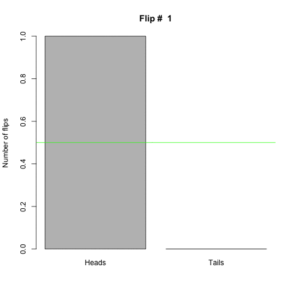{fig-align="center" fig-alt="Animation of random coin flips approaching the probability distribution of a 50-50 chance."}

This animation shows an ongoing, updating distribution of data that is getting closer to a theoretical probability distribution represented by the horizontal green line. Both bars in that chart should get closer and closer to aligning with that green bar as the sample size (the number of flips) gets bigger and bigger.

Here's a similar animation for 6-sided die rolls.

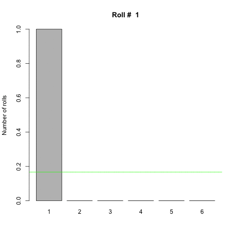{fig-align="center" fig-alt="Animation of random die rolls approaching the probability distribution where each outcome has a 1/6 chance of occurring."}

Since there are more possible outcomes (1 through 6), it takes longer for these data to approach the theoretical probability distribution where every outcome has a 1-in-6 chance of occurring.

One of the most important concepts in statistics is the idea of comparing your actual data to a theoretical probability distribution. Are your data more likely to have occurred if the coin was fair? Or, are your data more likely to occur if the coin is biased? In the coin flip GIF above, I told my program to generate random data where there really is a 50% chance of either landing heads or tails. What if I tell the program to come up heads 75% of the time and to come up tails 25% of the time?

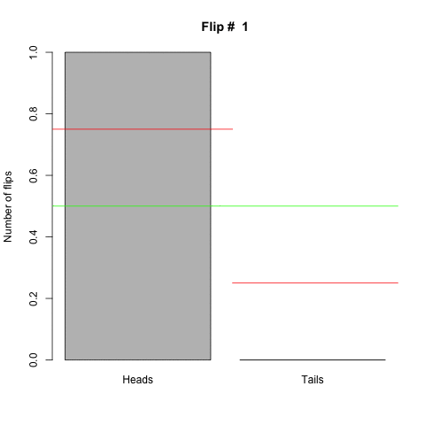{fig-align="center" fig-alt="Animation of random coin flips for a biased coin"}

In the simulated data above, the green line represents the long-term expected outcomes from a fair coin. The red lines represent the long-term expected outcomes from a coin that is biased to come up heads 75% of the time and otherwise come up tails. When we get to the last coin flip (#30), the data are closer to the red lines, which represents our expectations for the 75% biased coin. However, they still aren't **that** close. The red hypothesis (75%) appears to have more support than the green (50%) hypothesis, relatively speaking.

We still have sampling error though: the random samples only approximate the true population parameters. More generally, sampling error occurs when sample data fails to line up with the population data it's being drawn from to some degree. The ACT scores from a small, random set of college applicants might, on average, appear lower (or higher) than the actual average ACT score in the population.

Sampling error can also occur with probability distributions. I set the probability in the simulation to be 75% chance of heads. Because of randomness, however, the 30 coin flips didn't come out exactly 75% heads and 25% tails.

When you collect enough data, your sample statistics should get closer and closer to the true population parameters. However, there will often be times when the sample statistics are slightly off. There will also be times where sampling error makes your sample data look very, very off! This is just the nature of randomness and chance (and sampling error).

In the long run, "the house always wins". If you gamble money at a casino, you are probably (eventually) going to lose it all. But, because of randomness, you sometimes see small wins and streaks of random luck. In statistics, this "luck" is actually bad. We want our sample statistics to align closely with the population parameters we're trying to estimate. Because of random "luck" though, sometimes the sample statistics are misleading.

## Area $\approx$ probability

"The probability of rolling a 3 or lower" is equivalent to saying, "The cumulative probability of rolling a 3." It's also kind of like taking the entire probability distribution and cutting it in half.

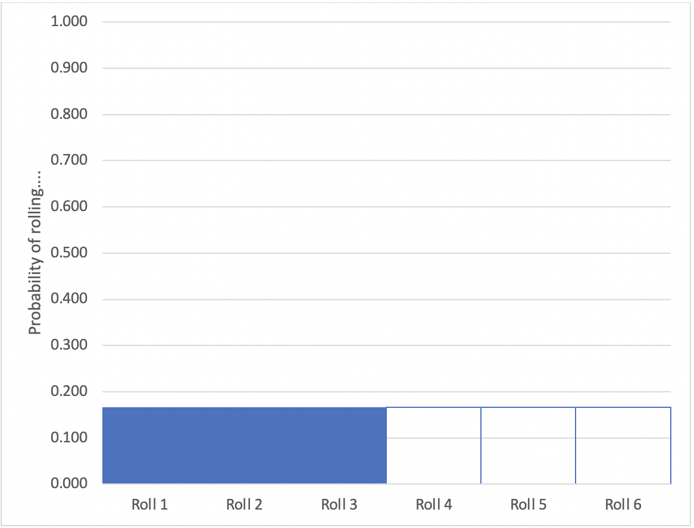{fig-align="center" width="50%" fig-alt="The cumulative probability of rolling a 3."}

And if you ask for the cumulative probability of rolling a 4, it's as if you cut a piece off of the entire probability distribution whose area makes up $\frac{4}{6}$ of the entire distribution, leaving the remaining $\frac{2}{6}$ of the distribution behind.

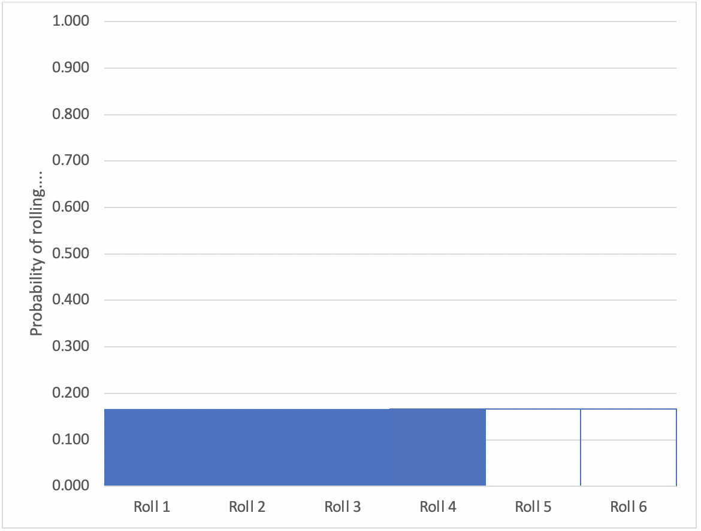{fig-align="center" width="50%" fig-alt="The cumulative probability of rolling a 4"}

The area of a 2 dimensional rectangle is equal to its height times its width. In the picture above, the height of entire distribution (encompassing all possible outcomes) is $\frac{1}{6}$ and the width is 6. $\frac{1}{6}*6=1$. That "1" represents 100% of the area of the rectangle. There's a 100% chance of observing an outcome that falls somewhere within the area of that rectangle. That shouldn't be surprising, because a probability distribution has to assign a probability to all possible outcomes and the probabilities of those outcomes have to sum to 100%.

What's the probability of rolling a 3 or lower with a fair die? This is like asking the probability of observing an outcome that falls within only half of the rectangle/distribution. You can still think of that sub-area (1 through 3) as a probability. It has a height of $\frac{1}{6}$ and a width of 3. $\frac{1}{6}*3=\frac{3}{6}=\frac{1}{2}=50\%$. 1 through 3 makes up half the possible outcomes for rolling a 6-sided die. The interval "1 through 3" also takes up half (50%) of the area of the overall "rectangle"/probability distribution.

When you ask the probability of rolling a 4 or lower, you end up with a sub-section of the "rectangle"/probability distribution that takes up $\frac{4}{6}$ (or about 66.67%) of the total area. You create a shape that is $\frac{1}{6}$ tall and 4 wide. $\frac{1}{6}*4=\frac{4}{6}=66.67\%$.

### The area of an oddly shaped room

A distribution has a total area that adds up to 1 (or 100%). Different subsections (or intervals) within the distribution have areas that make up a certain percent of the total area. This concept is so important, that I have more examples for you.

Imagine you and your roommate are in a 5 foot by 5 foot room.

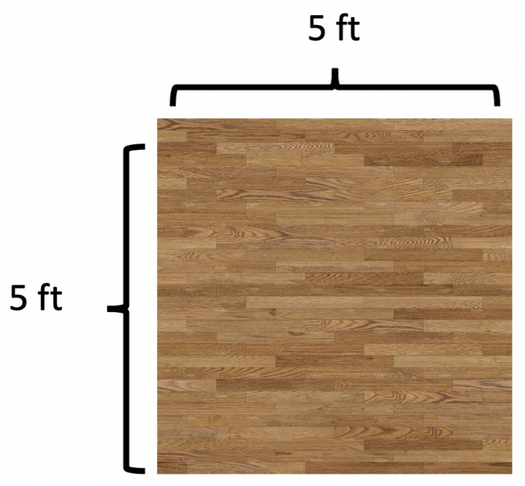{fig-align="center" width="50%" fig-alt="A picture of a 5x5 room"}

The room is 25 square feet. In other words, the total area of the floor is 25 square feet.

Now suppose your roommate is furious at you. In typical sitcom fashion, they draw a line across the floor separating their part of the room from your part of the room.

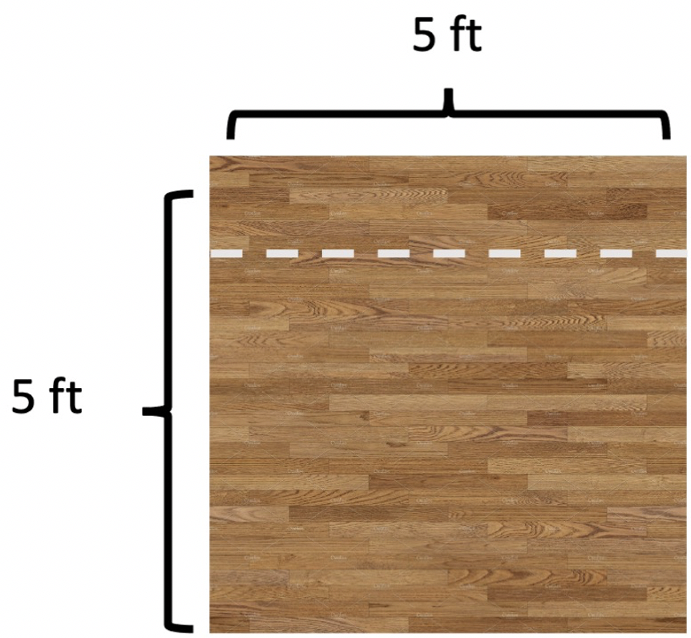{fig-align="center" width="50%" fig-alt="A picture of a 5x5 room with a dashed line drawn on the floor"}

Your roommate says you're not allowed anywhere above the dotted line. That's your roommate's side of the room. Let's say the rectangle formed by their side of the room is 1 ft tall and 5 ft wide. That makes their part of the room 5 square feet. That's 1/5 (or 20%) of the total area of the room.

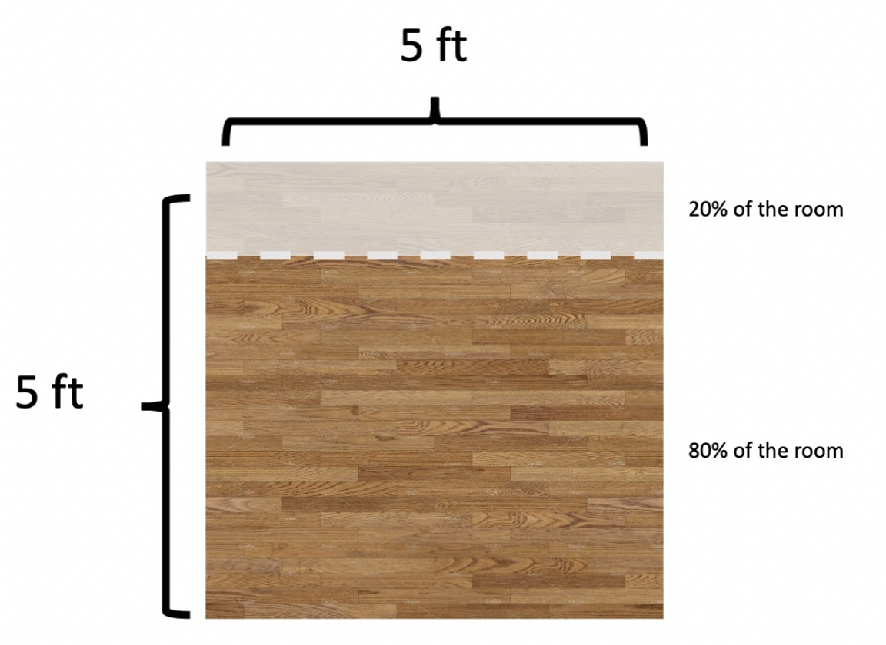{fig-align="center" width="50%" fig-alt="A picture of a 5x5 room split into 20% and 80% areas"}

To understand the connection between "area" and "probability", imagine this: Someone throws a red bouncy ball as hard as they can. It ricochets around the room, bouncing erratically off the walls and floor. It could land anywhere in the room completely at random.

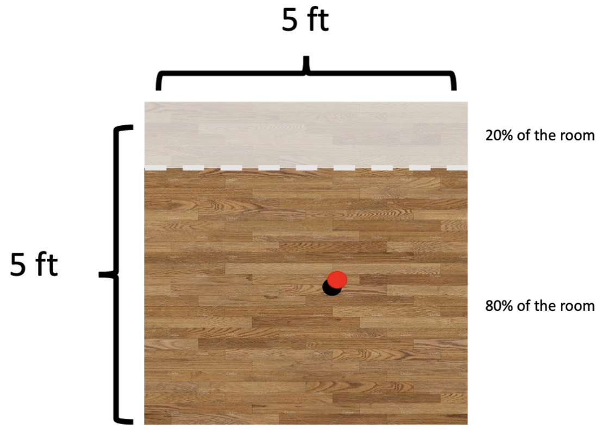{fig-align="center" width="50%" fig-alt="A picture of a 5x5 room split into 20% and 80% areas. A red rubber ball is on the floor."}

***Question:*** What is the probability that the ball will land on your roommate's side of the room? What's the probability that the ball will land on your side of the room?

***Answer:*** There's a 20% chance it will land on your roommate's side of the room and an 80% chance it will land on your side of the room.

The percentage of the total area sectioned off by the white dotted line corresponds to the probability of a ball landing on that side of the room at random.

Now let's try to transfer this reasoning over to a different shape. The area of a square is easy to deal with mathematically, but the area of a curved object like the normal distribution isn't. (We'll learn more about the normal distribution later. For now, just know that it's a very important probability distribution.)

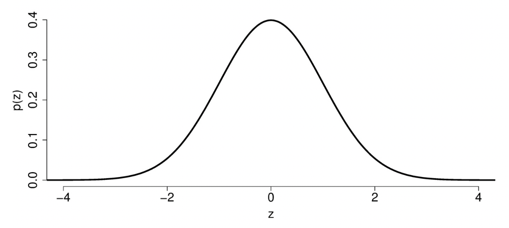{fig-align="center" width="50%" fig-alt="The normal distribution"}

But the logic is the same. Pretend this is just a room with a weird shape.

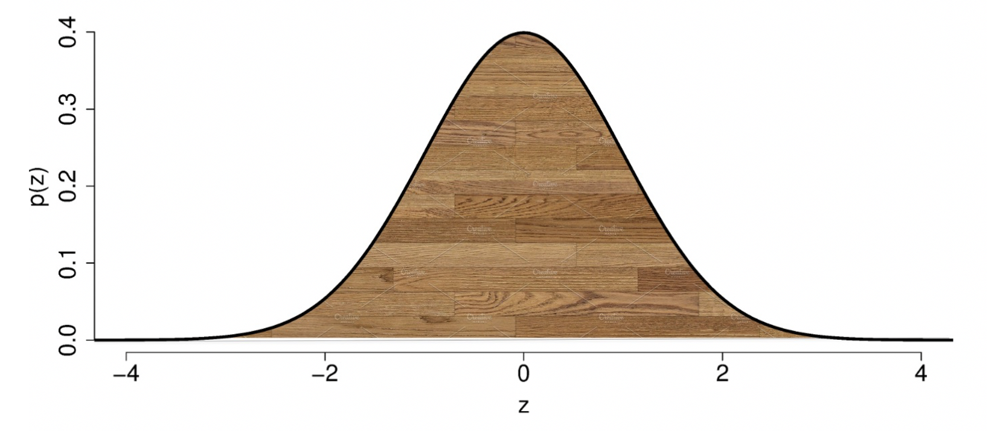{fig-align="center" width="50%" fig-alt="The normal distribution with the area under the curve made to look like a wood floor"}

If you draw a white dotted line somewhere in this oddly shaped room, you are still dividing the total area of the room into subsections.

Let's say you draw a white dotted line where z = 1.

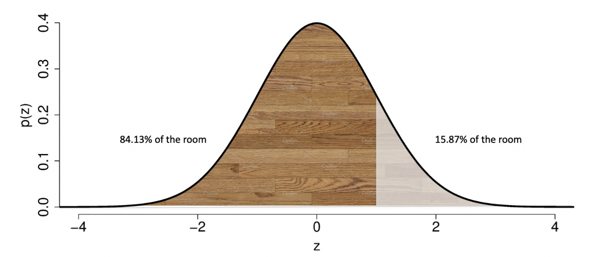{fig-align="center" width="50%" fig-alt="The normal distribution with the area under the curve made to look like a wood floor. The upper 15.87% of the area under the curve is overlaid with a shade of gray."}

This would divide the room into two parts: Most of it is ***not*** on your roommate's side of the room. 84.13% of the room is still yours. The part shaded in gray is your roommate's area. It takes up 15.87% of the total area of the room.

If you throw a ball in this oddly shaped room, there is an 84.13% chance it will land in your side of the room and a 15.87% chance it will land in your roommate's part of the room.

Let's say we divide the room where z = 2. Now you have 97.7% of the room to yourself and your poor roommate only gets 2.3% of the room. If you threw a ball in this room, there is still a chance the ball will land on your roommate's section, but it is very unlikely.

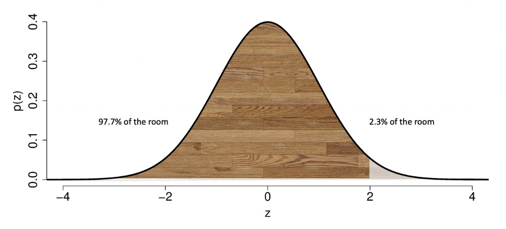{fig-align="center" width="50%" fig-alt="The normal distribution with the area under the curve made to look like a wood floor. The upper 2.3% of the area under the curve is overlaid with a shade of gray."}

Much of this chapter will focus on hypothesis testing in statistics. ***Statistical hypotheses are expressed in the language of probability distributions.*** You assume a certain statistical hypothesis is true (e.g., "This coin is fair, 50% heads, 50% tails."), then calculate how probable your data were to have occurred under this assumption. We'll end up talking about "area under the curve". That's because many important, widely-used probability distributions are curved. Thus, the interesting probabilities associated with our data (and our research hypotheses) are directly related to what percentage of the area "under the curve" those data take up. We'll return to this oddly-shaped room example. For now, we're going to focus on statistical hypotheses and explain what those are in more depth.

## Parameters of probability distributions

Probability distributions often have "parameters". Parameters are like the "settings" for the distribution. Just like how a TV can be set to different volumes and color contrasts, probability distributions can be set to have different peaks, widths, skews, etc. In the coin flip example above, I was using the binomial distribution, which has only two possible outcomes (e.g., heads vs. tails). The binomial distribution has a parameter called the "success rate". The "success rate" determines the probability of one outcome over the other (e.g., heads). In the first example, I set the success rate to 50%, like with a real coin. In the second example, I set this parameter to 75%. Below is the mathematical formula for the binomial distribution. (Don't worry! This won't be on the exam... at least not *my* exam.)

$$
p_{x} = \binom{n}{x}p^x q^{n-x}
$$

The binomial distribution can give you useful information about the probabilities of events with only two possible outcomes: heads vs. tails, "survived" vs. "didn't survive", "approved for a loan" vs. "not approved", have you ever been diagnosed with depression, "yes" or "no".

The binomial distribution has two parameters: The number of trials (n) and the probability of "success" on a given trial (p). Let's say flipping a coin and landing "heads" is a "success". The binomial distribution can tell you all sorts of things such as:

* The probability of landing heads at least twice throughout 10 flips.
* The probability of landing heads two or more times throughout 5 flips.

You could also make precise inferences about things psychology majors care about, like the probability that someone will experience depression during college.

It's easier to think about coins though. Just remember that the math/probability stuff applies to any situation with binary outcomes. Let's say you flipped a sketchy coin 20 times and it came up heads on 15 of those 20 flips. It's still possible that the coin is actually fair. You just got "bad luck" and flipped a higher percentage of heads than you would've seen in the long run, if you'd kept flipping. With the binomial distribution, you can plug in "20" as the number of trials (n) and plug in 0.5 (p) as the probability of landing "heads" (AKA, the success rate). According to the binomial distribution, there is a 1.48% chance of that happening. I'll leave it up to you to decide whether the coin was loaded or not.

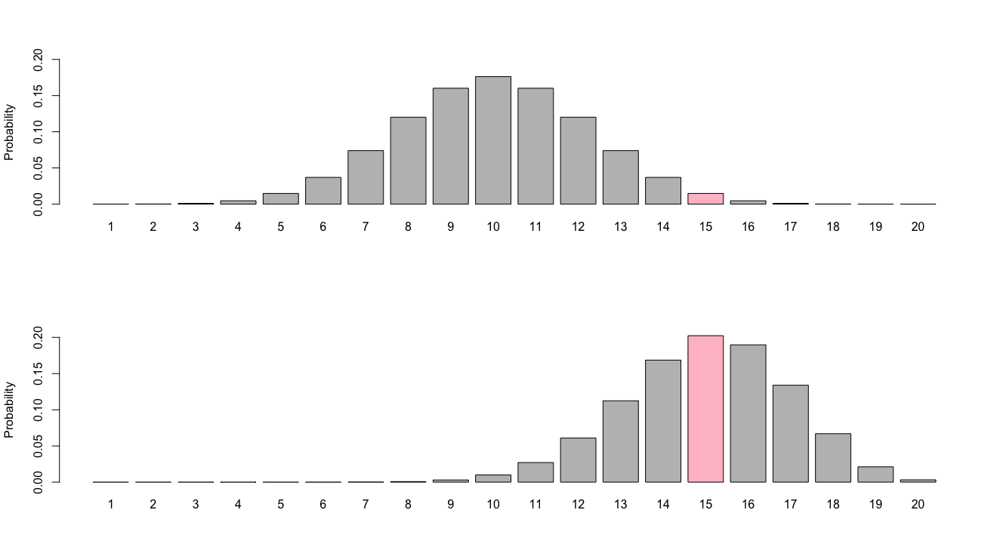{fig-align="center" fig-alt="Two binomial distributions. Both with the probability of 15 successes highlighted in pink. They have different probabilities for a \"success\" though."}

In the distribution at the top, the parameter (p) has been set to 0.5, a 50% chance of "success". In this case, a "success" is defined as "coming up heads." On the distribution at the bottom, p has been set to 0.75, a 75% chance of coming up heads. As you can see, these two probability distributions (with their two different p settings) have different implications for how likely it is you will flip 15 heads out of 20 overall flips. I've colored the bar representing 15 heads in each distribution pink and the rest as gray. The distribution at the top says there's about a 1.48% chance of flipping 15 out of 20 heads when you assume p = .50. The one at the bottom says there's about a 20.23% chance of flipping 15 out of 20 heads when you assume p = .75. So, flipping 15 out of 20 is still ***possible*** under both assumptions, but is much more likely under one assumption versus the other.

This is what statistical hypothesis testing is all about. Each probability distribution (and its parameter setting) represents a hypothesis. Each hypothesis renders your data more likely (or less likely). You can then make inferences about the underlying **population** parameters, based on your data.

Let's say a new cancer drug is going on the market and you need to decide whether it's safe enough for the public. You'll have to run some clinical trials and compare how many people die when using the new drug versus the old drug. But some people are still going to die either way.

You'll need to ask questions like

* What is the probability of 5 people dying out of 100 cancer patients in a clinical trial when the old treatment is used?
* Let's say usually 5 out of 100 people die during a clinical trial using the old treatment. If we see only 2 out of 100 people die in the new treatment, how likely were we to observe data like these if the new treatment is equally as effective as the old one?
* How likely are we to see this result if the new treatment has a better "cure" rate than the old treatment?

The binomial distribution can answer questions like these.

What's the probability of 0 people dying in a clinical trial of 100 cancer patients if the probability of dying is assumed to be 5%? Plug the right numbers into the binomial distribution and it'll tell you there's a 0.59% chance of that happening. Less than a 1% chance. What's the probability of exactly 1 person dying in that trial? 3.12%.

| Number of deaths | Probability of that many deaths when p is set to .05 in the binomial distribution |
|:-----:|:-------:|
| 0 out of 100 | 0.59% |
| 1 out of 100 | 3.12% |
| 2 out of 100 | 8.12% |
| 3 out of 100 | 13.96% |
| 4 out of 100 | 17.81% |
| 5 out of 100 | 18.00% |
| 6 out of 100 | 15.00% |
| 7 out of 100 | 10.60% |
| 8 out of 100 | 6.49% |
| 9 out of 100 | 3.49% |
| 10 out of 100 | 1.67% |
| 11 out of 100 | 0.72% |
| 12 out of 100 | 0.28% |
| 13 out of 100 | 0.10% |
| 14 out of 100 | 0.03% |
| 15 out of 100 | 0.01% |
| ... | ... |

You can see our friend "sampling error" at play here. If you assume the probability of dying during a clinical trial is 5%, that doesn't mean exactly 5% of the people in a new sample will die. We can see from the table above that the probability of exactly 5 out of 100 patients dying only has an 18% chance of occurring. Nearby outcomes (such as 4 people or 6 people dying) are almost equally likely.

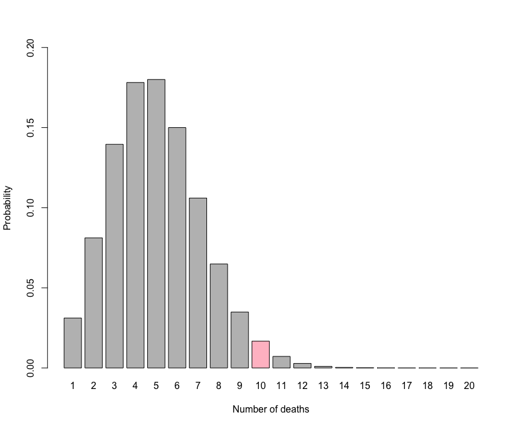{fig-align="center" width="50%" fig-alt="A binomial distribution with the probability of 10 deaths out of 100 highlighted in pink."}

Now let's say we do a clinical trial and 10 (out of 100) die. The probability of 10 or more people dying, when you assume there's really a 5% chance of dying is given by the binomial distribution: 2.82%.

That's pretty unlikely.

When you try different parameter values, you look to see how they affect the probability of the data when you assume those parameter values are true.

Hopefully you are starting to see how the parameters of a probability distribution can be used to assess the probability of some important data with implications outside of crooked coin flipping games. Parameters of probability distributions can be used to say ***precisely*** what some data hypothetically ***should*** look like. With statistical hypothesis testing, we are really just asking whether different sets of parameters are plausible (given our data) or which ones aren't.

## Statistical hypotheses

Let's go back to the 6-sided die. I want to know the probability of rolling a 2 or lower. I'll win money in a dice throwing game every time it comes up as a 1 or 2, but I'll lose money for any other outcome. Let's say I end up playing 20 rounds of this dice throwing game and I only win once. I'm worried that the die is loaded. We'll set our binomial distribution to have a "success rate" of 0.33. Theoretically, if a 6-sided die is fair, then that's what the real success rate should be for the interval of outcomes we've selected (2 or lower). The figure below shows the probabilities associated with winning 0 out of 20 times, 1 out of 20 times, and so on. If the die were fair, then we should usually be winning about 6 (or maybe 7) times out of 20 games. But it is possible that you'll win a bit less or a bit more than that. The probability of only winning once, when you assume the true "success rate" is 0.33, is 0.003. That's a mere fraction of 1%.

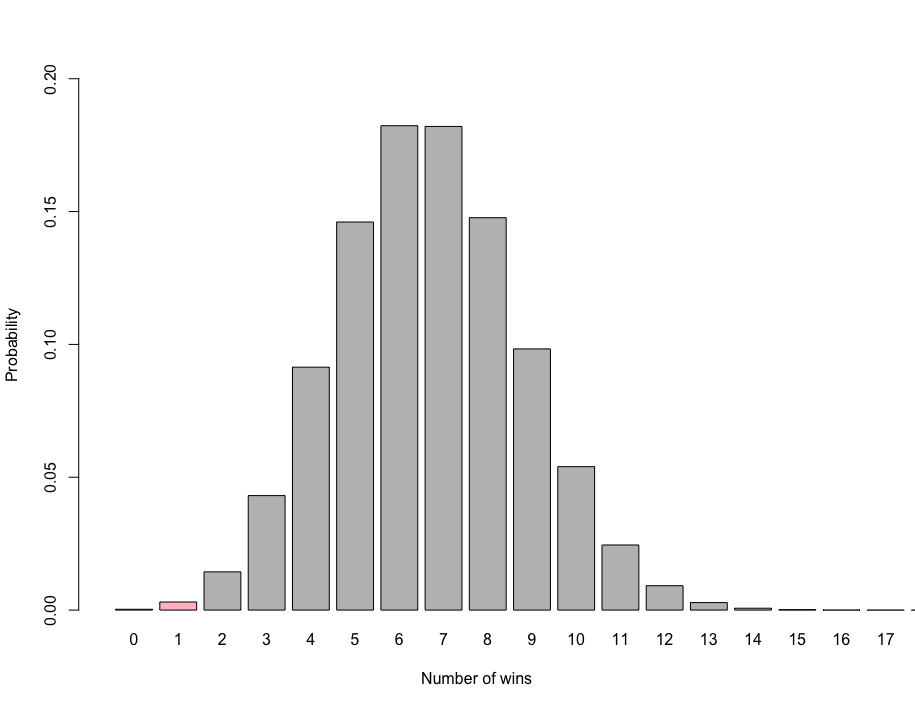{fig-align="center" width="50%" fig-alt="A binomial distribution with the probability of 1/20 successes highlighted in pink."}

The evidence at hand (only 1 win out of 20) therefore makes the hypothesis that the die is fair seem like it couldn't be true. The data are very unlikely to occur under that hypothesis. If the probability of winning on any given roll really was 33.33%, then something with a less than 1% chance of happening just happened. You just experienced catastrophically bad luck.

This is at the heart of statistical hypothesis testing: Calculating the probability of observing our data ***(or more extreme data)*** when you assume a certain statistical hypothesis is true. The clause "or more extreme data" is important here. There is a range, or "interval" of outcomes that we are interested in:

* What is the probability that 70% ***or more*** heads would come up when you assume the coin is fair?
* What is the probability that 5% ***or fewer*** would survive a clinical trial if the new drug is truly no more effective than the old drug?

### Null hypothesis significance testing (NHST)

In this book/class, we will focus on a specific type of statistical inference called Null Hypothesis Significance Testing (NHST). This is currently (and historically) the most popular approach to statistical inference. It is also far easier than Bayesian statistics, which is the only major alternative to NHST.

The main idea behind NHST is something called the ***null hypothesis***. The null hypothesis amounts to something like "Suppose the die is fair" or "Suppose I'm wrong and there is no correlation between these variables" or "Suppose I'm wrong, and there is no difference between these two groups."

What you're usually hoping to demonstrate with NHST is that the null hypothesis is false, or at least that it's very implausible. You want your argument to go something like this, "If there was really no difference (or no correlation), then the probability of observing my data would be very unlikely. Either my data are wrong or the null hypothesis is wrong. If the null hypothesis is wrong, then there really must be a difference (or a correlation) all along."

This is a type of *reductio ad absurdum* argument. Here's another example of a *reductio ad absurdum* argument: "You think the earth is flat? Okay, let's assume you're right and the earth is flat. Why aren't people falling off the edge of the earth? How come, when something disappears into the horizon, the bottom part of it disappears first? Why does the earth cast a circular shadow onto the moon?"

In a *reductio ad absurdum* argument, you grant a certain premise as true, for the sake of argument. Then you demonstrate how, when that assumption is made, it leads to absurdities. You say, "If we assume X is true, then the data should look like this. The data don't look like this. Therefore, X must not be true."

Ever heard of Alex Jones? (If you haven't, I envy you.) Jones runs a radio/internet show that promotes conspiracy theories. He was sued by the victims of the Sandy Hook massacre because he claimed that the children and parents involved were actors hired by the "Deep State". The whole thing was a "false flag operation" to help the "Deep State" justify stricter gun laws. He says the "Deep State" has murdered people who disagree with them or expose their conspiracies. He says the "Deep State" spies on people, looks for any reason they can to murder or silence its critics.

The reason I brought up Alex Jones is that his basic claims about the "Deep State" hunting down and killing conspiracy theorists can be destroyed with a very simple *reductio ad absurdum* argument: If the government is actively tracking down and killing anyone who criticizes them, especially if they're criticizing them on a large platform, then why haven't they killed Alex Jones? Alex Jones has been claiming for 30+ years on his radio/TV show that the government hunts down and kills anyone who points out the conspiracy theories that Alex Jones is pointing out. The government must not be trying that hard to assassinate their critics if Alex Jones is able to keep his show running for decades.

NHST works much the same way. You assume that you are wrong. "There is no correlation between these two variables." "There is no difference between these two groups." Once you've made that assumption, you can potentially demonstrate that this assumption leads to an absurdity. "If there really is no correlation between these two variables, then there's only a 1% chance that I would've observed a correlation as high (or higher) as the one I did." "If there really is no difference between these groups, then there's only a 4% chance that I would've observed a difference between the groups as large (or larger) as the one I did."

The null hypothesis is formulated by setting parameters to certain values. If you think a coin is unfair, assume it's fair. Set the parameter for "heads" at 50% and see how likely the data are under that assumption. You think there's a correlation between two variables? Set the parameter/correlation to 0 and see how likely it is to observe the correlation in your data when that assumption is in place. You think that one group of people is higher on some variable (e.g., anxiety) than another group of people? Set the difference between groups to 0. Then, calculate how likely the data are (the observed difference between groups) when that assumption is in place.

### Statistical significance

In statistics, we often talk about "statistical effects". A difference between two groups (whether it's a big or small difference) is an example of a statistical effect. "What effect does being in the honors program have on feelings of belonging on campus?" Correlations (or associations) between variables are talked about as effects too. "What is the effect of the hours of sleep on academic performance?"

You might observe a small effect or a large one. The size of your sample/data play a key role in how accurate you are in estimating the size of your statistical effect. If you observe a large effect in your data, this could be because there really is a large effect in reality (in the population). Or, it could be because you had a small sample, and small samples exhibit more extreme (and misleading) randomness.

To address this concern, we assess whether an effect is "statistically significant."

An effect is statistically significant if the probability of observing that effect (or a larger one) is less than 5% ***when you assume the null hypothesis is true***. This 5% threshold (or ".05" in decimal form) is referred to as the "alpha level" or "alpha".

A "*p*-value" is the probability of observing your data (or more extreme data) ***when you assume the null hypothesis is true.***

That definition is so fundamental to understanding the material in this book that I want you to take extra special care to understand it as best you can. Re-read the material leading up to it. Think it over. Re-visit it. Look at it from different angles. Say it to yourself every morning before you get out of bed. Tattoo it to your arm and stare at it every chance you get.

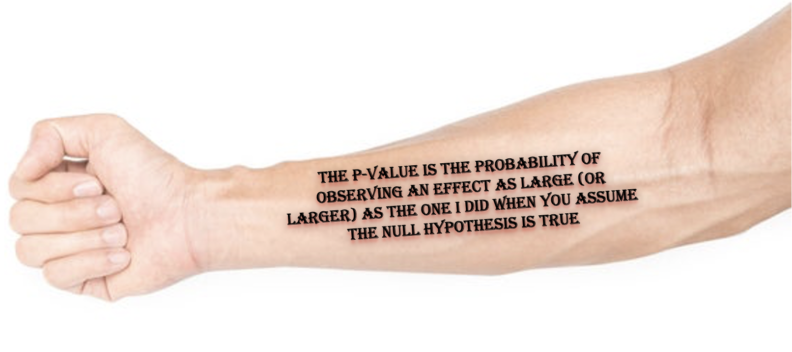{fig-align="center" width="50%" fig-alt="A picture of an arm with the definition of a p-value tattooed on it."}

Fun fact: I've jokingly (JOKINGLY!) told students in every class to tattoo the definition of the *p*-value to their arm. I was surprised when one of my students actually (sort of) did it.

{fig-align="center" width="50%" fig-alt="A person's arm with \"p < .05\" tattooed on it."}

Notice that he didn't really put a definition, just "*p* < .05". So he's calling himself statistically significant. Kind of boastful, but I appreciate it.

Let's say you observe a difference between two sample means. For example, you observe that a sample of Star Wars fans are taller, on average, than a sample of Lord of the Rings fans. But has lady luck played a trick on you? What if there really isn't a difference in height between these two fandoms? Suppose you just got a bad sample because of (bad) luck of the draw? What if you just happen to get some particularly short Star Wars fans and some particularly tall Lord of the Rings fans, even though there's really no difference overall in the general population between these groups?

In the NHST system, we answer this question by first formulating a null hypothesis: "Suppose there is no difference in height between these two fandoms." After this assumption is in place, you calculate the probability of observing a difference between means as large as the one you did when you assume the null hypothesis is true. What you end up with is a *p*-value: The probability of observing an effect as large as you did (or an even larger one) when you assume there is no difference between the means (i.e., that the null hypothesis is true). If this *p*-value is below .05 (below 5% probability) then we conclude that the null hypothesis is probably false. After all, when you assume the null hypothesis is true, then your data are very improbable.

We reject the null hypothesis when our *p*-value is less than .05. We call results with *p*-values below .05 ***"statistically significant"***. It is very important to interpret *p*-values and statistical significance for what they are, no more and no less. When we reject the null hypothesis, this amounts to saying, "there is probably some non-zero difference between means" or "there is probably some non-zero correlation between these variables". Statistical significance also doesn't entail that your result has any practical significance. You can make any trivial and unimportant effect, however small, show up as statistically significant if you collect a large enough sample. That doesn't mean it would be worth anyone's time and resources to translate these effects into practice.

Let's implement the concept of the *p*-value and statistical significance in our biased coin example. Remember, though, ***any*** serious real-world data can be tested using the same logic.

Let's say you believe a coin is biased. You think it's not a fair 50-50 coin. So, you form a null hypothesis: "Suppose I'm wrong, and the coin really is fair." Next, you calculate the probability of observing the data ***(or more extreme data)*** when you assume this null hypothesis is true. Let's say the coin in question was flipped 20 times and came up heads 15 of those times.

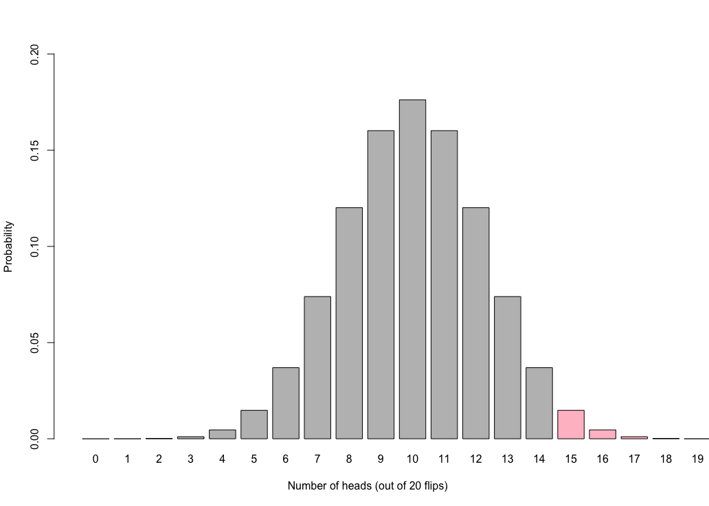{fig-align="center" width="50%" fig-alt="A binomial distribution with the probabilities of 15 or more successes out of 20 highlighted in pink."}

The figure above shows the probabilities of flipping a coin 20 times and observing different numbers of "heads" out of those 20 flips. 15 and onward is highlighted in pink. Under these assumptions, the probability of flipping 15 heads out of 20 is 1.48%. The probability of flipping 16 out of 20 is 0.46%. 17 out of 20 is 0.11%. If you add up all of these probabilities, you get about 2.07%. So, if you assume the null hypothesis is true, there is only about a 2% chance that you would observe as many "heads" as you did (or more). You might call these results... statistically significant!

### Directional hypotheses: 1-tailed vs. 2-tailed tests

So far, I've talked about statistical hypotheses that are technically called "directional" hypotheses (or "1-tailed" tests). It's like saying, "I predict group A will be *taller than* group B" or "I believe variable A will be *negatively correlated with* variable B." In both cases, you are making a specific prediction. A less-specific prediction might be "I predict there will be some difference (either way) between group A and group B" or "I think there will be some correlation (don't know which way) between these two variables."

Directional hypotheses include, "I predict there will be a positive correlation," "I predict there will be a negative correlation", or "I predict that the Lord of the Rings fans will have a higher average IQ compared to the Star Wars fans." In other words, there's some predicted direction for the effect.

By contrast, there are non-directional hypotheses. Non-directional (or "2-tailed") tests predict that there will be some effect, but the direction of this effect is not specified: "There will be a correlation between these variables" or "There will be a difference in IQ between Lord of the Rings fans and Star Wars fans."

Directional hypotheses are also called "1-tailed" tests whereas non-directional hypotheses are sometimes called "2-tailed" tests. This terminology comes from looking at the threshold of statistical significance on a null-hypothesized probability distribution. When you make a directional (1-tailed) hypothesis, you have to observe an effect so large that it either exceeds the top 5% or bottom 5% of the area of the distribution, depending on which direction the hypothesis goes in. In other words, you have to observe an effect so large that there's less than a 5% chance of observing that effect when you assume the null hypothesis is true.

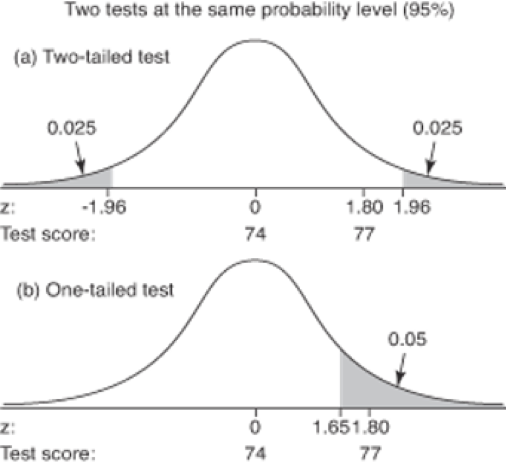{fig-align="center" width="50%" fig-alt="Two normal distributions. One has the top and bottom 2.5% of the area under the curve marked off. The other has just the top 5% marked off."}

On the other hand, when you formulate a non-directional (two-tailed) hypothesis, you need to observe an effect that surpasses ***either the top 2.5% or the bottom 2.5%***. So, in total, there is still 5% of area under the curve you have to reach, but that area is split between the two extremes (or tails) of the distribution.

It is easier to observe a statistically significant result when you use a 1-tailed hypothesis compared to a 2-tailed one. If you observe a positive correlation, it only has to surpass the top 5% of the area under the curve with a 1-tailed test. With a 2-tailed test, it has to surpass the top 2.5%. Same thing for a negative correlation: with a two-tailed test, a negative correlation has to be so large that it surpasses the bottom 2.5% of the distribution rather than the bottom 5%.

There was a time when researchers were allowed to "predict" that an effect will go in a specific direction. They were allowed to predict that group A would be higher than group B (not the other way around). Or they were allowed to predict a negative correlation between two variables (rather than a positive one). This made it easier to get a statistically significant result. And publishing scientific papers is still heavily biased towards statistically significant results. Failing to reject the null hypothesis is still not considered "sexy" enough to get published in many places.

People (probably) abused this though, and decided to report 1-tailed test results only after they saw non-significant 2-tailed results. They would (probably) pretend as if they had made a directional prediction all along, when really they had no clue beforehand which way an effect would go. The era of 1-tailed tests has long passed. Nowadays, if you use directional hypotheses in your statistical analyses, people will think you're trying to pull a fast one on them and demand to see what your *p*-values look like if you use a 2-tailed test rather than a 1-tailed test.

### Type 1 and Type 2 errors

When you collect data and calculate means or correlations (or whatever), you can never know whether the null hypothesis is actually true or not. You only have your data and your hypotheses. You calculate a *p*-value and you decide whether to reject or retain the null hypothesis based on your data, but you can never know with 100% certainty whether you made a mistake or not.

We have names for the different mistakes that could emerge from null hypothesis significance testing. A ***type 1 error*** occurs when you reject the null hypothesis, but you shouldn't have. The null hypothesis was true, but you rejected it anyway. There really is no effect, but lady luck played a trick on you. You happened to observe what looks like an effect because of sampling error. Not to oversimplify, but you may think of a type 1 error as a "false positive" result. You assert that the findings of your research were "true" when, in fact, they were "false".

A ***type 2 error*** occurs when the null hypothesis is false, but you fail to reject it. There really is an effect, but you failed to detect that effect. Maybe you observed an effect so close to zero that it was statistically indistinguishable from the null hypothesis. Or maybe your sample was so small that there just isn't enough confidence in ruling out the null. Maybe a larger sample would've done the trick. To oversimplify once more, you may think of a type 2 error as a "false negative" result. You assert that the findings of your research were "false" when, in fact, they were "true".

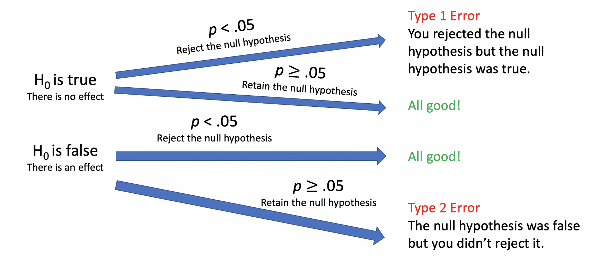{fig-align="center" width="50%" fig-alt="A flowchart demonstrating how type 1 and type 2 errors occur."}

Both errors are bad. With a type 1 error, you're making it look as if there's an effect when there really isn't one. People might waste resources doing follow-up studies or trying to put your research into practice. On the other hand, a type 2 error is bad because you missed something that might have been important. Maybe there's some effect that could have been put into practice and could've helped people, but here you are going around telling people that this effect doesn't exist.

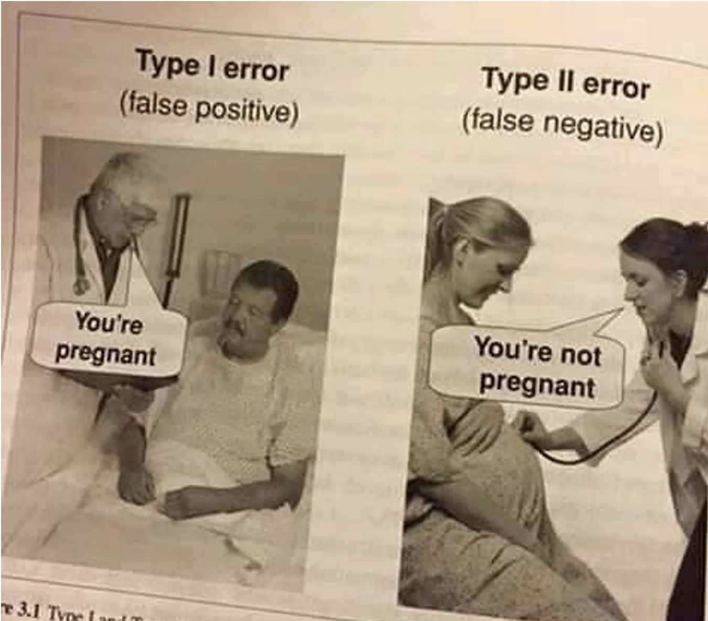{fig-align="center" width="50%" fig-alt="Two pictures. One is labelled \"Type 1 error (false positive)\". A doctor is telling a man he's pregnant. The other picture is labelled \"Type II error (false negative)\". It shows a doctor telling a pregnant woman she's not pregnant."}

Null hypothesis significance testing (NHST) and its associated Type 1 and Type 2 errors can be confusing because there are a lot of opposites and double-negatives in the logic of it. That's why it's worth repeatedly studying these concepts, putting them into your own words, and testing yourself as much as possible. They're tricky. Make yourself some flashcards. It'll be tempting to try and "boil it down" to some simple rules. And that's okay. But sometimes that can lead to confusions later on, when someone uses different phrasing that you're not used to. I've been using NHST and teaching it for a long time and I still get tongue twisted and say stuff backwards at times.

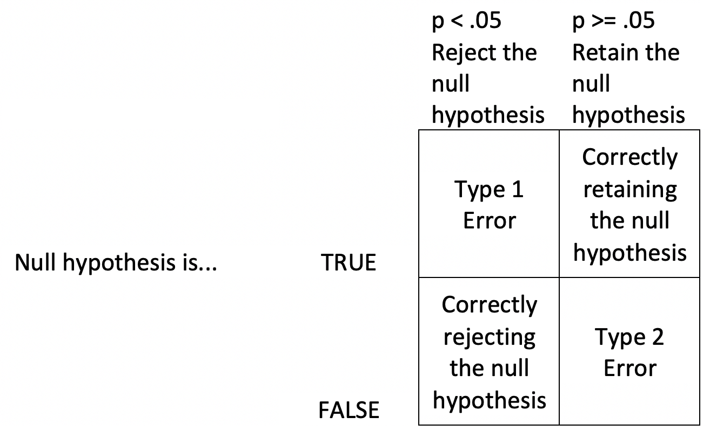{fig-align="center" width="50%" fig-alt="A table showing when a type 1 or type 2 error has occurred."}

### Statistical power

Statistical power is the ability of your study to detect an effect if that effect is real. In other words, statistical power is your ability to avoid a Type 2 error. Traditionally, people want their statistical power to be at 0.8 (or 80% probability). This would be the probability of rejecting the null hypothesis if the null hypothesis is indeed false.

{fig-align="center" width="50%" fig-alt="Two overlapping distributions, one for the null hypothesis and one for the alternative hypothesis, with regions for type 1 errors, type 2 errors, and correct rejections shaded."}

On the right hand side of the image above, we have two hypothetical distributions. You can think of them as two parallel universes, one where the null hypothesis ($H_0$) is true and one where the alternative hypothesis ($H_A$) is true. In either universe, your samples can end up giving you ambiguous results. In the universe where $H_0$ is true, you're most likely to observe sample statistics close to zero, like a correlation of 0 or a difference between groups of 0. But, because of sampling error, you will also see some sample statistics that are higher (or lower) than 0. There's a 5% chance that the results will be so high (or low) that we'll end up rejecting the null hypothesis. In the universe where $H_0$ is true, this is a mistake, a type 1 error.

In the universe where $H_A$ is true, you will usually see sample statistics close to the real population parameters (e.g., correlation and differences between means). Remember, in the $H_A$ universe, $H_0$ is false, so most sample statistics should hover around the true population parameters, not around 0. Just like in the $H_0$ universe, though, random chance (sampling error) can lead us astray. Any results observed on the red section of the $H_A$ distribution would lead us to retain $H_0$. If this occurs in the universe where $H_A$ is true, then we've made a mistake (a type 2 error). We failed to find evidence strong enough to reject the notion that we're in the $H_0$ universe.

The parts of the $H_A$ distribution shaded in green represent results that would lead us to reject $H_0$. We would end up concluding (correctly) that we live in the $H_A$ universe rather than the $H_0$ universe.

Remember, whether we're committing a type 1 or type 2 error depends entirely on two things: whether $H_0$ is true and whether we reject $H_0$. We can never know with 100% certainty if $H_0$ is true. **Hypothetically though**, we know that a mistake is made when we falsely reject $H_0$ in cases where it was actually true (type 1 error) or mistakenly retain $H_0$ when it's not true (type 2 error). Less hypothetically, we always know our *p*-value, which decides whether we reject $H_0$ or not. The *p*-value simply reflects the data we have in hand.

### Factors that impact statistical power

There are many factors that affect statistical power. The two main ones are sample size and effect size. In general, if your sample is small, you're probably not going to be able to detect small (or small-ish) effects. In other words, you won't be able to reject the null hypothesis. This is because the null hypothesis and reality are too close together. The difference between a small effect and no effect are too similar. A large sample would be needed to reliably differentiate between these two possibilities.

Small samples are also more erratic, giving you extremely large or extremely small sample means (or correlations). In other words, sampling error is more of a problem with smaller samples. Large sample sizes are therefore good because they avoid extreme, erratic sampling error problems and they increase statistical power.

The other important factor is effect size. Let's say I have a hypothesis that people who drink diet sodas tend to be shorter than people who don't drink diet sodas. If that's true, it's going to be a very small effect. You would need an extremely large sample to be able to detect it (i.e., reject the null).

Let's say, on the other hand, I have a hypothesis that people bowl better when they haven't been sprayed in the eyes with mace. I have a control group that bowls like normal with no mace in their eyes. I also have an experimental group of bowlers who I spray down with mace. You don't need a very big sample size to see the difference in bowling scores. This is going to be a "night and day" difference. When you're dealing with genuinely large effect sizes, you will have high statistical power, even if the sample size isn't all that big.
