# Baby's first statistical tests

So far, you should understand null hypotheses and *p*-values. Those two concepts are the ***FOUNDATION*** of everything that comes later. So if you're kind of shaky on those concepts, turn back now and re-read the last chapter or two. Email me and ask me to clarify something for you. You don't want to try and build a second floor onto a house that doesn't have a sturdy first floor.

If you're still reading this, then you must feel like you understand null hypotheses and *p*-values well enough. Awesome! For the rest of this book, we're going to learn some standard statistical tests and when to use them. Each of these tests start with a null hypothesis and end with a *p*-value.

## The normal distribution

The average IQ in the general population is 100. The average male height is 5'6". But if you grab a random person off the street, is their IQ always going to be exactly 100? If you grab a random man off the street, will he be exactly 5'6"? Of course not. You will find people slightly above the population average and slightly below. In some rare cases you'll find someone who is very far from average in the IQ department (either good or bad), or someone who's abnormally short (or tall).

IQ and height (and many, many other variables) follow a **normal distribution** (or "Bell Curve").

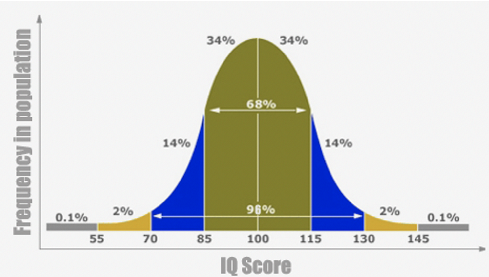{fig-align="center" width="50%" fig-alt="The normal distribution with different z scores, percentages of area under the curve, marked off"}

The normal distribution is a probability distribution. It is defined by a mathematical equation (see below) that tells us the likelihood of any given observation from a normally distributed variable. You will never have to use this equation yourself (not in my classes, at least). A computer will do it for you. You just need to understand the basic logic. Just like with the dice and coin examples from the previous chapter, we have an equation (or probability distribution) that gives us a probability for any given outcome (or range of outcomes).

$$
f(x)=\frac{1}{\sigma\sqrt{2\pi}}\exp\left(-\frac{1}{2}\left(\frac{x-\mu}{\sigma}\right)^2\right)
$$

Unlike the other two distributions we've met, the normal distribution **technically** stretches from negative infinity to positive infinity. In practice, this isn't relevant. All possible outcomes have a specific probability of being observed, and if you add up the probabilities of all possible outcomes, they add up to 100%. (Note: Technically, with continuous variables, we're not really talking about "probability" but "probability density". Despite some important differences "under the hood", we can still use the same analogies we've been using.)

This complicated-looking math just turns the mean, standard deviation, and the observation (x) into a probability. At the end of the day, we're still just dealing with probabilities for observations or intervals of observations.

If you kept sampling people at random from the general population, about 68% of them will have an IQ between 85 and 115. This is 100-15 (the mean minus 1 standard deviation) and 100+15 (the mean plus 1 standard deviation). About 95% of random draws will come between an IQ of 70 and 130. That's 100-30 (the mean minus 2 standard deviations) and 100+30 (the mean plus 2 standard deviations).

## z-scores

Any normally distributed variable can be "standardized" to have a mean of 0 and standard deviation of 1. In this case, 68% of random draws come between -1 and +1 standard deviations. 95% come from between -2 and +2 standard deviations.

Standardized scores are often called z-scores. These are just a measure of how far from the center of the distribution an observation comes from. In other words, *it's an observation's distance from the mean of the distribution*. If z = 0, then the score is exactly equal to the mean. If z = 1, then the score is exactly 1 standard deviation above the mean. This is equivalent to having an IQ of 100 or 115, respectively.

Here's the equation for calculating a z-score:

$$
z = \frac{x-\mu}{\sigma}
$$

"x" is the observation you want to calculate a *z*-score for. "z" is... the *z*-score. $\mu$ is the mean, and $\sigma$ is the standard deviation. In words, a z-score is *just a measure of "how many standard deviations away from the mean is x?"*

z-scores are used to determine how likely/unlikely an observation is or how extraordinary/average an observation is. A z-score of 0 is as average as you can get. A z-score of 0.5 (half a standard deviation above the mean) cuts off the bottom 69.15% of the normal curve. This means that the observation is in about the 69th percentile (i.e., it's higher than about 69% of the population).

Remember that, ***as long as you supply a mean and a standard deviation, you can calculate the area under the curve for any interval within the normal distribution***. Every z-score cuts off the top X% of the normal curve or the bottom X%. You can even ask what percent of the distribution falls between two z-scores. For instance, about 68% of the distribution is between z = -1 and z = +1.

A z-score of 0 cuts the normal distribution in half. There's a 50% chance that any random data point drawn from the normal distribution will fall below 0 and a 50% chance that any random data point will fall above 0.

As z-scores get higher, they cut off increasingly larger proportions of the bottom of the normal distribution. In the table below, each z score in the left column cuts off the bottom x% on the corresponding row in the right column. So, a z-score of 0 cuts off the bottom 50% of the normal curve. A z-score of 0.5 cuts off the bottom 69.15% and so on.

| *z*-score | Area under the normal curve below that *z*-score |
|:-----:|:-------:|
| 0.00 | 0.5000 |
| 0.50 | 0.6915 |
| 1.00 | 0.8413 |
| 1.50 | 0.9332 |
| 2.00 | 0.9772 |
| 2.50 | 0.9938 |
| 3.00 | 0.9987 |
| 3.50 | 0.9998 |
| 4.00 | 1.0000 |

[(Note: there is some rounding in the table. z = 4 does not actually cut off the bottom 100% of the normal curve, only about 99.999...... percent of it.)]{.small}

## Group z-test

Let's say you have a theory. You believe that a certain demographic on college campuses experience more anxiety, on average, compared to other students. Or, let's say you believe fans of a particular TV show, on average, have a lower IQ than the general population. How do you go about testing whether a specific group within the general population is different, on average, from the rest of the population when it comes to some continuous variable like anxiety or IQ?

It's one thing to find individual students or fans of a (dumb?) TV show at random and calculate their individual z-scores. Those z-scores would tell you where each individual person measures up to the general population.

That's not what you're interested in though. You want to know whether a *particular group*, as a whole, has a different average compared to the general population. You wish you could somehow combine a group of people's z-scores together.

It turns out you can do this! But you're not going to compare a single z-score to the population distribution. Instead, *you are going to compare a sample mean to a distribution of sample means.*

{fig-align="center" width="50%" fig-alt="A shocked face emoji."}

Read that last part a few more times and try to wrap your mind around it: *"A distribution of sample means."*

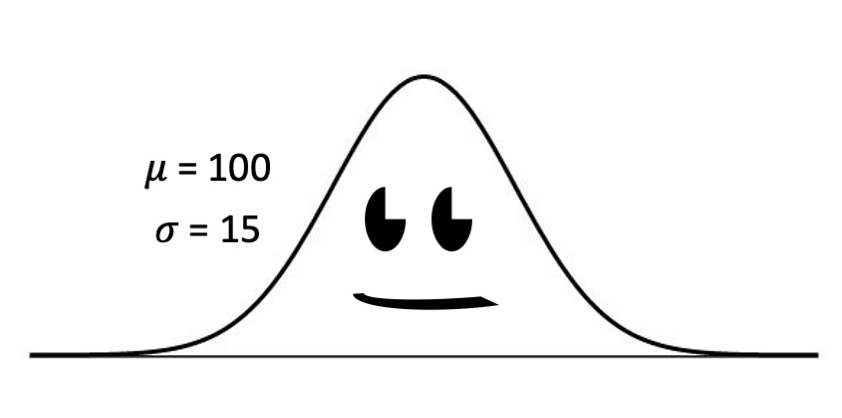{fig-align="center" width="50%" fig-alt="A cartoon of a normal distribution with a mean of 100 and SD of 15"}

Let's say you have a completely normal population distribution. It has a mean of 100 and a standard deviation of 15. It's normally distributed. It's happy. After all, it represents every single person's IQ score and the relative frequency (or probability) of each IQ score.

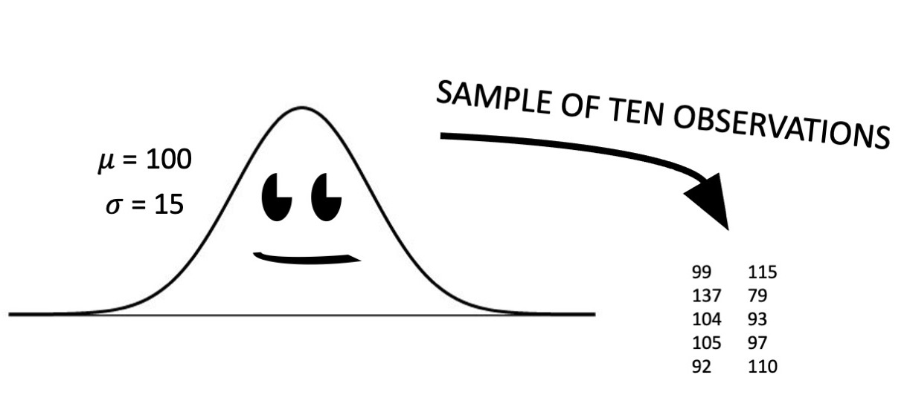{fig-align="center" width="50%" fig-alt="A cartoon of a normal distribution having random draws made from it."}

You never really get to see a population distribution directly, unless you have access to every single possible data point. Usually we can only deal with samples from the population. Let's say you draw ten people at random from this normal distribution. The first person might have an IQ of 99. The second person might have an IQ of 115. And so on. Every person tends to be close to the population mean of 100, but there is plenty of variability. The further from 100 they get, the more unexpected (or extraordinary) that person is.

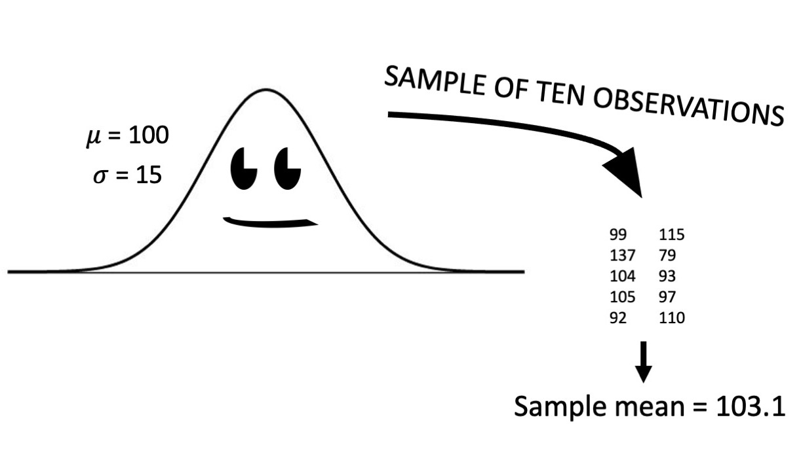{fig-align="center" width="50%" fig-alt="A random draw from a normal distribution producing a sample mean of 103.1."}

If you calculate a sample mean from your 10 observations, you get *an estimate of the population mean*. In this case, 103.1 is actually pretty close to the real value of 100. Sample statistics will get closer to the real population parameter the larger the sample size gets. But if you take a bunch of small samples, all those individual sample means will be slightly different.

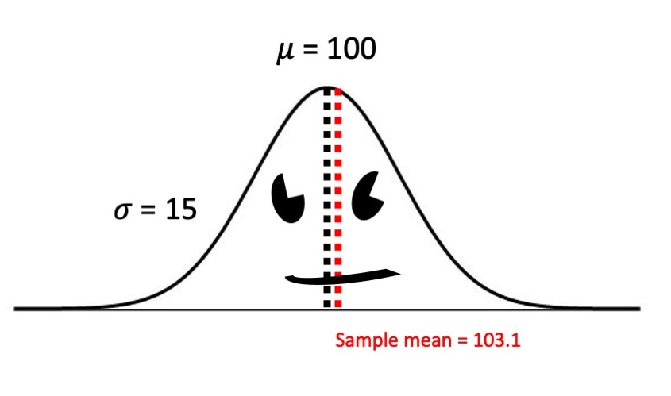{fig-align="center" width="50%" fig-alt="The sample mean plotted on the population distribution it was drawn from. It slightly over-estimates the population mean."}

Let's say we draw a whole new sample of ten random observations from our normal population distribution. The first two people actually happen to have a low IQ: 76 and 88. But there are a few people with a pretty high IQ: 121 and 118. Overall, the mean for this new sample is 97.7.

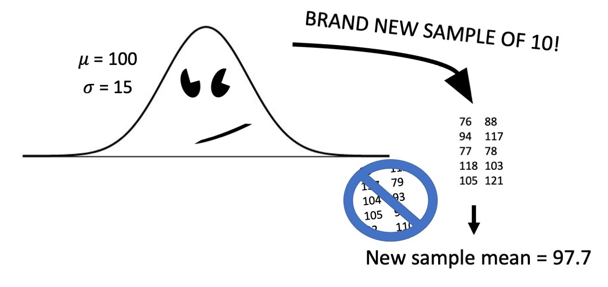{fig-align="center" width="50%" fig-alt="A new sample being drawn from the normal distribution with a new sample mean of 97.7"}

That's a little lower than the first sample mean, but both of them are pretty close to 100. In the long run, if you were to keep drawing random samples from the population and calculating sample means for each of those samples, you'd keep getting sample means that hover around 100.

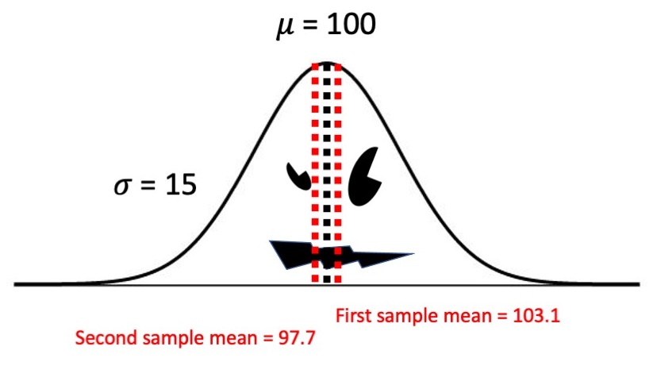{fig-align="center" width="50%" fig-alt="Both sample means plotted onto the normal distribution, one underestimates the population mean and the other overestimates it."}

Every now and then, when you're dealing with random events over and over again, you are going to see something pretty rare. Like, if you keep playing a slot machine over and over again, you might actually win from time to time, even though a win was never likely, on any given pull. Likewise, most sample means will be close to 100, but some of them will get a few really low IQ people or really high IQ people mixed in. Rare observations like these drag the sample means up or down.

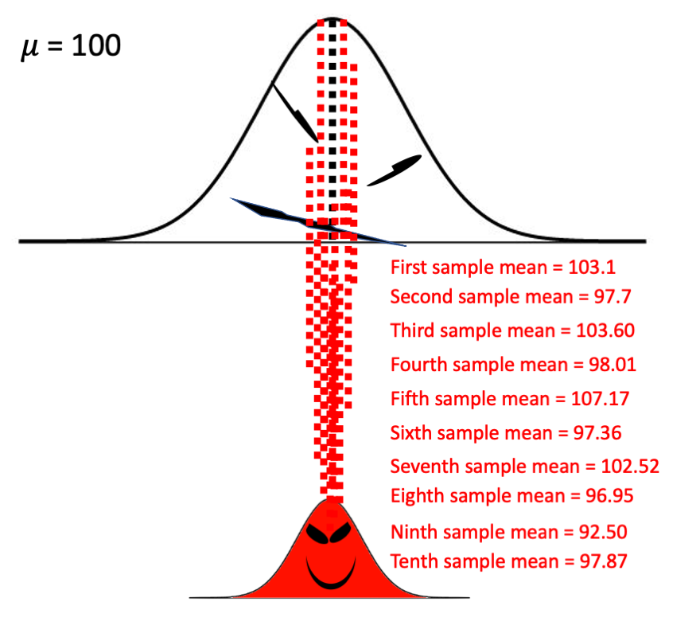{fig-align="center" width="50%" fig-alt="Tons of sample means being drawn from the population distribution and forming a new, evil distribution of sample means."}

If you were to keep drawing random samples from the population distribution, and calculating sample means for each of those samples, you'll end up with... *a distribution of sample means*. Most of the sample means will be close to the population mean (100, in this case), but there will be some sample means that are slightly lower or slightly higher. Every now and then, you'll observe a sample mean that's really off the mark. This distribution of sample means is called the ***sampling distribution of the sample mean***. It's depicted as a little red evil distribution in the picture above.

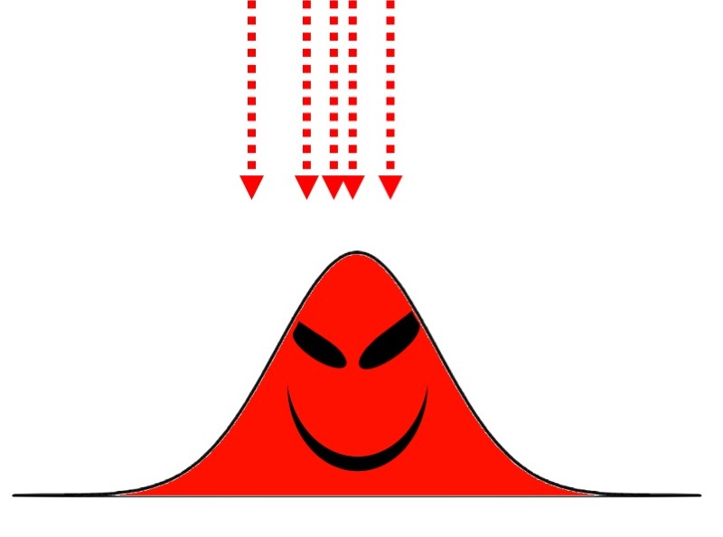{fig-align="center" width="50%" fig-alt="An evil sampling distribution smiling and receiving sample means"}

If these are truly random draws from general population (and there's nothing special about the particular group you are examining), then most of the sample means should be very close to the middle of the sampling distribution.

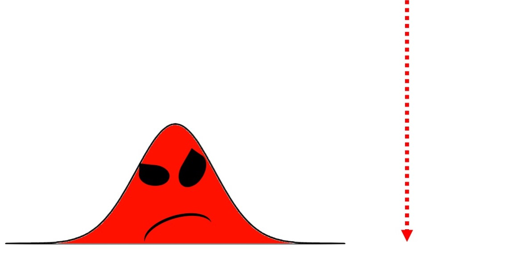{fig-align="center" width="50%" fig-alt="The evil sampling distribution sees a sample mean that is really, really high."}

***BUT***, if there is something unusual about a particular group, then their sample mean should be unusually high (or unusually low) compared to the rest of the sampling distribution. Remember, we're using null hypothesis significance testing (NHST). We assume the null hypothesis is true, that our sub-population is no different from the general population. This assumption implies that sample means drawn from the sub-population should be very similar to sample means drawn from the general population.

Suppose you believe that *Lord of the Rings* fans are more intelligent than the general population. If you want to test this hypothesis, you start by formulating a null hypothesis: "Suppose I'm wrong. Suppose *Lord of the Rings* fans, on average, have an IQ that is ***equal*** to that of the general population's." Now let's say you measure the IQ of 10 *Lord of the Rings* fans and the average IQ from this group was 140. According to the null hypothesis, sample means of size 10 should tend to be close to 100. The further from 100, the more unlikely it is that our sub-group comes from the general population. Later, we'll talk about how to calculate *p*-values.

For now, let's just say the null hypothesis for a group *z*-test says there's a spectrum of sample means (of size 10) we'd expect to see, if we truly were sampling from the general population. If our observed sample mean has a high percentile rank / *z*-score on that distribution of expected means, then we'll end up with a low *p*-value. The assumption that our *Lord of the Rings* fans are just like average people in the IQ department will look less likely the more these LotR fans' IQ deviates from 100.

To be clear, the null hypothesis in this situation says, "*Lord of the Rings* fans will have average IQ scores no different from the general population":

$$
H_0: \mu_{\text{general population}} = \mu_{\text{LotR fans}}
$$

Thus, according to $H_0$, any sample mean of IQs drawn from *Lord of the Rings* fans should fall within 95% of the sampling distribution of sample means coming from the general population. If you observe a sample IQ from *Lord of the Rings* fans that are higher (or lower) than the middle 95%, then you can reject the idea that they really have the same average IQ as the general population.

We can write this alternative hypothesis as:

$$
H_1: \mu_{\text{general population}} \neq \mu_{\text{LotR fans}}
$$

It is a lot simpler to calculate the probability of the data assuming $H_0$ is true than it is to calculate the probability of the data assuming $H_1$ is true. That's why NHST is so popular.

### Some special characteristics of the sampling distribution

One important property of the sampling distribution of the mean is, *the greater the sample size in each mean inside that distribution, the more normally distributed the sampling distribution overall will be*. In other words, the distribution of sample means will more closely approximate a normal distribution depending on how large the sample size is for all of those means. This is called the ***central limit theorem***. What's really cool, too, is that it doesn't matter how the population distribution is shaped. *The distribution of sample means drawn from that population distribution will still approach normality as the sample size for those means increases.* [A really cool simulator that helps demonstrate what a sampling distribution is can be found here.](https://onlinestatbook.com/stat_sim/sampling_dist/) See if you can play around with the simulator in the link above to observe the central limit theorem in action.

### The math behind the group *z*-test

To calculate the *z*-score for a ***group mean*** (not a single observation), you use the following equation:

$$
z=\frac{\bar{x}-\mu}{SEM}
$$

In this equation, the "*z*" still stands for "*z*-score" and $\mu$ still stands for the population mean. Only two things have changed between a normal *z*-score for a single observation and a group *z*-score for a sample mean. Let's look at the two equations side by side to highlight the differences:

::::: {layout-ncol="2"}
::: {.text-center}
$$z=\frac{x-\mu}{\sigma}$$

**Equation for a single observation**
:::

::: {.text-center}
$$z=\frac{\bar{x}-\mu}{SEM}$$

**Equation for a group mean**
:::
:::::

When we calculate a ***z-score for a single observation***, we're asking, *"How many standard deviations from the population mean is this observation, x?"* With a ***group mean***, we're asking, *"How many standard errors of the mean (SEM) is this group mean ($\bar{x}$) from the population mean?"*

This might still seem a bit mysterious until I reveal to you that the ***standard error of the mean*** is just the *standard deviation of the sampling distribution of the mean*. That little red guy that represents the likelihood of observing different sample means in the long run, if you repeated your study over and over again? He has a standard deviation just like any other normal (or normal-ish) distribution. We just have a special name for that standard deviation: The standard error of the mean, or just ***standard error***.

The standard error of the mean is calculated with one of the following equations:

::::: {layout-ncol="2"}
::: {.text-center}
$$SEM=\frac{\sigma}{\sqrt{n}}$$

**Equation for a group *z*-test**
:::

::: {.text-center}
$$SEM=\frac{s}{\sqrt{n}}$$

**Equation for a 1 sample *t*-test**
:::
:::::

Notice the only difference between these is the $\sigma$ and *s* in the numerator. $\sigma$ is *the population standard deviation* and *s* is the *sample standard deviation*. You either have ***ALL*** the data in population or you drew a random sample from that population. Thus, ***you're either calculating the "real" standard deviation or merely estimating what you think that "real" standard deviation is from the little bit of data you have on hand.***

Notice too that the denominator contains *n*, the sample size. Do you know what happens when you make the denominator of a fraction bigger and bigger while the numerator goes unchanged? The overall value of the fraction gets smaller and smaller. This is like dividing the same total amount of pizza between more and more people. ***We want our standard errors of the mean (SEM) to be as small as possible.*** For one, we can have more confidence that our estimate of the population mean is close to the real thing if the ***DISTRIBUTION*** of sample means is not too wide. Secondly, if you want to reject the null hypothesis in your one sample *z*-test, you're more likely to accomplish this when your SEMs are as small as possible. The only way to do this is to either shrink the standard deviation (which you can't really do) or you can collect lots of data, which you usually can have some control over.

### Confidence intervals for a group z-test

The notion of a **confidence interval** throws a lot of people for a loop at first. I suspect this has something to do with how easy it is to *technically* give the wrong definition for a confidence interval.

Loosely speaking, *a confidence interval is a range of values that represent plausible values for a population parameter you're trying to estimate*. Like, "I don't know the population mean, but based on my data on hand, I think THIS range of potential values represent good, plausible values that the population mean might have." Let's say I have a sample mean of 30. Is the population mean 30? Maybe. Is it close to 30? We hope. Our degree of confidence for how close we've gotten is closely related to our sample size.

Confidence intervals have an **upper** and **lower boundary**. The most common confidence interval is the **95% confidence interval** (95% CI). If you had a very large sample, then you might end up saying, "We observed a sample mean of 30.00, 95% CI[28.50, 31.50]." So, "30" is the **"point estimate"**, but there's a margin of error. The population mean (in all likelihood) could be as low as 28.50 and as high as 31.50.

If you had a very small sample, then you might end up saying, "We observed a sample mean of 30.00, 95% CI[18, 42]." So, "30" is the "point estimate", but as best we can tell from our small data set, the real population mean could plausibly be anywhere between 18 and 42.

Think of it like the "margin of error" in an election poll. A poll of 400 voters might say that Johnny Republican has 51% of the votes with a 4 point margin of error (so he might really have between 47% and 55% of the votes). Given that the margin of error contains 50%, things are "too close to call". Even though Johnny Republican is leading in this poll, the margin of error is too large to be confident in a win.

Now let's say you conduct a much larger poll of 4,000 voters. Now Johnny Republican has 51% of the votes with only a quarter of a point margin of error. So he really might have between 50.75% and 51.25% of the votes. Now we can feel confident in a win. Let's just hope Johnny Republican doesn't have any scandals or gaffes before election day.

***Important note:*** Increasing the sample size creates narrower confidence intervals (or narrower "margins of error", if you prefer to think of it that way).

Let's say our sample mean of 30 came from 20 observations. The sample standard deviation was 4. In that case,

$$
SEM=\frac{s}{\sqrt{n}}=\frac{4}{\sqrt{20}}=\frac{4}{4.47}=0.89
$$

I did a little rounding (and thank God for calculators!). We now know that, if I were to repeatedly draw samples of 20 observations from this population and estimate a mean each time, we'd have a sampling distribution that looks something like this:

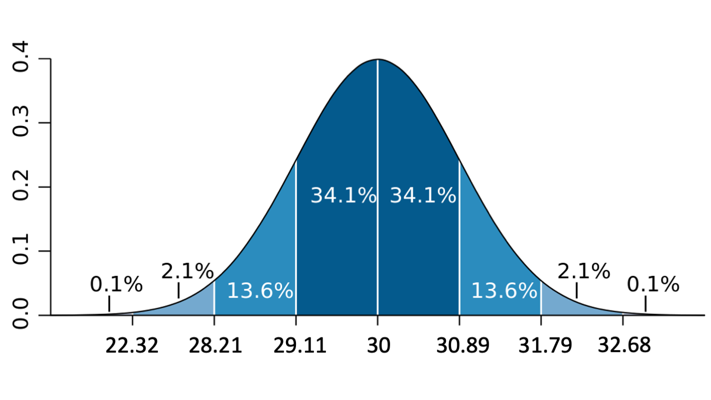{fig-align="center" width="50%" fig-alt="A sampling distribution of the mean centered at 30 with a standard error of 0.89"}

Since the sampling distribution is assumed to be normal, we can say that about 68.2% of observations fall between -1 standard deviation and +1 standard deviation. 30 - 0.89 = 29.11 and the area under the curve between 29.11 and 30 is about 34.1%. Any observation drawn at random from this distribution has about a 34.1% chance of being drawn from the interval between 29.11 and 30.

The same logic applies to the interval between the mean of the sampling distribution (30) and + 0.89 (30.89). Since the normal distribution is symmetrical, this interval also takes up 34.1% of the area under the curve.

All told, about 68.2% (34.1 x 2) of the hypothetical sample means would fall between 29.11 and 30.89. After some rounding, we can say about 70% of hypothetical sample means will be within one standard error of the observed sample mean of 30.

If we broaden that out, about 95.4% of hypothetical sample means will fall somewhere between 28.22 and 31.78.

95.4% of hypothetical sample means will fall within 2 standard errors of the observed sample mean of 30. All of these inferences, though, are based on only one sample. If you collected another sample mean, the 95% confidence interval would be slightly different. Technically speaking, for any given sample mean you calculate, **the 95% confidence interval based around that sample mean is going to contain the true population mean 95% of the time.**

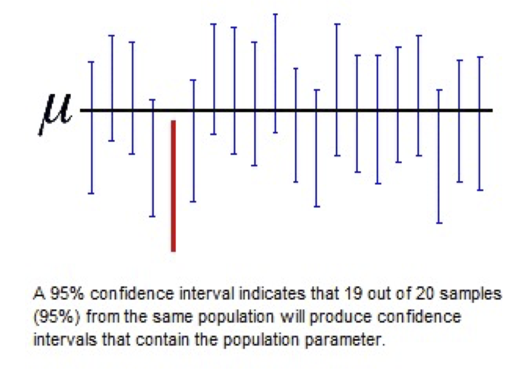{fig-align="center" width="50%" fig-alt="Many 95% confidence intervals from repeated samples plotted against the true population mean, with most intervals containing it"}

In the figure above, the true population value of the mean ($\mu$) is represented by the black horizontal line. Each vertical line represents a 95% confidence interval calculated from a random sample from the population. The middle of each interval represents a sample mean. We see that, most of the time, these intervals actually contain the true value of $\mu$. However, in some rare cases, we'll get unlucky and draw a sample mean that ends up much lower (or much higher) than the true population mean. Thus, the 95% confidence interval based off of this sample does not contain the true population mean that it is trying to approximate.

We saw earlier that 68.2% of random draws come between -1 and +1 standard deviations of a normal distribution. 95.4% of random draws come between -2 and +2 standard deviations of a normal distribution. When we form a 95% confidence interval, we want... 95%, not 95.4%. To capture **exactly** 95%, you'd need to look at 1.96 standard errors above and below the mean. In the current example, because the standard error is 0.89, we get...

$$
30 - 0.89(1.96) = 28.2556
$$

That's the lower boundary of our 95% CI. The upper boundary would be...

$$
30 + 0.89(1.96) = 31.7444
$$

So, 95% of our hypothetical means would fall between about 28.26 and 31.74. In APA style, we would write, "The sample mean was 30, 95% CI[28.26, 31.74]."

In general, the 95% CI for a sample mean (assuming a normal distribution) can be written as:

$$
\bar{x} \pm SEM(1.96)
$$

The "$\pm$" means "plus or minus". After all, we want to subtract "SEM(1.96)" from the sample mean to get a lower boundary for our confidence interval ***AS WELL AS*** add "SEM(1.96)" to the mean in order to get the upper boundary of the interval.

## One sample *t*-test

With a group *z*-test, *you are formulating a null hypothesis that your sample mean will be equivalent to the (known) population mean*. You're saying, "Suppose I'm wrong, and *Lord of the Rings* fans have an average IQ of 100, just like the rest of the population." In order to proceed with a group *z*-test, **you have to know the population mean and population standard deviation**. But what happens if you don't know the population standard deviation?

You'll have to estimate the population standard deviation with your sample data. It turns out that, when you estimate the population standard deviation with a sample standard deviation, your estimate will be biased. Sample standard deviations tend to underestimate their respective population standard deviations. Thus, things would get distorted if you assumed your data follow a normal distribution.

### Student's *t*-distribution

**Student's *t*-distribution** was developed as a way to acknowledge systematic (and pretty well-understood) distortions created with the normal distribution. When you have a small sample size or you don't know the population standard deviation, the normal distribution becomes a less plausible model for your data. That's where the *t*-distribution comes in handy.

Student's *t*-distribution, in equation form, looks like this:

$$
f(x)=\frac{\Gamma\left(\frac{v+1}{2}\right)}{\sqrt{v\pi}\,\Gamma\left(\frac{v}{2}\right)}\left(1+\frac{x^2}{v}\right)^{-\frac{v+1}{2}}
$$

(Note, the $v$ in these equations equals the "degrees of freedom".)

Just like with the equation for the normal distribution, you don't need to memorize or even use this scary-looking equation to conduct a *t*-test correctly and get the *p*-value out the other end of it.

### Calculating and testing the *t*-statistic

Let's say *you want to test whether a sample mean is different from a known population mean, but you don't know the population standard deviation*. Just like with a group *z*-test *(where the population standard deviation is known)*, you calculate a test statistic that represents the distance between the population mean and the sample mean. Here are the equations for the *z*-statistic used in a group *z*-test side-by-side with the *t*-statistic used in a one-sample *t*-test. See if you can spot the difference!

::::: {layout-ncol="2"}
::: {.text-center}
$$z=\frac{\bar{x}-\mu}{SEM}$$
:::

::: {.text-center}
$$t=\frac{\bar{x}-\mu}{SEM}$$
:::
:::::

Did you find the difference? It was a bit of a trick question... *the only difference* was that one of those has *z* on the left side of the equation and the other has *t* on the left side. The *real* difference was hidden behind the "SEM" (standard error of the mean) abbreviation. The "SEM" is calculated a bit differently in these two scenarios:

Let's see if you can tell them apart:

::::: {layout-ncol="2"}
::: {.text-center}
$$SEM=\frac{\sigma}{\sqrt{n}}$$

**SEM for a group *z*-test**
:::

::: {.text-center}
$$SEM=\frac{s}{\sqrt{n}}$$

**SEM for a one sample *t*-test**
:::
:::::

This time the difference is a little more obvious. When doing a group *z*-test, you use the (known!) population standard deviation in the numerator, which is denoted with the lower-case Greek letter sigma ($\sigma$). For a one-sample *t*-test, *you instead use the sample standard deviation*, which is a mere estimate of $\sigma$. This estimate (the sample standard deviation) is denoted as "*s*".

Once you've calculated your *t*-statistic, you can do the same thing you'd ordinarily do with a *z*-statistic, but again, with only a slight twist. With a *z*-statistic, you ask how much of the normal distribution is "cut off" by, say, a *z*-statistic of 2 or higher. Or, you might do a 2-tailed test: "What's the probability of seeing a *z*-score of -2 (or lower) OR a *z*-score of +2 (or higher)?" In either case, **you're comparing a test statistic to a probability distribution**.

***z*-scores get compared to a normal distribution and *t*-scores get compared to a *t*-distribution.**

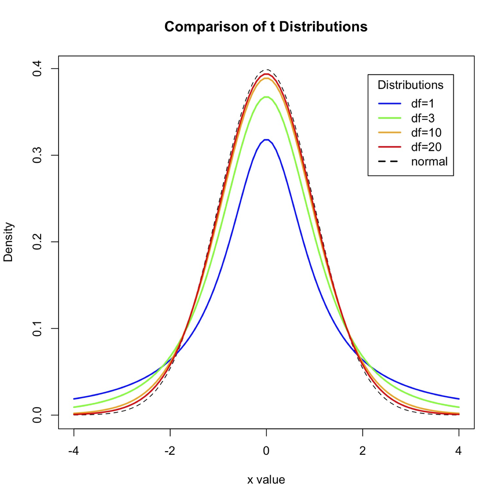{fig-align="center" width="50%" fig-alt="The t-distribution at different degrees of freedom compared to the normal distribution."}

Where the normal distribution has two parameters (a mean and standard deviation), the *t*-distribution has only one, degrees of freedom (df, AKA $v$). In the present context (one-sample *t*-tests), df will equal our sample size minus one. So, if your sample mean was derived from 100 observations, then you would set df to 99 for your statistical test.

**Degrees of freedom** change the shape of the *t*-distribution. Thus, ***the associated probabilities of any t-score change along with the degrees of freedom***. The probability of observing a *t*-score of 2 (or higher) on a distribution with 25 degrees of freedom does not have the same probability as observing a *t*-score of 2 (or higher) on a distribution with 100 degrees of freedom.

As you can see from the figure above, when degrees of freedom is low, the *t* distribution has a lower peak and fatter tails compared to the normal distribution. As degrees of freedom increase, however, the *t*-distribution and the normal distribution become indistinguishable. Remember when I said that the normal distribution doesn't work so well when you are using a sample of data to estimate a population mean AND a population standard deviation? The *t*-distributions with lower degrees of freedom make up for these distortions. They also make up for the fact that smaller samples are more erratic: sample means derived from small samples have more dispersion compared to sample means derived from larger samples. The larger tails in the *t*-distribution make up for this as well. The *t* distribution was created to represent the normal distribution after adjusting for these known biases. As sample sizes get bigger, the adjustments in the *t*-distribution become less necessary and it starts to look more like the idealized, bias-free version of itself: *the normal distribution*.

### Confidence intervals for a one sample *t*-test

Let's say you want to calculate a sample mean from a small data set. You don't necessarily want to use the normal distribution to create your 95% confidence interval for this sample mean. After all, we've just learned that the normal distribution is not accurate when you are calculating sample means based on small samples or ones drawn from populations whose standard deviations are unknown.

Recall that the formula for 95% CIs for a sample mean (based on a normal distribution) goes as follows:

$$
\bar{x} \pm SEM(1.96)
$$

Using words (instead of numbers), this translates to something like, "The sample mean is $\bar{x}$, but could have been as high (or as low) as the standard error of the mean times 1.96".

Why "1.96" again? Because, on a normal distribution, -1.96 cuts off the bottom 2.5% of the area under the curve and +1.96 cuts off the top 2.5% of the area under the curve. Collectively, there's only about a 5% chance of an observation falling below -1.96 or above +1.96.

Since the general shape of a normal distribution doesn't change, you can always just have "1.96" in the formula. You could also use "$z_{.025}$". That is the *z* score that cuts off the bottom (or top) 2.5% of the normal curve. Again, because the normal distribution doesn't really change shape, $z_{.025}$ is always equal to 1.96 (after some rounding). So, the following two equations are equivalent:

::::: {layout-ncol="2"}
::: {.text-center}
$$\bar{x} \pm SEM(1.96)$$
:::

::: {.text-center}
$$\bar{x} \pm SEM(z_{.025})$$
:::
:::::

With a *t*-distribution, though, *the number you want is going to change based on degrees of freedom*. $t_{.025}$ is the *t* score that cuts off the top (or bottom) 2.5% of the *t*-distribution, but ***WHICH*** *t*-distribution? **The *t*-distribution changes shape depending on degrees of freedom**. When you have 25 degrees of freedom, $t_{.025} = 2.06$. But when you have 100 degrees of freedom, $t_{.025} = 1.98$.

Most of the time, you will have a computer figuring all of this stuff out for you. Hopefully you understand now why we say the equation for a 95% CI for a sample mean (based on a *t*-distribution) is:

$$
\bar{x} \pm SEM(t_{.025})
$$

We can't put the same number on the right side of the equation because, unlike $z_{.025}$ (which is always equal to 1.96), $t_{.025}$ changes depending on your sample size / degrees of freedom.

## Statistical tests learned so far

Below is a table of all the statistical tests/analyses we've learned so far.

| Name | When to use | Distribution / Requirements |
|-----|-------|---|
| **Single observation *z*-score** | You just want to know how likely (or unlikely) or how extraordinary (or average) a single observation is. | **Normal distribution**. Population mean and population SD are known. |
| **Group *z*-test** | You want to know whether a sample mean (drawn from a normal distribution) is higher or lower than a certain value (usually the population average) | **Normal distribution**. Population mean and population SD are known. |
| **1 sample *t*-test** | You want to know whether a sample mean is different from a certain value (either 0 or the population average) | **Student's *t*-distribution**. Population mean is known, but not the population SD |

A big part of (beginner) statistical analysis is *knowing which tests are appropriate for which kinds of data*. So, if I were to give you a data analysis scenario, would you know which of the three analyses are most appropriate? Here are some rules to remember to help narrow down the right test:

* Anything with a "z" in it involves the normal distribution. **The normal distribution requires that the population mean and SD are provided.**
* If I want to know whether a single observation is unique/extraordinary/average, then you'll just end up analyzing a z-score, not using a group z-test. **A group z-test is for when you are testing whether a sample mean (multiple observations grouped together) is different from the general population.**
* **If you don't know the population standard deviation, then you aren't going to be using the normal distribution** (no *z*-scores, no group *z*-tests). You'll have to use the *t*-distribution.
