# Correlation and Regression

In its simplest form, correlation analyses are a way of determining whether two variables are associated with each other. Do people with high self-esteem tend to have better grades? Do people with more depression-like symptoms tend to spend more time on their smartphone on a given day?

We don't know if these variables are necessarily ***causing*** each other. We talked all about that in an earlier chapter. Correlation does not imply causation. But correlation ***does*** imply that two variables coincide. (Correlation implies coincidence.) For the first part of this chapter, I'll describe the specifics behind correlational analyses. After that, I'll describe simple linear regression. (For now, I'll call it "regression" for short.)

Regression is very tightly linked with correlation. They're actually two sides of the same coin. So why learn both? Well, simple correlational analyses are good for when you want to answer a simple question about whether two variables are statistically linked with one another. Regression, though, is a more versatile method that can be expanded to address more complex questions. In fact (SPOILER ALERT!) this whole book is basically just a book about regression. But I'll save that for later chapters.

## Correlation coefficients

A correlation coefficient (*r*, also known as "Pearson's *r*") quantifies the degree to which two variables coincide. A positive correlation means that, as the first variable goes up, the second variable tends to go up as well. A negative correlation means that, as the first variable goes up, the second variable tends to go down. Correlation coefficients can be as low as -1 or as high as +1.

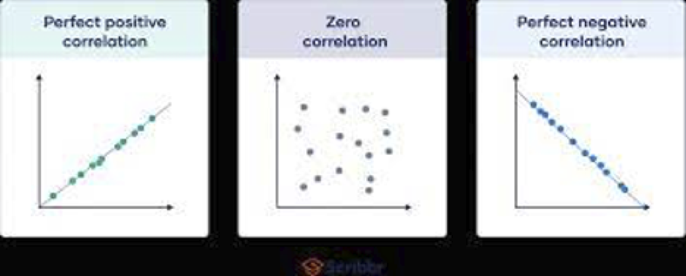{fig-align="center" width="50%" fig-alt="Three scatterplots. One's a perfect positive correlation, one has no correlation, and the last has a perfect negative correlation."}

A perfect positive correlation (r = 1.00) means that an increase in the first variable corresponds to a perfectly predictable increase in the second variable (and *vice versa*). The correlation between daily temperatures expressed in Fahrenheit would have a perfectly positive correlation with daily temperatures expressed in Celsius. They are, after all, the same information re-phrased into different formats. A perfectly negative correlation (r = -1.00) means that an increase in variable 1 corresponds to a perfectly predictable decrease in variable 2 (and *vice versa*). The correlation between my daily spending and my total wealth are perfectly negatively correlated. For every dollar I spend, I lose a dollar in total wealth.

A correlation of zero (r = 0.00) means that the two variables do not coincide at all. Knowing something about the first variable tells you nothing about the second variable. Perfectly non-existent correlations like these do exist: Your shoe size doesn't correlate with the last two digits of your phone number. It can be difficult, though, to think of two ***interesting*** variables that do not coincide whatsoever. People's shoe size and their self-esteem could be correlated, however slightly. People's daily caloric intake and the daily temperature probably have some small correlation with each other.

Correlation coefficients only measure the degree to which two variables coincide. That doesn't mean the two variables are causing each other. Case in point: there is a well-known correlation between the number of weddings in a given month and the number of June bugs lurking about. Does that mean that June bugs feel the love in the air and fly into town when there's a wedding? Do people plan their weddings so they can have drunken bugs flopping around outside on their special day? No. Both variables are caused by a third variable: summer. People tend to have weddings during the summer and that just so happens to be June bug season.

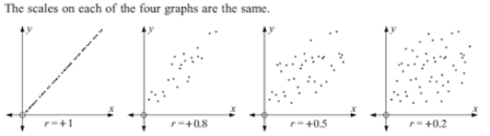{fig-align="center" width="70%" fig-alt="A series of 4 scatterplots. The first one has a correlation of +1, the next is 0.8, then 0.5, then 0.2."}

As you might expect, most interesting correlations are nowhere near a perfect +1 or -1 value. Most relationships between psychological variables are closer to the 0.15 to 0.20 range. A perfect correlation, when shown on a scatterplot, looks like a bunch of dots falling on a straight line. As a correlation coefficient shifts between a perfect +1 or -1, it will look more like a cloudy line of data points. In the figure above you can see that a correlation of 0.8 looks like a cloudy straight line. As *r* keeps decreasing, getting closer to 0, it looks less like a cloudy line and more like just a cloud.

### How to calculate a correlation coefficient

Remember how we calculated the variance (or $SS_{Total}/df$)? We added up the squared distance between each data point and its mean? Then we divided the sum of these squared distances by degrees of freedom? Like, we basically ended up with "the average squared distance between each data point and its mean"?

With correlation coefficients, we use a fairly similar line of reasoning. Rather than find the total amount of variation in a single variable, though, we end up looking for the total amount of **CO**variation between two variables. Let's look at $SS_{Total}$ again:

$$
SS_{Total} = \sum(x - \bar{x})^2
$$

When translated into words, this would read something like, "You get 'sum of squares total' when you add up the (squared) difference between each value of x and the mean of x." To get the variance, you divide by degrees of freedom:

$$
variance(x) = \frac{\sum(x - \bar{x})^2}{df}
$$

$df$ is equal to the number of data points, N, for population variances but equal to N - 1 for sample variances. With a covariance, we don't just want to see how much x tends to deviate from the mean of x, we also want to see how much a second variable (y) tends to deviate from its own mean ($\bar{y}$). Most importantly, we want to see how much deviations of x from its own mean tend to go in the same direction as deviations of y from its own mean.

The numerator of a covariance is...

$$
\sum(x - \bar{x})(y-\bar{y})
$$

The deviations of x from its mean are multiplied by the deviations of y from its mean. As you add up these products, the running total will grow larger if the deviations are going in the same direction. Recall that a positive number times a positive number is a positive number. A negative number times a negative number is a positive number. However, if one of the numbers is negative and the other is positive, then the product will be negative.

Thus, $\sum(x - \bar{x})(y-\bar{y})$ will grow larger if x and y are deviating in the same direction but stay small if they are deviating in opposite directions.

To calculate the covariance from here, we divide by degrees of freedom ($df$):

$$
\frac{\sum(x - \bar{x})(y-\bar{y})}{df}
$$

I highly recommend you look back and forth between the formula of the variance for a single variable, x, and the formula for the covariance between two variables, x and y. Look at their similarities and differences. Reflect on what they are for.

::::: {layout-ncol="2"}
::: {.text-center}
$$\frac{\sum(x - \bar{x})^2}{df}$$

**Variance of x**
:::

::: {.text-center}
$$\frac{\sum(x - \bar{x})(y-\bar{y})}{df}$$

**Covariance between x and y**
:::
:::::

The variance of x is a measure of how spread out the variable x is. Is it widely dispersed? Or, is it pretty narrow, with low dispersion? We answer these questions by calculating something closely analogous to the average deviation from the mean of x. The covariance of x and y is an attempt at answering a different, but related, set of questions: To what degree do x and y typically deviate in the same direction? When x values are higher than usual, are the corresponding y values higher than usual? When x values are lower than usual, are the corresponding y values lower than usual? What is the average (or "typical") amount by which x and y vary in the same direction?

To calculate a correlation coefficient, you standardize the covariance so that it can only range between -1 to +1. You do this by dividing the covariance by the product of the standard deviations of x and y.

::::: {layout-ncol="2"}
::: {.text-center}
$$cov(x,y)=\frac{\sum(x - \bar{x})(y-\bar{y})}{df}$$

**Covariance between x and y**
:::

::: {.text-center}
$$corr(x,y) = \frac{cov(x,y)}{sd(x)sd(y)}$$

**Correlation between x and y**
:::
:::::

### Testing correlation coefficients for statistical significance

When you observe a seemingly large correlation coefficient, that doesn't mean that there's necessarily a real correlation between the two variables. With small samples, you might be seeing flukey results: differences between groups that aren't real or correlations that aren't real. Small samples are just crazy that way. That's why you want to calculate a *p*-value and formally test whether an observed correlation is statistically significant.

To do this, we use the *t*-distribution. The degrees of freedom are equal to the number of pairs of data points minus 2. So, if you have 20 pairs of observations for each variable (40 observations overall) then degrees of freedom would be 18. Let's say I wanted to know whether there was a correlation between students' GPA and their self-esteem. If I recruited 20 students for a study and asked them their GPA and gave them a self-esteem survey, I'd end up with 20 pairs of observations, but 40 observations overall (20 GPAs and 20 self-esteem scores, all from 20 people). Degrees of freedom would be 18: the number of pairs minus 2.

To test whether a correlation coefficient is statistically significant, we first formulate a null hypothesis: Suppose there is no correlation ($H_0: \rho=0$). The correlation between variable 1 and variable 2 is 0. With this assumption in place, I can determine the probability of observing the correlation coefficient I calculated from my sample, *r*. This sample correlation (*r*) is an estimate of the population correlation ($\rho$, pronounced like "row"), and I want to know if I can reject the null hypothesis that $\rho$ = 0. If the *p*-value is low enough (below .05), then we reject the null hypothesis. We conclude that the population correlation ($\rho$) is not equal to 0.

Let's work through a simple example with only 8 pairs of observations:

| Subject | GPA | Self-esteem |
|:----:|:----:|:---:|
| 1 | 3.4 | 30 |
| 2 | 3.0 | 32 |
| 3 | 2.5 | 30 |
| 4 | 3.3 | 31 |
| 5 | 2.2 | 28 |
| 6 | 3.4 | 30 |
| 7 | 2.0 | 20 |
| 8 | 2.5 | 40 |

We have 8 subjects. For each of these subjects, we have a GPA and a self-esteem score. The sample correlation between subjects' GPA and self-esteem in this sample is *r* = 0.33. Sounds pretty good, right? Remember, most psychological variables have much lower correlations between each other.

We used the *t* distribution a couple of times in the previous chapter. We use the same distribution to test whether correlations are statistically significant. The *t* value we calculate means the same thing, but isn't calculated the same way. Here's a reminder of what it means: *t* is a measure of how far our statistical effect has deviated from where the null hypothesis says it should be. For a 1 sample *t*-test, *t* was literally equivalent to "how far is our sample mean from our population mean (in standard errors)": $t = \frac{\bar{x}-\mu}{SEM}$.

In the present context, we're asking how far our sample correlation ($r$) got from the null-hypothesized population correlation ($\rho$): "$r - \rho$". If the null hypothesis is true, then "$r - \rho$" should be close to zero. And we're still wanting to look at the distance between the two in standardized units. There's no "standard error of the correlation," but in the following equation you get something pretty similar:

$$
t = \frac{r - \rho}{\sqrt{(1-r^2)/(n-2)}}
$$

According to the null hypothesis, $\rho$ = 0, so the above equation could be simplified to...

$$
t = \frac{r}{\sqrt{(1-r^2)/(n-2)}}
$$

Once we calculate *t*, we have a measure of how much our sample correlation deviated from 0 in standardized units. Other statistics books present the above equation like this:

$$
t = \frac{r\sqrt{n-2}}{\sqrt{1-r^2}}
$$

With a little bit of basic algebra, you could show that these equations are the same, just re-arranged a bit. I prefer the first one, personally, because it more closely approximates what we mean when we say, "How big is our sample correlation (r) in standard units?" or "How far from zero did *r* get (in standardized units)?"

In our current example...

$$
t = \frac{0.33}{\sqrt{(1-0.33^2)/(8-2)}} = 0.8563008
$$

The probability of observing a *t* value of -0.856 (or lower) or +0.856 (or higher) on a *t*-distribution with 6 degrees of freedom is 0.42.

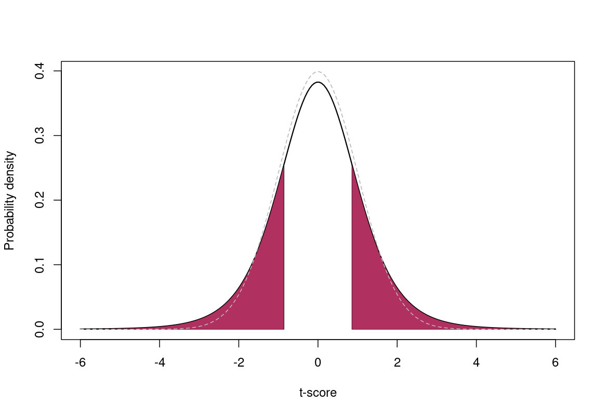{fig-align="center" width="50%" fig-alt="A t-distribution with 6 degrees of freedom"}

In other words, the *p*-value associated with a correlation that high (*r* = 0.33), with 6 degrees of freedom, is 0.42. That means there's a 42% chance of observing a correlation at least as far from zero as 0.33 (in either direction) when you assume the null hypothesis is true. When you assume there is no correlation, and you observe a correlation of 0.33, but from only 8 observations, we can't reject the null hypothesis. It's still very possible that the real correlation is zero. That's the problem with small samples. They're so erratic they produce extremely small and large values. That's why we use statistical tests to make sure we're not falling for these unreliable results.

Technically, I rounded the sample correlation in this example to 0.33 instead of the full number that my stats program gives. When you don't do this, the *t*-value equals 0.86401. The probability of observing a *t*-value as high as that (or higher), when you assume the null hypothesis is true, is about 21%. In other words, the interval between *t* = 0.86401 and *t* = $+\infty$ takes up about 21% of the area under the curve of the *t*-distribution.

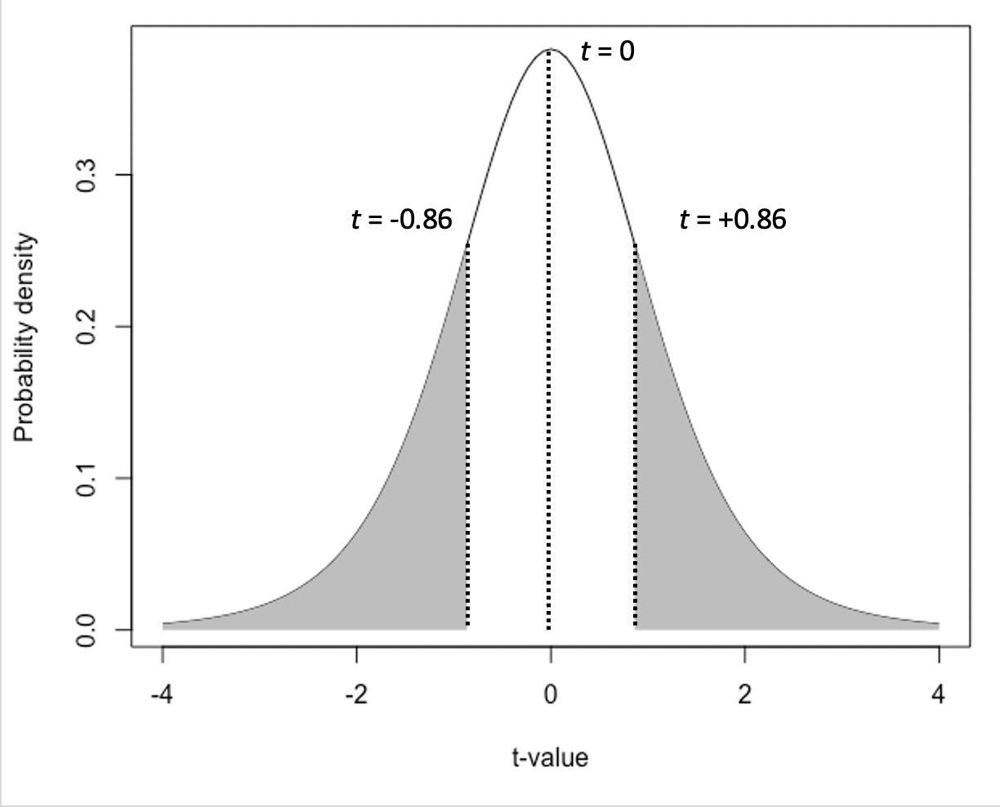{fig-align="center" width="50%" fig-alt="The t-distribution with areas marked that are less than -0.86 or greater than 0.86."}

The interval between *t* = -0.86401 and *t* = $-\infty$ also takes up about 21% of the area under the curve. Put together, the probability of observing a *t* statistic of -0.86401 (or lower) or +0.86401 (or higher) (when you assume the null hypothesis is true) is 42%. That's our *p*-value.

The gray areas in the figure above mark out these intervals. Together, they take up 42% of the area under the curve. If we were in an oddly shaped room (one shaped like a *t*-distribution with 6 degrees of freedom), there's a 42% chance that a bouncy ball would land somewhere in the shaded areas if we made it ricochet and bounce around in a truly random fashion.

### Confidence intervals for correlation coefficients

Remember the 95% confidence interval? Confidence intervals for correlation coefficients have virtually the same ***conceptual*** meaning as confidence intervals for sample means. They're just calculated very differently. Recall that a confidence interval for a sample mean represents a range of plausible values that the population mean might have. Let's say you have a sample of Lord of the Rings fans and you calculate their average IQ. It comes out to 105. Since this is only a ***sample*** average, you want to know how much uncertainty is associated with your estimate of the population average. Let's say you take your sample size into account, the dispersion of the data, and all of that. You plug these numbers into the correct equation and you get a 95% confidence interval of 101 and 109. This means that, while your average IQ from your sample was 105, your data tell you that the population average IQ could plausibly be between 101 and 109.

Let's switch over to correlations. Let's say you ask people to rate how strongly they love Lord of the Rings on a scale ranging from 0 (don't like LotR at all) to 100 (love LotR the most). For each person's 0-to-100 score of LotR fandom, you also have a corresponding IQ. Let's say you calculate a correlation coefficient of 0.40 between LotR fandom and IQ. That's a pretty strong correlation! But wait, let's say this was based on a small sample. So, when you run the numbers, you might end up with a 95% confidence interval of -0.20 to 0.60. This would mean that there's so much uncertainty associated with your estimated correlation coefficient that you can't even be sure whether it's positive or negative! One of the plausible values for the population correlation is 0.

Calculating a confidence interval for a sample mean was relatively straightforward. It was straightforward mostly because we (safely) assume that the sampling distribution of the sample mean is symmetrical, i.e., normally distributed. The sampling distribution for a correlation coefficient, though, won't necessarily be symmetrical. This is because correlations can't go below -1 or above +1. Thus, if you're working with a very high or very low correlation, there's a hard "floor" or "ceiling" limiting possible values the correlation might take. You can't have symmetrical tails in a sampling distribution if you're close to either the floor or the ceiling of possible values. The resulting distribution would be skewed.

A clever statistician named Ronald Fisher figured out a way around this. First, you transform your *r* into a *z*:

$$
z = \ln\left(\frac{1+r}{1-r}\right)0.5
$$

These *z*-scores should tend to center around $\ln\left(\frac{1+r}{1-r}\right)0.5$ and have a standard deviation of $\sqrt{1/(n - 3)}$. All you need now is the *z* score that cuts off appropriate areas under the curve. *z* scores of -1.96 and +1.96 capture the middle 95% of the area under the curve of a normal distribution. Everything below -1.96 or above +1.96 constitutes the outer 5% of the area under the curve. Thus, the 95% CI for a sample r is...

$$
z \pm 1.96\sqrt{1/(n-3)}
$$

In the data above, we observed a correlation coefficient of 0.33 based on 8 observations. Thus:

$$
z = \ln\left(\frac{1+0.33}{1-0.33}\right)0.5 = 0.34...
$$

The standard deviation would be...

$$
\sqrt{1/(8-3)} = 0.447...
$$

Thus, the 95% CI for our correlation coefficient would be...

$$
0.34 \pm 0.447(1.96) = [-0.53612, 1.21612]
$$

This interval, [-0.53612, 1.21612] is still formatted as *z*-scores, though. To transform them into *r*-scores, we invert the Pearson's *r*-to-*z* formula above, turning it into a *z*-to-*r* formula instead:

::::: {layout-ncol="2"}
::: {.text-center}
$$z = \ln\left(\frac{1+r}{1-r}\right)0.5$$

**r to z formula**
:::

::: {.text-center}
$$r = \frac{e^{2z}-1}{e^{2z}+1}$$

**z to r formula**
:::
:::::

If we plug the boundaries of our 95% confidence intervals into this new equation we get...

$$
r = \frac{e^{2(-0.53612)}-1}{e^{2(-0.53612)}+1} = -0.49
$$

...and...

$$
r = \frac{e^{2(1.21612)}-1}{e^{2(1.21612)}+1} = 0.84
$$

Thus, the correlation for the data above is 0.33, 95% CI[-0.49, 0.84]. That means we observed a correlation of 0.33, but based on our sample size, it really could've been anywhere between -0.49 and 0.84. There could be a really large negative correlation between GPA and self-esteem (*r* = -0.49) or there could be a large positive correlation between the two (*r* = 0.84). Maybe there's no correlation. A correlation of zero is within the lower and upper boundaries of our 95% confidence interval.

If you wrote this result up in APA style, you'd say something like, "There was no statistically significant correlation between GPA and self-esteem, *r*(6) = 0.33, 95% CI[-0.49, 0.84], *p* = .421."

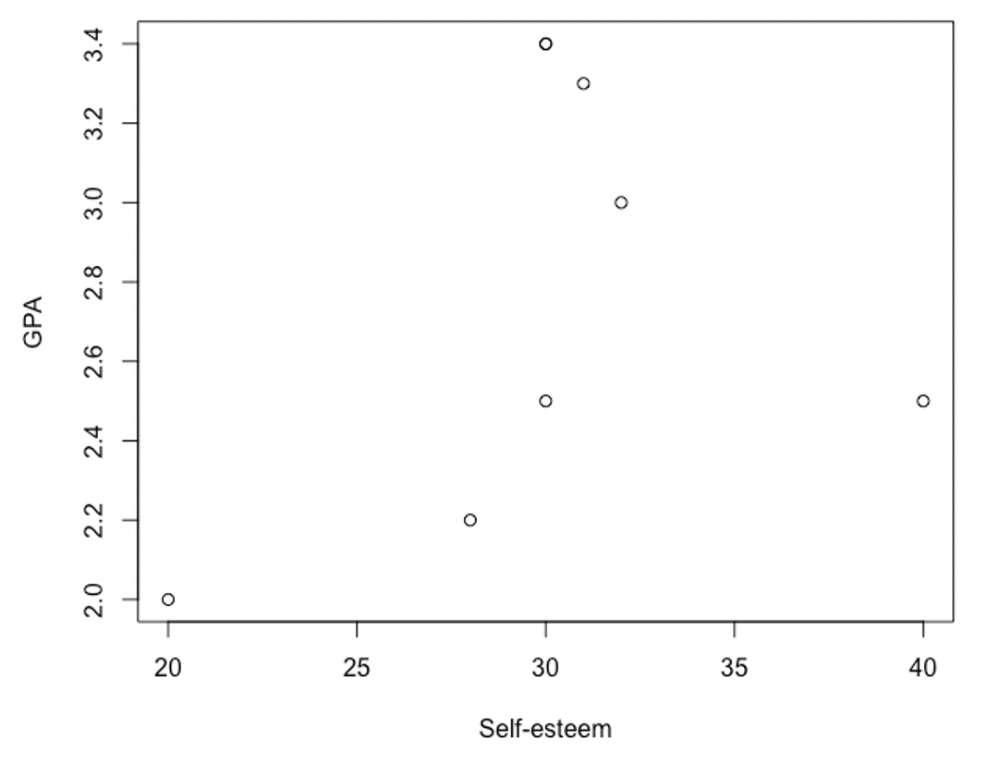{fig-align="center" width="50%" fig-alt="A scatterplot with some, if anything, weakly correlated data."}

You can see from the scatterplot above that there's maybe some tendency for GPA to rise as self-esteem rises. But there's just not enough data to strongly confirm this possibility. No wonder the correlation isn't statistically significant.

Now, let's say we took the same data and repeated it five times. Subject 1 is copied and pasted to be subject 9. Subject 2 is copied and pasted to be subject 10. ***Never do this kind of thing in real life!*** I'm just illustrating the effect of sample size on statistical significance. The correlation would stay the same, but the larger sample size would change some things. Degrees of freedom would be 38 instead of 6. This changes the shape of the t-distribution and, thus, all the corresponding probabilities of observing different *t*-values. The *t*-value associated with a correlation of 0.33 would go from 0.86 to 2.17. When we assume the null hypothesis is true, there is only a 1.79% percent chance of observing a t-score of 2.17 or higher. There's also only a 1.79% chance of observing a t-score of -2.17 or lower. Therefore, the combined probability of observing a t-score as large (or larger [in absolute value]) as the one we did is 2 x 1.79% or about 3.6%. There's our p-value: The probability of observing the data that we did (or data more extreme), when you assume the null hypothesis is true, is 3.6%.

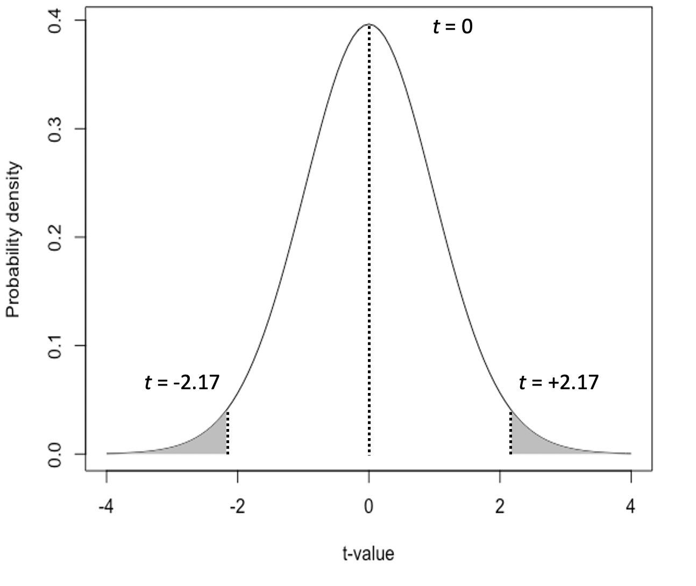{fig-align="center" width="50%" fig-alt="t-distribution with areas marked off less than -2.17 and greater than 2.17."}

The new APA-style write up would be, "There was a statistically significant correlation between GPA and self-esteem, *r*(38) = 0.33, 95% CI[0.02, 0.58], *p* = .036." Now that *p* is less than .05 our results are statistically significant. The 95% CI also became narrower. The lower end of the interval is still very close to zero (0.02). Therefore, we just barely achieved statistical significance with this hypothetical example.

### Tomatometer example

To further illustrate the concept of correlation, I'm going to go gather some real data from a publicly accessible source: [Rotten Tomatoes](https://www.rottentomatoes.com/). Each movie on this site has a Tomatometer score representing how much critics (or typical moviegoers) liked the movie. The higher the score, the more people liked the movie.

I went to Quentin Tarantino's page and recorded the Tomatometer score for each of the films that he directed and the year that film came out.

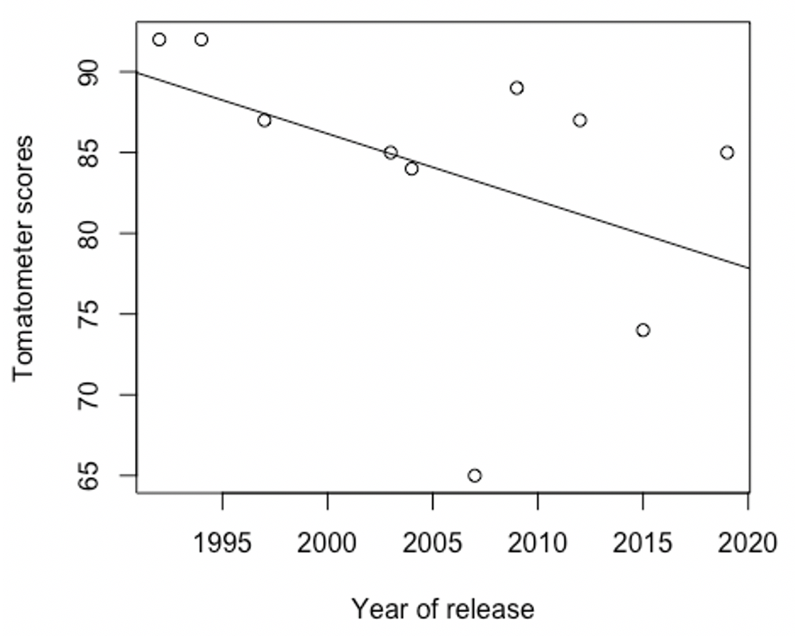{fig-align="center" width="50%" fig-alt="A scatterplot showing tomatometer scores kind of sort of going down over time."}

There was a negative correlation between Quentin Tarantino's Tomatometer scores and the year of each film's release, *r* = -0.44, 95% CI[-0.84, 0.26]. However, this correlation was not statistically significant, *t*(8) = -1.40, *p* = .198. It appears as if Tarantino's movies are **not** getting worse over time. Or, if they are, we don't have sufficient evidence to conclude that in the current analysis. In other words, we may have just committed a type 2 error: There could be a real effect (movies getting worse over time), but we failed to conclude that the effect is there.

Unfortunately, many researchers don't take "the data don't agree" for an answer. You can always go and change different things about your data in order to change the *p*-value coming out the other end. You might even come up with plausible-sounding reasons after the fact. For instance, should Tarantino's "Death Proof" really be included as one of his films? I mean, "Death Proof" was more of a short film than a feature-length film like all the others in the data set. If we included "Death Proof", should we also include other short-form media he directed? Commercials? Music videos?

If you remove "Death Proof" from the data, you come very close to achieving statistical significance. "There was a negative correlation between Quentin Tarantino's Tomatometer scores and the year of each film's release, *r* = -0.64, 95% CI[-0.92, 0.04]. This effect, however did not reach statistical significance, *t*(7) = -2.22, *p* = .062."

See how the correlation, degrees of freedom, *t*-score, and *p*-value all changed? All I did was remove one pesky data point that didn't agree with my hypothesis that I'm trying to force.

This time our data refused to take "I don't like you" for an answer and stayed statistically non-significant! People will sometimes call *p*-values like the one above (just slightly higher than .05) "marginally significant". They're just being sore losers. But keep in mind that people will sometimes play around with different criteria for including or excluding some data to change the statistical significance of the result. They might even completely change the way they approach analyzing their data. This practice is called "*p*-hacking". They're pulling dirty little tricks to try and get the *p*-value on the "good side" of 0.05.

Now let's take a look at M. Night Shyamalan's movies (side note: I got the idea to use M. Night Shyamalan's Rotten Tomato scores to teach correlation and regression from Andrew Littlefield. I wanted to give him credit for that. If he stole this idea from someone else, he never told us.). A lot of people used to say that Shyamalan's first film "The Sixth Sense" was his best work, but that he kind of went downhill from there. You can almost see it in the scatter plot below.

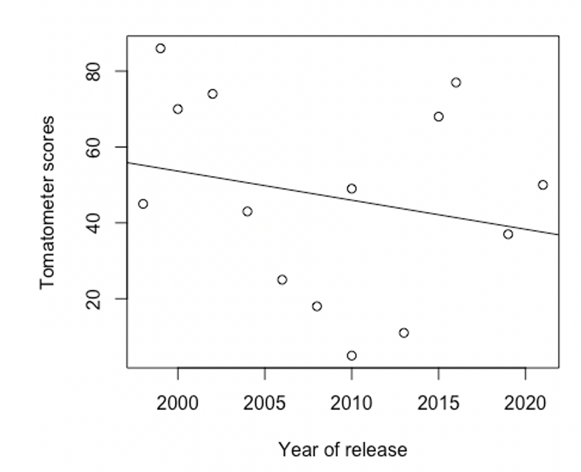{fig-align="center" width="50%" fig-alt="A scatterplot showing the relationship between tomatometer scores and time."}

"There was a negative correlation between M. Night Shyamalan's Tomatometer scores and the year of each film's release, *r* = -0.22, 95% CI[-0.67, 0.35]. However, this correlation was not statistically significant, *t*(12) = -0.79, *p* = .443."

Dang! The results weren't statistically significant! Well, you know what? People have said that M. Night has been having a resurgence lately. They say he hit rock bottom with "The Last Airbender" and decided to pull out all the stops and start churning out bangers like "The Visit" and "Split." If you've seen "Glass" or "Old", however, you'll know this isn't the case. Regardless, I can mess with my data and exclude films that preceded his "resurgence."

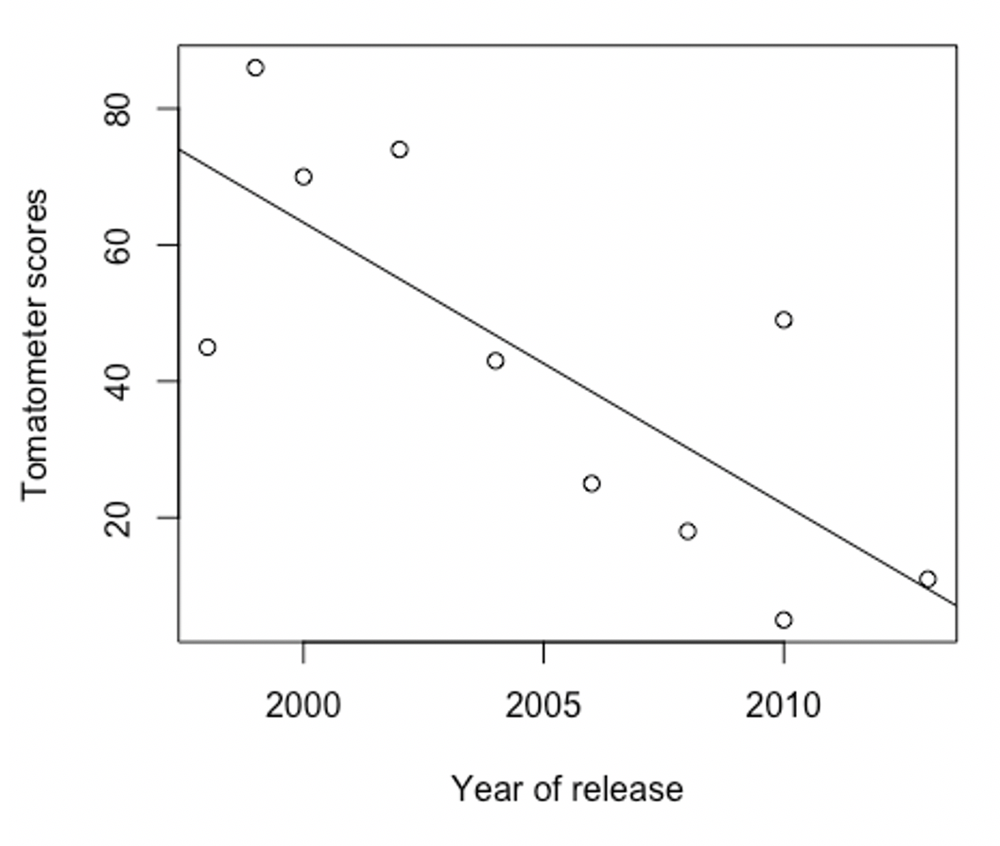{fig-align="center" width="50%" fig-alt="A scatterplot showing the relationship between tomatometer scores and time, for only the later films."}

"There was a negative correlation between M. Night Shyamalan's Tomatometer scores and the year of each film's release, *r* = -0.77, 95% CI[-0.94, -0.28]. This correlation was statistically significant, *t*(8) = -3.44, *p* = .008."

There we go! *p*-hacking worked this time.

### Assumptions of correlational analysis

Every statistical test comes with assumptions. For instance, when we look at a *z*-score or conduct a group z-test, we're assuming the variable of interest is normally distributed in the population. If our variable of interest is skewed, then a group *z*-test is actually an inappropriate way to model the data. We're pushing a square block through a circular hole.

There are two important assumptions I want to draw your attention to when it comes to correlation tests.

1. **The relationship between the variables is linear:** As the IV increases, the DV either increases or decreases in a straight line. The rate at which the DV increases or decreases doesn't change. If it did change, you'd get a curvilinear relationship like the one in the top right corner of the figure below.
2. **There are no outliers in the data:** In a small data set, just one observation can dramatically increase or decrease the correlation coefficient. Outliers can wreak havoc on a large data set too. That's why it's important to plot your data and examine whether any of the observations are far outside the general trend.

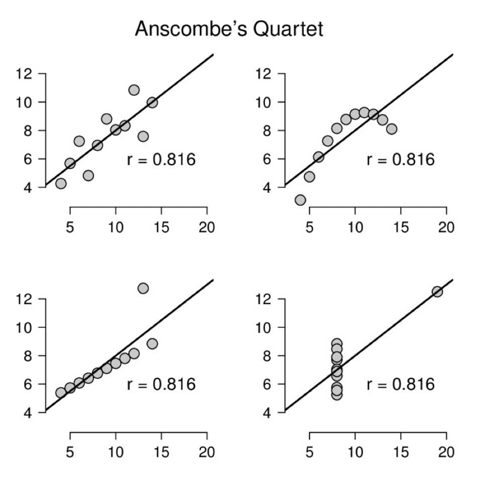{fig-align="center" width="50%" fig-alt="4 scatterplots, all with the same correlation but various non-linear relationships or an outlier present."}

The figure above depicts Anscombe's Quartet: four different data sets that have the same correlation between the independent and the dependent variables, but don't all match the assumptions of correlation (and regression) analyses. You can tell from the top-right data set that there isn't really a linear relationship between the two variables but a curvilinear one. One of the assumptions of the correlation test has been violated. The bottom 2 sets have a single point that is "inflating" the correlation coefficient. It's making the overall set appear more linear than it really is or pulling the line in a direction it shouldn't be going in.

It's always important to plot your data and examine whether there's really a linear relationship between your variables because, after all, the test you want to use ***ASSUMES*** the relationship is linear. If you violate these assumptions, then the *p*-values that come out the other end of your analysis are not accurate.

## Simple linear regression

Regression analysis is used to make predictions. At least that's what a lot of people say. Really, though, simple regression analyses like the ones I'm about to describe do the same thing as correlational analyses. Regression underlies most of the statistics currently in use in the social sciences. Regression is at the foundation.

In a simple linear regression model, the independent variable is being used to predict the dependent variable. Sometimes, we're not trying to actually make predictions, but to test whether you **could** reliably make such predictions. The "simple" in "simple linear regression" is there because we only have one independent variable. The "linear" in "simple linear regression" is there because we are using a single straight line to make predictions.

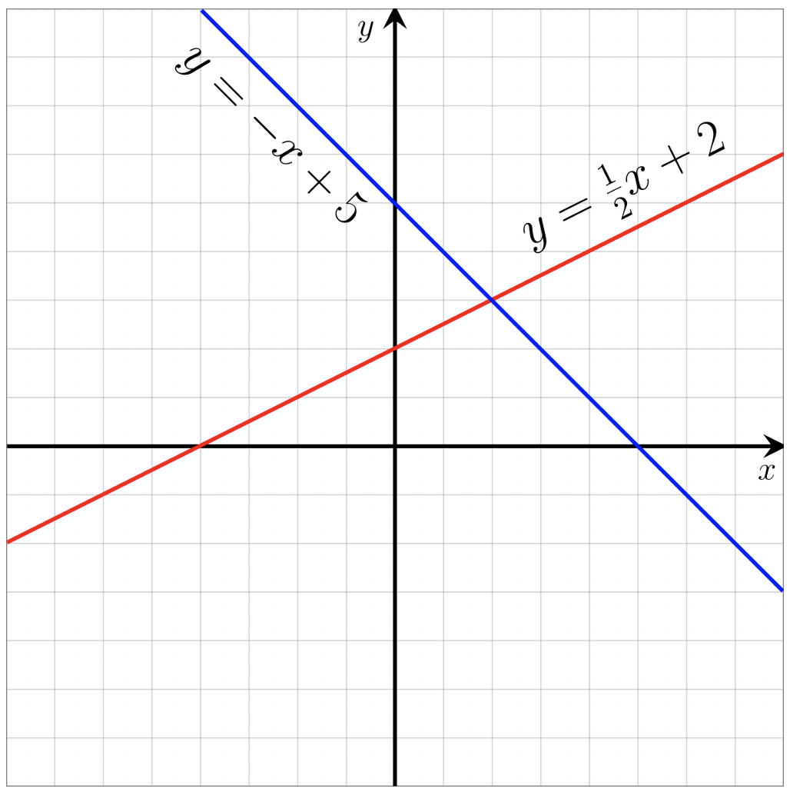{fig-align="center" width="50%" fig-alt="Two linear equations plotted on a graph."}

Every straight line can be described by a linear equation of the form "y = mx + b". Here, "m" is the slope of the line and "b" is the intercept of the line, the place where the line crosses the y-axis when x = 0.

With some slight changes and rearranging, we get:

$$
\hat{y} = b_0 +xb_1
$$

"$\hat{y}$" is the predicted level of y, our dependent variable. "$b_0$" is the intercept. It's the place where our regression line crosses over the y-axis when x = 0, just like before. "$b_1$" is our regression slope. Just like with a normal slope, it represents the change in y for every change in x. If $b_1$ = 1, then our predicted y value goes up by 1 every time x (our independent variable) goes up by 1. If $b_1$ = 0.5, then our predicted y value goes up by half a unit for every unit increase in x.

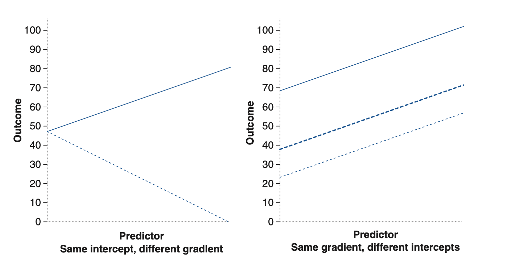{fig-align="center" width="50%" fig-alt="Two panels of lines. On the left, two lines share an intercept but have opposite slopes. On the right, three parallel lines have different intercepts."}

On the left-hand image, you can see two lines that start at the same point on the y-axis. In other words, they have the same intercept. But the solid blue line has a positive slope and the dashed blue line has a negative slope. In the right-hand image, you can see three lines that each have different intercepts, but all have the same slope (or "gradient").

Once you've chosen some numbers for the slope and intercept, you'll have a line. But with correlational data, you rarely have a perfect linear relationship between your two variables. We get cloudy lines because our variables merely correlate with each other. Let's look at the Quentin Tarantino Tomatometer scores from earlier.

{fig-align="center" width="50%" fig-alt="A scatterplot showing the relationship between tomatometer scores and time."}

I've plotted the "best fitting" regression line. It's the line that comes as close as possible to all the data points. I've chosen a slope/intercept combo that minimizes the distance between the regression line and each data point as much as possible.

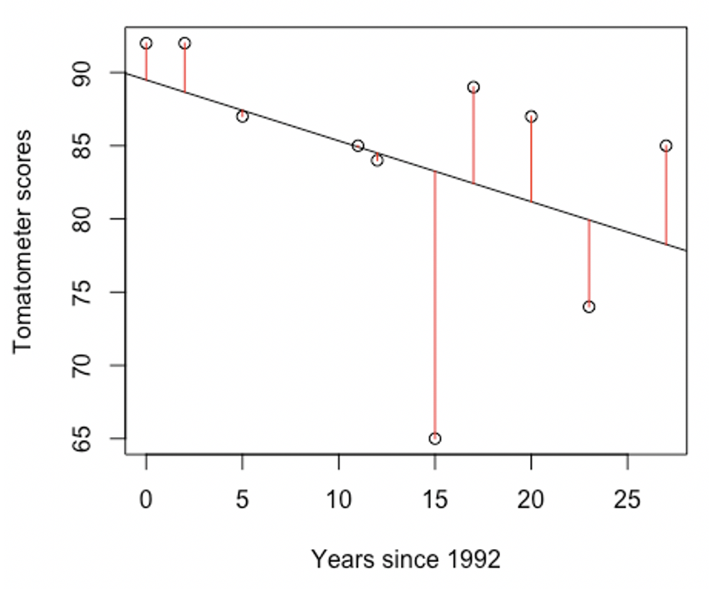{fig-align="center" width="50%" fig-alt="A scatterplot with regression residuals marked in red."}

The mismatch (or distance) between the regression line and each point is called a residual (i.e., a "leftover"). Some really clever people figured out how to derive the perfect intercept/slope combo that jointly minimize the **squared** residual between each point and the regression line. That's why the particular form of regression we're learning in this course is called "ordinary least squares regression". We're deriving a line (i.e., a slope/intercept combo) that minimizes the squared residuals between our data and our regression line.

Recall that, $\hat{y}=b_0+xb_1$, which reads as something like "predicted y equals the intercept plus slope for every x." All the $\hat{y}$s that result from all possible xs you could plug in form the regression line. You could add the residual (or "error") to each equation and get y itself: $y = b_0+xb_1+error$. Basically, you take the predictions of the regression line (all the $\hat{y}$s), and add the gap between the line and the actual data to get y itself. These errors are often symbolized with $\epsilon$, the lower-case Greek letter epsilon. Thus, $y = b_0+xb_1+\epsilon$, each observation, y, is equal to the regression equation ($b_0+xb_1$) plus whatever the regression equation missed ($\epsilon$).

If the slope equals 0 in a regression model, then the line will be flat. The dependent variable does not go up or down in response to changes in the independent variable. This corresponds to a correlation of zero between the two variables. If there is a positive association between the two variables, then the slope will be greater than 0. The line will be sloped upward, getting higher when you go from left to right. If there is a negative association between the two variables, then the slope will be less than 0. The line will slope downward when you scan from left to right.

The "best fitting" regression line in the figure above is $\hat{y} = 89.49 + x(-0.42)$.

This means that, when Quentin Tarantino first started directing (and x = 0), the best prediction you could make (based on the present data) is that his Tomatometer score would be 89.49. For every year afterwards (every time x goes up by 1), we lower our predicted Tomatometer score by 0.42. That's almost half a Tomatometer point lost each year!

What is our prediction when Tarantino is 5 years into his film career?

$$
89.49 + 5(-0.42) = 87.39
$$

What if he's 10 years into his film career?

$$
89.49 + 10(-0.42) = 85.29
$$

What if he's been making films for 100 years?

$$
89.49 + 100(-0.42) = 47.49
$$

You see, it takes Quentin Tarantino a whole century to be as bad as M. Night Shyamalan.

Well, actually, we can't necessarily say that. Our regression equation, as a whole, gives us the best possible predictions that we can make with the data on hand. It's best not to extrapolate too far outside of the data we actually have (i.e., late 20th and early 21st century).

The parameters of the regression equation (the slope and intercept) might appear extremely small or extremely large, but you still have to worry about sample size. Small samples are pesky that way, and give us misleading results that don't align with the population they're drawn from. That's why we test the parameters of a regression model for statistical significance. For each parameter, we start by hypothesizing that it is actually equal to zero. (This is just null hypothesis significance testing like we've been doing all along.) We then calculate how probable it is that we observe a value as high or higher (in absolute value) as the one we did when you assume the null hypothesis is true. We use the *t*-distribution to calculate these probabilities.

The intercept in the model above is equal to 89.49, *t*(8) = 19.22, *p* < .001. This means that the intercept probably isn't zero. Usually, in a regression model, the intercept isn't really what we're interested in testing. In this context, a statistically significant (different from zero) intercept just means that Quentin Tarantino didn't start off making awful movies (like literal 0 out of 100 Tomatometer scores, he's not Tommy Wiseau!).

The slope is usually what we're more interested in. The slope in the current regression model was -0.42, *t*(8) = -1.40, *p* = .198. So, the slope was negative, but it wasn't so negative (relative to the sample size) that we can conclude that it is definitely lower than zero. If we were to repeat this "study" a few times, with a similar sample size, we might very well see regression slopes close to 0, or even some positive ones.

Just like with the correlation analysis above on Tarantino's Tomatometer scores, we see a negative trend, but we don't have enough evidence to conclude that there really is a negative relationship between the quality of Tarantino's movies and the amount of time he's been making movies. We can't reject the null hypothesis. We can't conclude that he's been getting worse (or better) over time.

In fact, you might have noticed something odd. The correlation between Tarantino's Tomatometer scores and the number of years he's been making movies is -0.44. That's different from the regression slope relating those two variables, -0.42. And yet, when I do a *t*-test on the correlation coefficient and on the regression slope, I get the same *t*-value (-1.40), the same degrees of freedom (8) and the same *p*-value (.198).

What gives? Well, for simple linear regression, the regression slope is just a re-scaled version of the correlation between the two variables. If the regression slope is statistically significant, then so is the correlation coefficient.

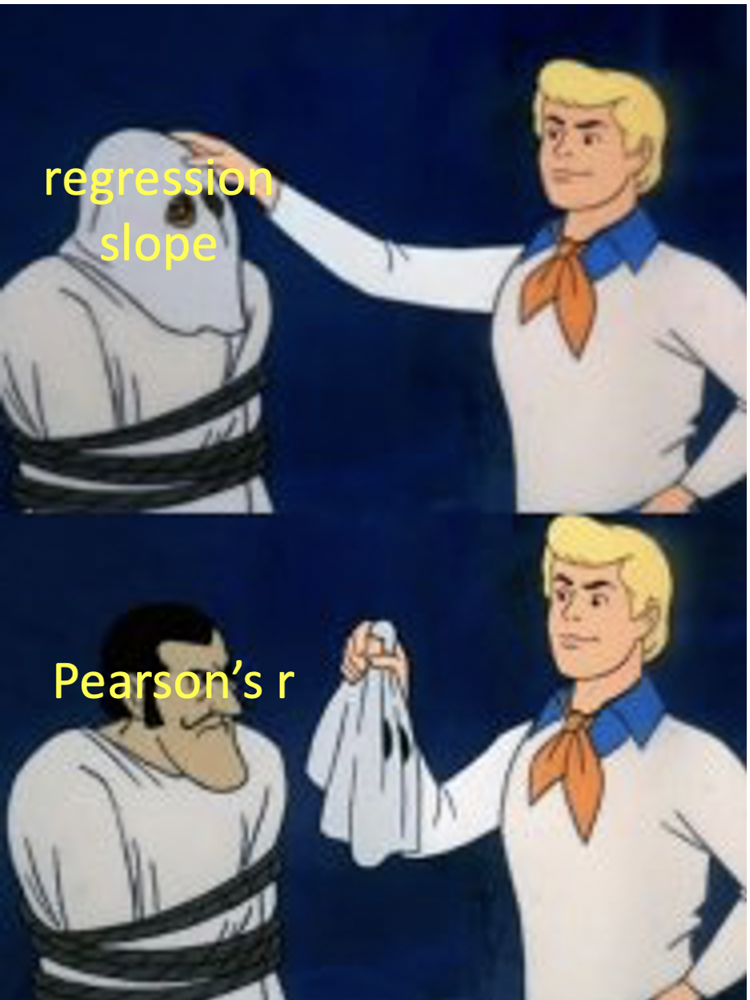{fig-align="center" width="50%" fig-alt="A meme of Fred (from Scooby-Doo) unmasking the regression slope to find that it was Pearson's r the whole time."}

In fact, the equation for the regression slope that minimizes the squared residuals is just the correlation coefficient multiplied by the ratio of the standard deviations of the two variables. In other words, it's just the correlation coefficient re-scaled.

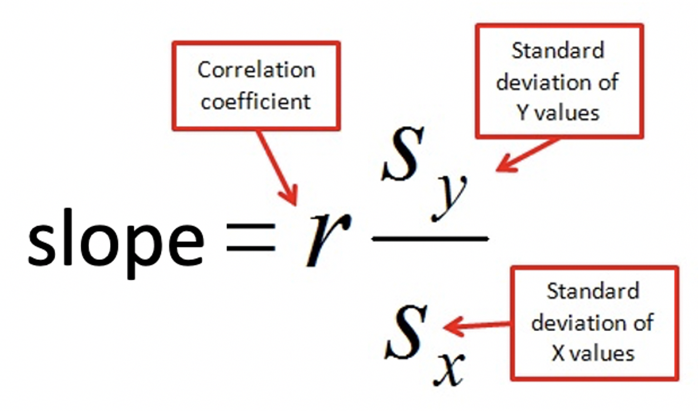{fig-align="center" width="50%" fig-alt="The equation for a simple linear regression slope"}

If you were to flip your dependent and independent variables around, so that you're using Quentin Tarantino's Tomatometer scores to predict which year each movie was made, the regression slope would change. You'd multiply the correlation between the two by $\frac{s_x}{s_y}$ instead of $\frac{s_y}{s_x}$. It's still the same correlation though. It would have the same *t*-value, degrees of freedom, and *p*-value.

Why am I harping on this? Well, ultimately because I think it's cool. You might not though, so here's another reason: People mistake correlation and regression coefficients (or slopes) as signs of causality, as if the independent variable *causes* the dependent variable. Correlation and regression analyses absolutely do not provide any evidence of a causal link between variables on their own.

And I once saw a guy at an academic conference make this mistake. Someone in the audience asked, "How do you know your independent variable is causing your dependent variable? Why not the other way around?" The presenter responded, "Because when you rerun the regression equations with the variables flipped, they are no longer statistically significant."

At best, there was a misunderstanding or the presenter misspoke. To me, though, it just sounded like a lie. What the presenter said isn't mathematically possible.

### Assumptions of simple linear regression

The first two assumptions for simple linear regression are the same as for correlation. The third one ***technically*** is an assumption of nearly all the tests covered in this book, so I'm going to elaborate a lot on it. It's very important.

1. **The relationship between the variables is linear**
2. **There are no outliers in the data**
3. **The residuals are normally distributed**

For any point along the regression line, there might be a number of actual data points that the line is either close to or not so close to. The distances of all these points from the line are called residuals (or "errors", $\epsilon$). Simple linear regression assumes that these residuals are normally distributed. Even if you don't even have data at every point along the x-axis, it's assumed that, if you did, some data points would be close to the regression line, about 70% would be within one standard deviation of the regression line. About 95% of them would be within two standard deviations of the regression line. And so on.

Like I said, this third assumption underlies almost every test covered in this book, so it bears elaboration.

You know those poster display cases they have in stores? You can flip through the different posters?

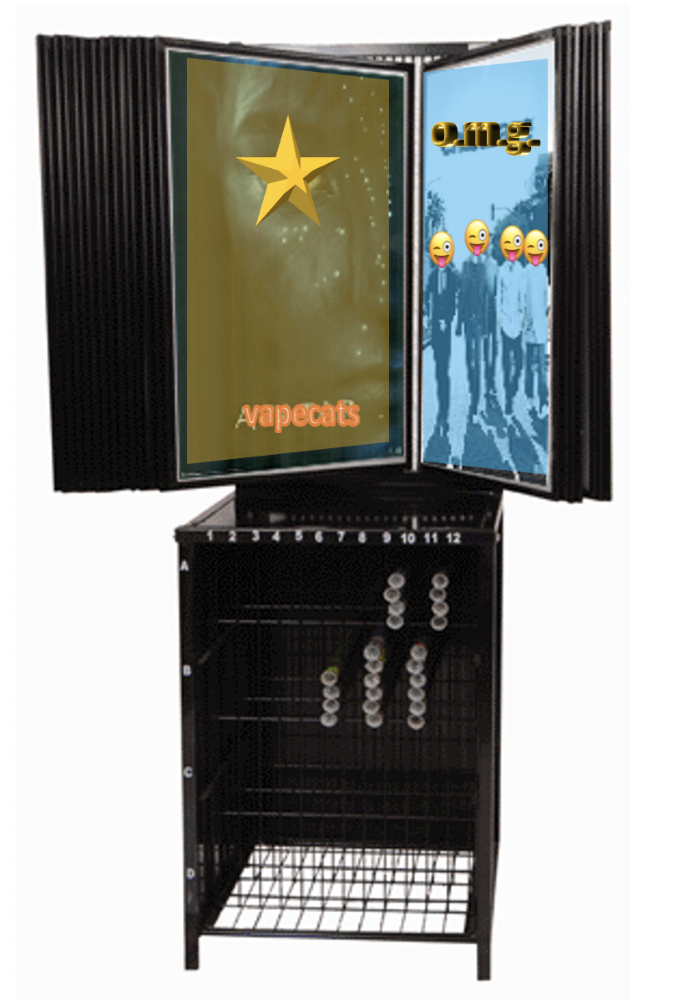{fig-align="center" width="50%" fig-alt="A poster display case in a store, with posters mounted on panels you can flip through"}

I want you to imagine that we shut the case completely. All the posters' right sides are now facing you.

{fig-align="center" width="10%" fig-alt="The closed poster case seen from the side, forming a rectangle"}

Now, I want you to imagine that this rectangular shape formed by the poster cases is a scatter plot. It has a y-axis (its height) and an x-axis (its width). You can plot some data on this:

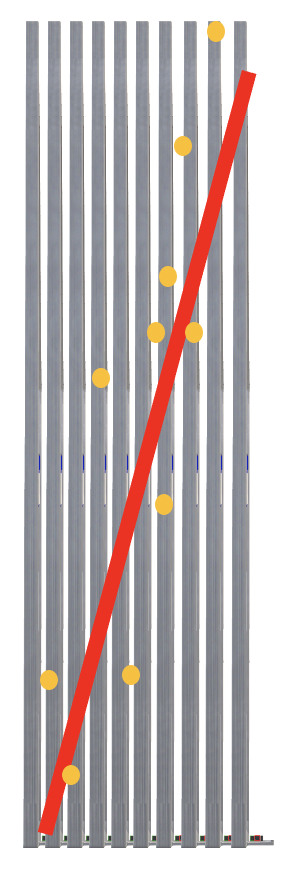{fig-align="center" width="10%" fig-alt="A scatterplot drawn on the side of the closed poster case, with orange data points and a red regression line"}

We have data points plotted with orange circles. The best fitting regression line is marked out in red. Now imagine that we can open up this poster case and look at each slice of the x-axis in isolation.

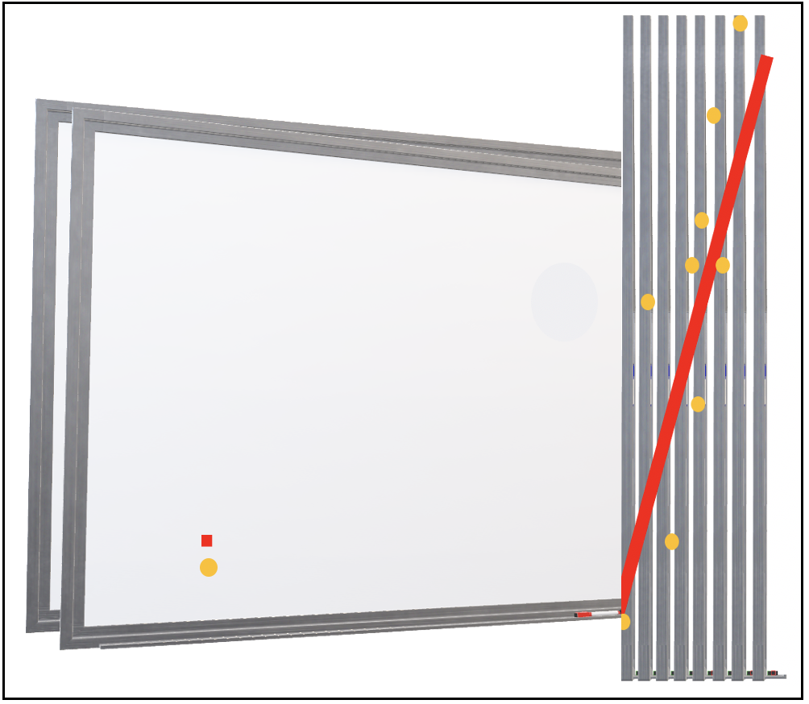{fig-align="center" width="50%" fig-alt="An early poster panel showing one slice of the x-axis, with a red marker for the regression line and one data point"}

You see a small cross-section of the data. You see where the regression line runs through this slice of the x-axis and the one data point that happened to be on this part of the x-axis.

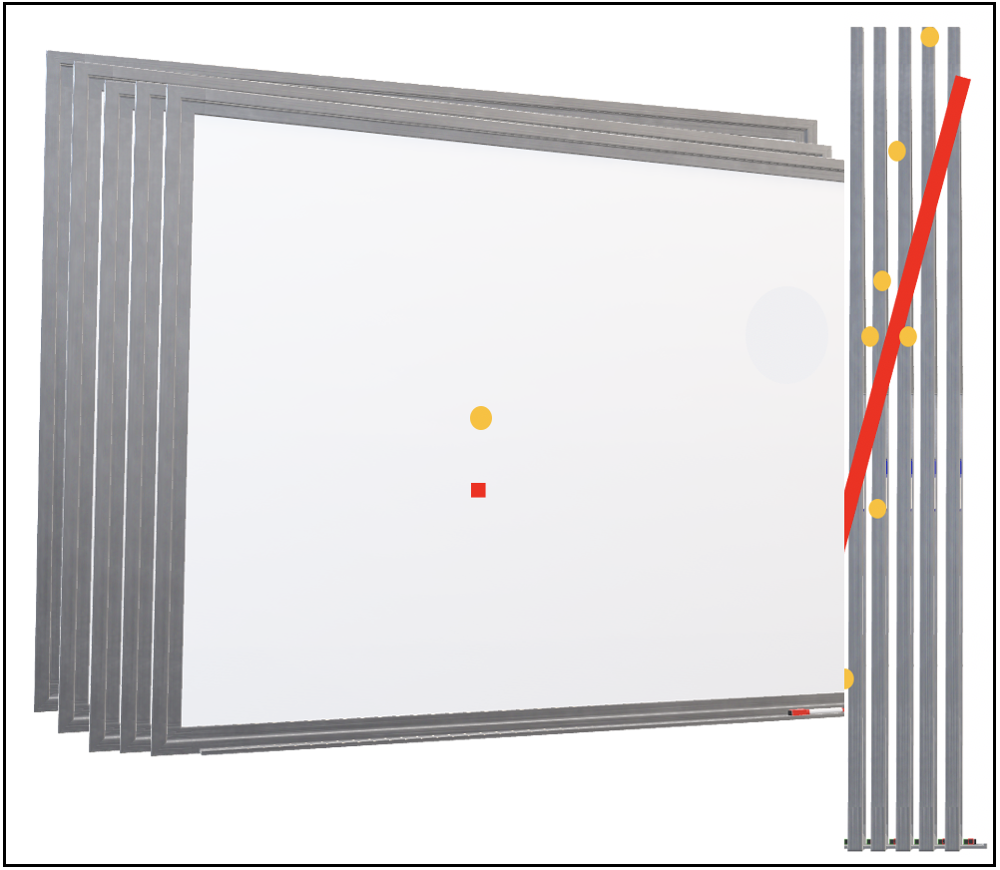{fig-align="center" width="50%" fig-alt="A poster panel from the middle of the case, with the red regression marker higher up"}

As you flip through the posters, the red marker for the regression line gets higher and higher. That's because the regression line has a positive slope. As x increases, so does y. We also see that sometimes the data points at different areas along the x-axis are either above the regression line or below it. Remember, the distance between each data point and the regression line is called a "residual".

{fig-align="center" width="50%" fig-alt="A poster panel near the end of the case, with the red regression marker near the top"}

When you finally get to the end of the poster case, there will be no more data. Technically, a regression line would keep going on into infinity, regardless of whether there was any actual data far out there along the x-axis.

According to our new, third assumption, these residuals are normally distributed. This means that, if you kept collecting data *ad infinitum*, they would tend to be close to the regression line. The gaps between each data point and the regression line would have lengths that follow a normal distribution.

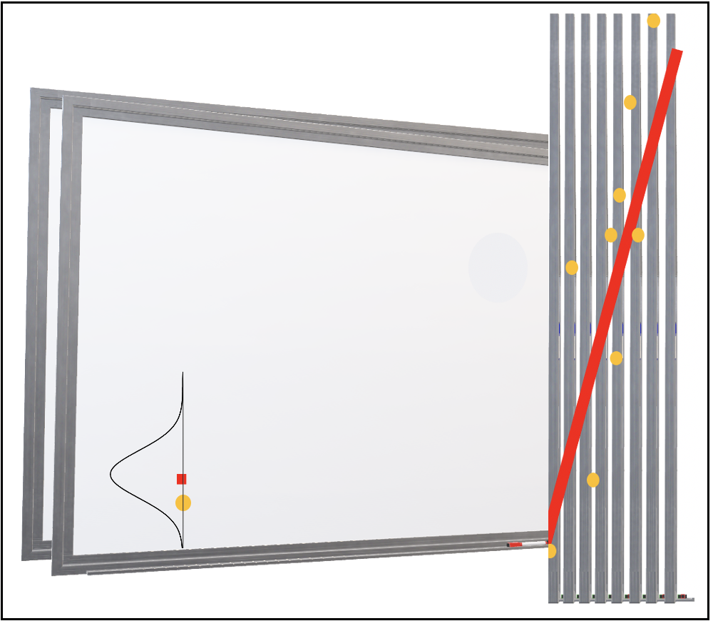{fig-align="center" width="50%" fig-alt="An early poster panel with a normal distribution of residuals centered on the red regression marker"}

***THE REGRESSION LINE IS THE MEAN OF EACH OF THESE DISTRIBUTIONS.*** Doesn't matter where that line actually is. Usually our actual data will be close to the mean (the red marker on all the poster boards). Sometimes it won't be that close.

{fig-align="center" width="50%" fig-alt="A middle poster panel with a normal distribution of residuals centered on the red regression marker"}

Like with a normal distribution, about 70% of all our actual residuals (and hypothetical/theoretical residuals) fall within 1 standard deviation of the mean. The remaining 30% are rarer. The further away from the regression line (the average), the less likely they are to occur.

{fig-align="center" width="50%" fig-alt="A late poster panel with a normal distribution of residuals centered on the red regression marker"}

It follows from this assumption that the distribution of residuals is symmetrical (i.e., not skewed). After all, the normal distribution is symmetrical.

It also follows from this assumption that the standard deviation of the residuals is constant. Sometimes, in real (and messy!) data sets, the data become more dispersed as we move from the left-hand side of the x-axis to the right (or *vice versa*). That's why many statistics books say that regression analyses assume a "constant error variance". That just means the error variance (or standard deviation) stays the same, no matter where you are along the x-axis. Many writers like to whip out words like "homoskedasticity" to denote residuals with constant, unchanging variance. And they'll use "heteroskedasticity" to denote residuals that become more (or less) dispersed depending on where you are along the x-axis. Since I'm not paid by the syllable, and I like to be understood, I'm going to go ahead and ***not*** use these terms. I just wanted you to recognize them if you saw them in other, lower quality statistics books.

Many statistics books become confusing because each test seems to have its own unique set of assumptions, yet others have the same assumptions but stated in different terminology. Worse, they'll end up saying that regression analysis has 4 assumptions even though 3 of those assumptions just follow from the "residuals normally distributed" assumption and, technically, there are way more than just 4 assumptions...

Yes, if you peek under the mathematical hood of all this stuff, things get more complicated. I'm going as deep as necessary to get you started on your stats journey, but no deeper.

I think you'll find it very useful to memorize/internalize/bake-into-your-brain this assumption of normally distributed residuals. Later, you'll see that most of the assumptions underlying statistical tests are straightforward consequences of this one rule.

## Statistical tests learned so far

Below is a table of all the statistical tests/analyses we've learned so far:

| Name | When to use | Distribution / Requirements |
|-----|-------|---|
| Single observation *z*-score | You just want to know how likely (or unlikely) or how extraordinary (or average) a single observation is. | Normal distribution. Population mean and population SD are known. |
| Group *z*-test | You want to know whether a sample mean (drawn from a normal distribution) is higher or lower than a certain value (usually the population average) | Normal distribution. Population mean and population SD are known. |
| 1 sample *t*-test | You want to know whether a sample mean is different from a certain value (either 0 or the population average) | Student's *t*-distribution. Population mean is known, but not the population SD |
| Correlation | Measuring the degree of co-occurrence between two continuous variables | Linear relationship between variables, no outliers, normally distributed residuals. |
