# Are these statistical tests or prediction models?

So far, we've learned how to test a few hypotheses:

1. Whether a sample mean is different from a specific (known) population mean (via *z* or *t*-tests)
2. How to determine whether two continuous variables are correlated (or associated with one another; via correlation or regression).

In this chapter I'm going to start paving the way towards learning how to determine whether sample means are different from one another while also reinforcing what we've already learned.

Let's say I want to know whether drinking coffee or a Monster energy drink (or nothing at all) before a round of speed dating will result in more interest from potential partners. Do you know the population mean of how many phone numbers someone will get if they drink coffee right before a speed dating gauntlet? What about the population mean for people who drank a Monster? Most population means aren't known, really. There are ways we account for that in our statistical tests/models.

If you wanted to know whether traditional or non-traditional students had more (or less) feelings of preparedness or satisfaction from their college degree, you won't know any of those population means either.

In the next chapter, we will cover the statistical analyses that allow you to test for a difference between two sample means (an independent samples *t*-test) or more than two sample means (an Analysis of Variance; ANOVA). Before I do that though, I want to stop and talk about some stuff that will deepen your understanding of correlation and regression. (Remember, regression is at the foundation of all the statistics commonly used in the social sciences, including the tests used throughout the rest of this book. So, it's worth understanding it in as much depth as possible.)

Covering these topics will also help make the math parts of the next chapter make more sense. A lot of people struggle with the Sum of Squares total ($SS_{Total}$) versus Sum of Squares between ($SS_{Between}$) versus Sum of Squares residual ($SS_{Residual}$) when they first learn about ANOVA.

It is worth noting that students will probably run into several terms that mean the same thing (or have very similar meanings):

* $SS_{Between} = SS_{Model}$
* $SS_{Residual} = SS_{Within} = SS_{Error}$

I'm going to take my time in this chapter to talk about these things, which are already present "under the hood" in regression, on a conceptual level. Once I've planted the seeds for what all this stuff is on a conceptual level, tackling it on a mathematical level in the next chapter will be easier.

So, what is this chapter actually about? This chapter is about how most of the statistical tests in this book are connected because they are all (in some sense or another) a method for making predictions (or establishing that you *could* make predictions) with your statistical tests. And that statistical "tests" are also statistical "models".

## Using the mean to make predictions

Let's say I grabbed 10 students at random and asked each of them for their GPA. After I have 10 randomly drawn GPAs, I feel like maybe I can use that information to predict the 11th student's GPA.

Here's the data:

| GPA |
|:----:|
| 4.00 |
| 3.31 |
| 2.24 |
| 2.92 |
| 2.33 |
| 3.29 |
| 3.00 |
| 2.03 |
| 3.88 |
| 2.76 |

The average is 2.97, but the GPAs also range from 4.0 to 2.03. That's a lot of room for error in my predictions.

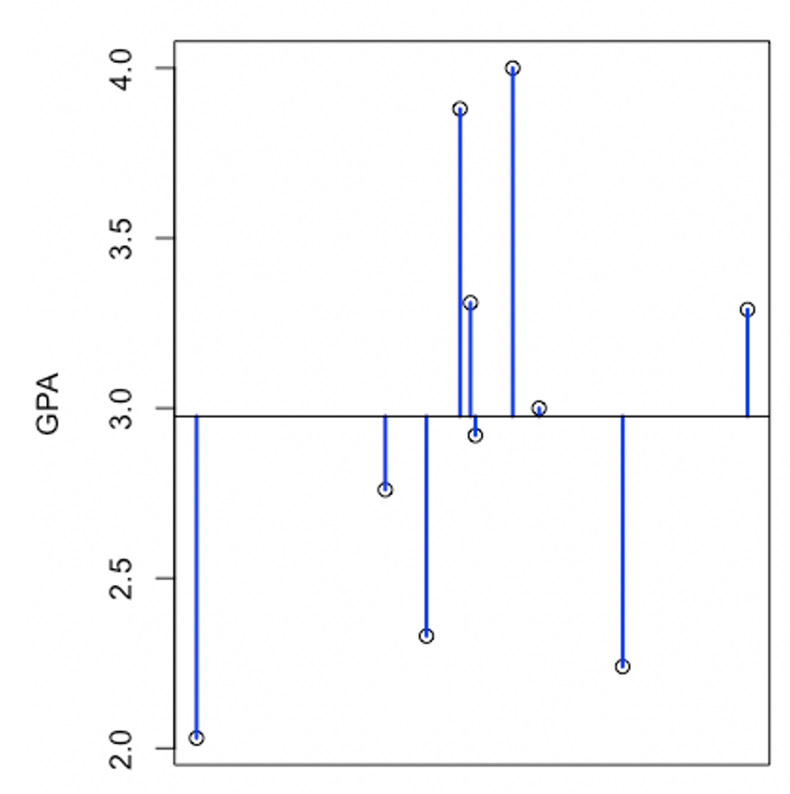{fig-align="center" width="50%" fig-alt="A chart showing each student's distance from the mean using blue lines from each specific data point to the sample mean"}

Above is a chart of each GPA in our data. The black horizontal line represents the average GPA from our sample, 2.97. Each blue line represents the distance (i.e., deviation) between each data point and the sample mean. Recall that, when we calculate the standard deviation for a variable, we sum the squared deviations. The sum of these squared deviations is basically a measure of how dispersed the variable is, and we square and sum these deviations to calculate ***standard*** deviations.

| GPA | Deviation from the mean | Deviation$^2$ |
|:----:|:--:|:--:|
| 4.00 | 4.00 - 2.97 = 1.03 | $(1.03)^2$ = 1.06 |
| 3.31 | 3.31 - 2.97 = 0.34 | $(0.34)^2$ = 0.12 |
| 2.24 | 2.24 - 2.97 = -0.73 | $(-0.73)^2$ = 0.53 |
| 2.92 | 2.92 - 2.97 = -0.05 | $(-0.05)^2$ = 0.003 |
| 2.33 | 2.33 - 2.97 = -0.64 | $(-0.64)^2$ = 0.41 |
| 3.29 | 3.29 - 2.97 = 0.32 | $(0.32)^2$ = 0.10 |
| 3.00 | 3.00 - 2.97 = 0.03 | $(0.03)^2$ = 0.0009 |
| 2.03 | 2.03 - 2.97 = -0.94 | $(-0.94)^2$ = 0.88 |
| 3.88 | 3.88 - 2.97 = 0.91 | $(0.91)^2$ = 0.83 |
| 2.76 | 2.76 - 2.97 = -0.21 | $(-0.21)^2$ = 0.04 |

The middle column in the table above corresponds to the length of those blue lines. Each deviation is just the difference between each individual GPA and the average GPA. Sadly, we can't just add up these deviations to get a "total deviation". That would always add up to 0. The negative deviations will cancel out the positive deviations. To get around this, we square each deviation so that each one is positive. (A negative times a negative is a positive and a positive times a positive is a positive). So, each squared deviation is a measure of the absolute deviation from the mean, though it's not literally equivalent to the absolute value.

The sum of the squared deviations for the GPA data above is 3.98. We can call this "Sum of Squares Total" or "total sum of squares" or "$SS_{Total}$". This number represents the total amount of variation in a variable. Here's $SS_{Total}$ defined with our friend sigma notation:

$$
SS_{Total} = \sum (x_i-\bar{x})^2
$$

The larger $SS_{Total}$ is, the trickier it is to make predictions for a variable. There's more dispersion, more room for error. Remember, $SS_{Total}$ is a measure of how spread out our data are. It's part of the equation for a standard deviation, which itself is a measure of dispersion. So, if your $SS_{Total}$ is smaller, your data are less spread out. With less variability in your data, predictions can be more accurate. Conclusions can be drawn more easily.

## Using a regression line to make predictions

But let's say I have some extra information to help make predictions. In addition to asking everyone's GPA, I asked participants in my study to fill out a self-esteem measure. There turns out to be an observed correlation of 0.36 between GPA and self-esteem.

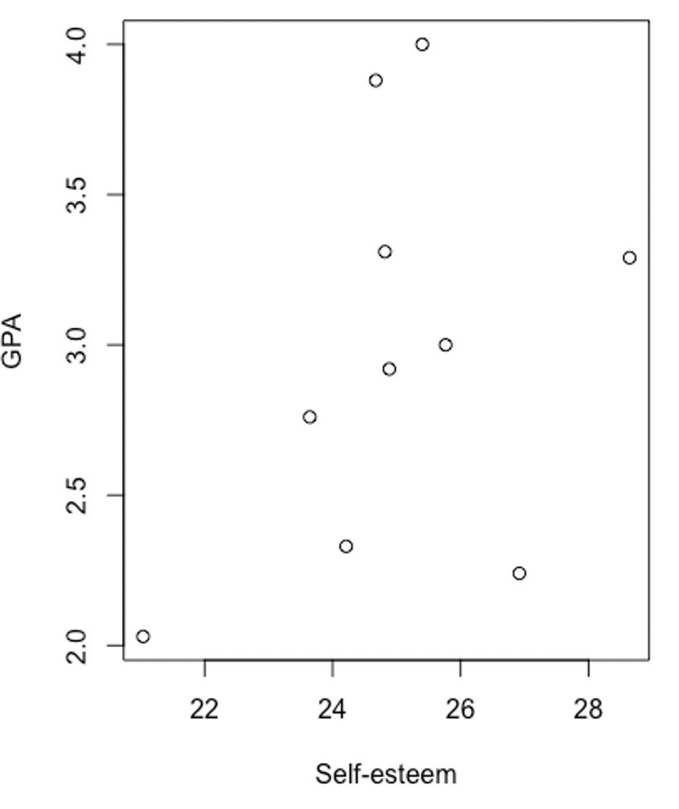{fig-align="center" width="50%" fig-alt="A scatterplot showing the relationship between GPA (y axis) and self-esteem (x axis)."}

Remember from the previous chapter that you can use one variable to predict levels of another variable based on an equation for a line? Here's the regression equation using self-esteem scores to predict GPA:

$$
\text{predicted GPA} = -0.05 + \text{Self-esteem score} \times 0.12
$$

The intercept (-0.05) and slope (0.12) are set to the values that minimize the squared deviations between the resulting regression line and each of the data points.

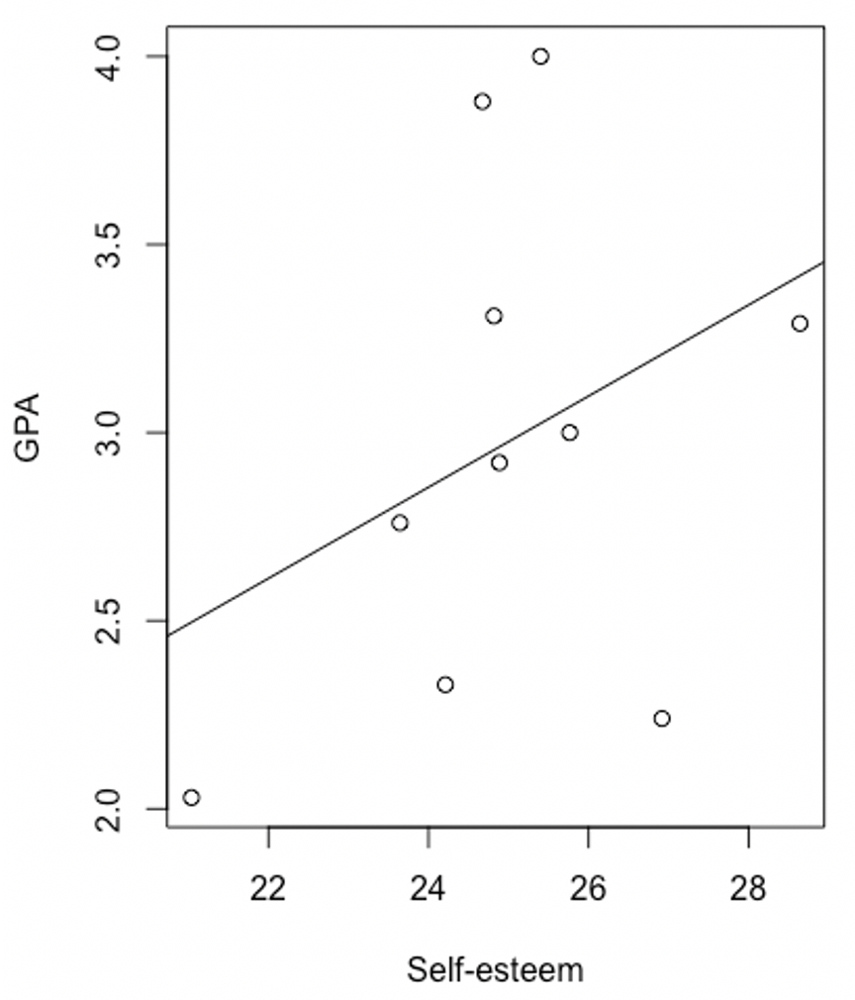{fig-align="center" width="50%" fig-alt="A scatterplot showing the relationship between GPA and self-esteem with a regression line added."}

According to this equation, people's GPA starts at -0.05 when their self-esteem is at zero. This doesn't actually make any sense, but it's just an equation for a line. It has to start somewhere, even if that "somewhere" doesn't exist in a practical setting. The self-esteem scale might not even go as low as zero. What we really want to look at is the slope. According to our regression equation, for every point someone goes up in self-esteem, our prediction for their GPA goes up by 0.12.

There's still a lot of room for error in our predictions. The regression line has a lot of residuals between itself and the individual data points (the red lines in the figure below).

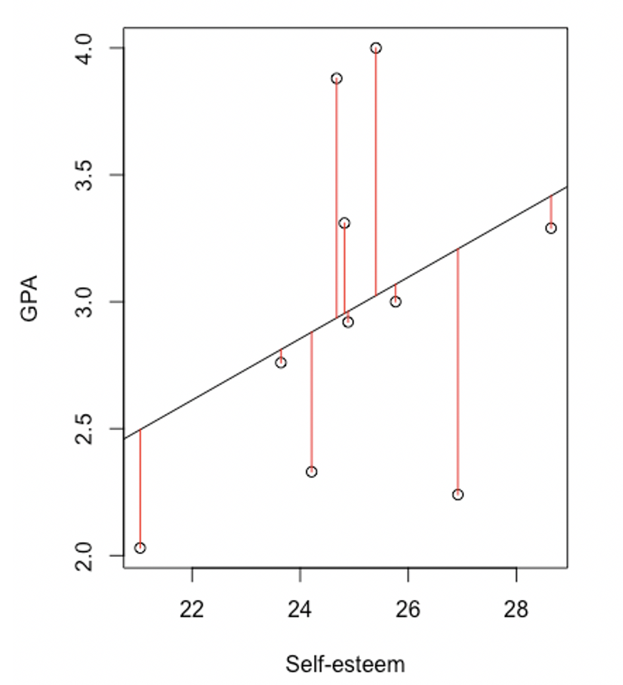{fig-align="center" width="50%" fig-alt="A scatterplot showing the relationship between GPA and self-esteem with a regression line added. Red lines connect each data point to the regression line to show the residuals."}

## Different sources of variance

The crucial question is, what's worse, the total distances between the mean and each point (the blue lines on the plot from before) or the total distances between the regression line and each point (the red lines on the plot up above)? One represents deviations from the sample mean and the other represents deviations from the regression line.

If you had to make a prediction based on the mean or based on the regression line, which will have fewer errors (shorter deviations)?

To answer this question, we'll calculate the sum of squared residuals. This is the distance between the regression line and each data point... squared.

| GPA | Predicted GPA | Residual | Residual$^2$ |
|:----:|:--:|:--:|:--:|
| 4.00 | 3.02 | 4.00 - 3.02 = 0.98 | $(0.98)^2$ = 0.9604 |
| 3.31 | 2.95 | 3.31 - 2.95 = 0.36 | $(0.36)^2$ = 0.1296 |
| 2.24 | 3.21 | 2.24 - 3.21 = -0.97 | $(-0.97)^2$ = 0.9409 |
| 2.92 | 2.96 | 2.92 - 2.96 = -0.04 | $(-0.04)^2$ = 0.0016 |
| 2.33 | 2.88 | 2.33 - 2.88 = -0.55 | $(-0.55)^2$ = 0.3025 |
| 3.29 | 3.42 | 3.29 - 3.42 = -0.13 | $(-0.13)^2$ = 0.0169 |
| 3.00 | 3.07 | 3.00 - 3.07 = -0.07 | $(-0.07)^2$ = 0.0049 |
| 2.03 | 2.50 | 2.03 - 2.50 = -0.47 | $(-0.47)^2$ = 0.2209 |
| 3.88 | 2.94 | 3.88 - 2.94 = 0.94 | $(0.94)^2$ = 0.8836 |
| 2.76 | 2.81 | 2.76 - 2.81 = -0.05 | $(-0.05)^2$ = 0.0025 |

The column furthest to the left holds our GPA scores that we started the chapter with, our data. The next column (predicted GPA) is the GPA predicted by our regression equation. The next column (Residual) is the distance between the actual GPA in our data and the predicted GPA from our regression equation. The last column (Residual$^2$) is just what it sounds like: We square the residuals so that you can add them up. They'd add up to zero if you didn't square them first.

When you sum up the squared residuals, you get 3.46.

We'll call this the "Sum of Squares Residual," "residual sum of squares," or "$SS_{Residual}$." This number represents the amount of leftover variance in the variable (GPA) that is not accounted for by the regression model. In other words, $SS_{Residual}$ represents the amount of misfit between our regression model and the actual data.

$$
SS_{Residual} = \sum{(\hat{y}_i-y_i)^2}
$$

The equation above conveys the idea with math. In words, it'd read something like, "Add up all the squared differences between each predicted y value and each actual y value."

You might remember from earlier that $SS_{Total}$ for this data was 3.98. That means that, overall, there are 3.98 units of variance in GPA that could possibly be accounted for by a model. We know that our regression model accounts for all but 3.46 of those units. Therefore, 3.46/3.98 of the variance in our variable (GPA) is unaccounted for by the model. That's about 87% of the variance in GPA unaccounted for. On the plus side, this means about 13% of the variance ***IS*** accounted for. Or, about 13% of our uncertainty in GPA is reduced when we take our regression model into account.

In general, you can quantify the proportion of variance in the dependent variable that your model is able to account for with the following equation.

$$
R^2 = 1 - \frac{SS_{Residual}}{SS_{Total}}
$$

Let's look back at the total amount of variance in the dependent variable. In the figure below, this is represented by a black line connecting each data point to the overall average GPA.

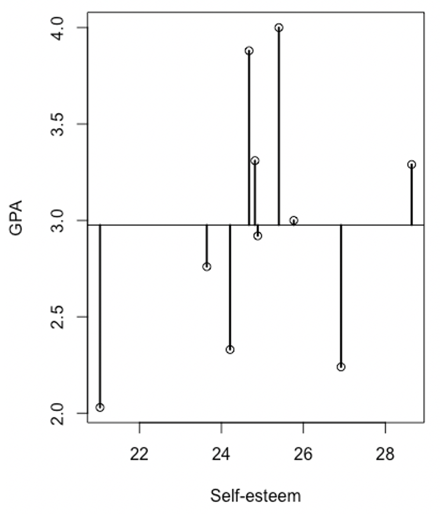{fig-align="center" width="50%" fig-alt="Some data plotted on a scatterplot. Their deviations from the mean are marked with black lines."}

We can separate this "total variance" into two parts: one part that's accounted for by a regression equation using self-esteem to predict GPA, and a second part that the model misses out on (the residuals, "leftovers"). Each black line represents the distance between the data point and the average of all the data points. Now let's put the best fitting regression line over all of this in red.

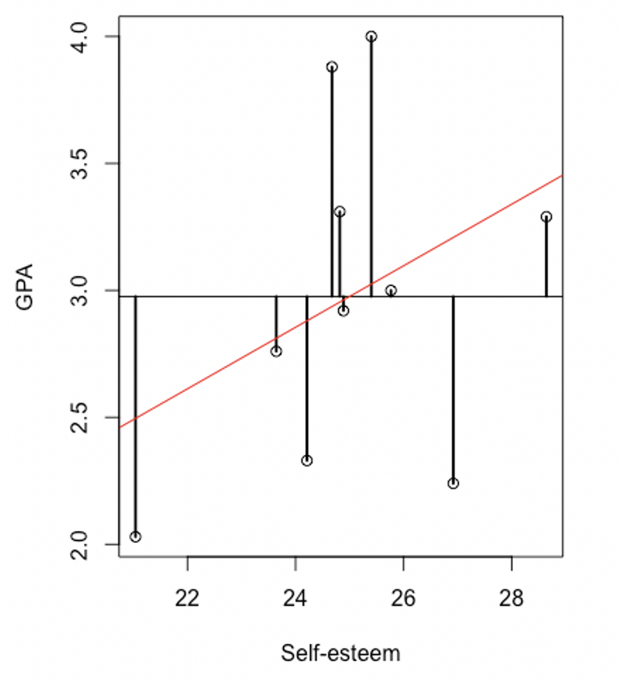{fig-align="center" width="50%" fig-alt="Scatterplot with deviations from the mean marked in black and a regression line in red."}

Each of the black lines can now be split into two components: (1) a piece that's accounted for by the regression model and (2) a piece that the regression model missed. In the figure below, I marked (1) in green and (2) in red.

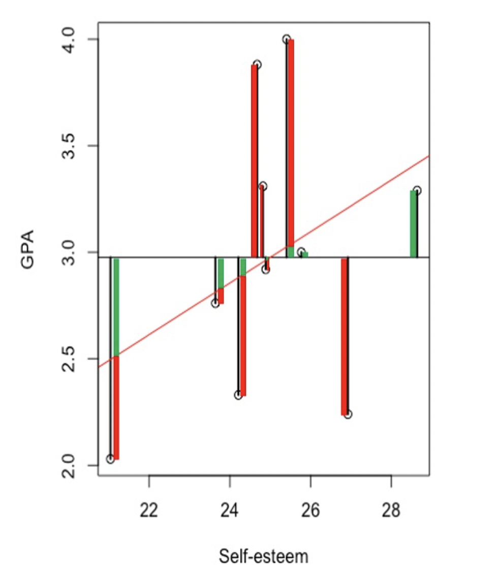{fig-align="center" width="50%" fig-alt="Some data plotted. Each data point is divided into red and green sections. Green sections are parts of the data accounted for by the regression model. Red parts are parts of the data not accounted for by the model."}

So, the black lines represent the total amount of variation that could've been accounted for. Each of those black bars are split into a green part and a red part. The green part is the portion of the total that can be attributed to the model. In other words, the model "accounts for" the green part. The red part is the amount of variance in GPA left "unaccounted for". It's the "residual" or "leftover" variance.

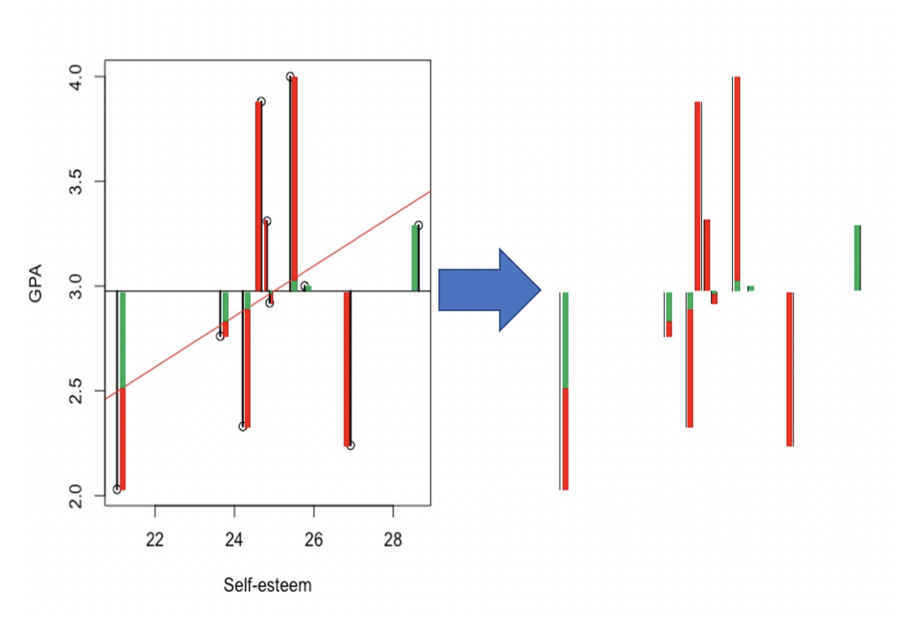{fig-align="center" width="50%" fig-alt="The black (absolute deviation), green (regression accounted for), and red (residual, unaccounted for) lines from the previous plot being removed and separated into sections."}

I'm going to get a little artistic to make an important point. Let's just scooch all these bars off to the side...

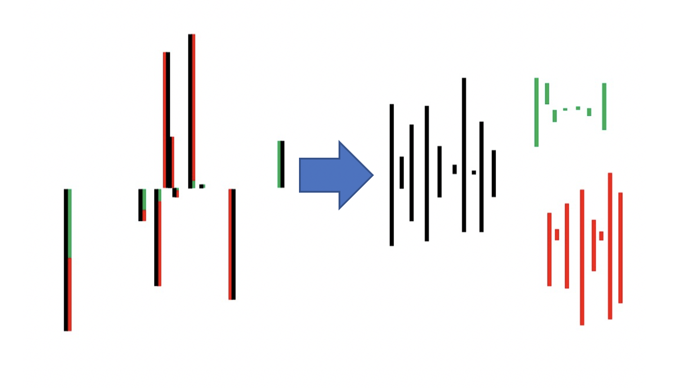{fig-align="center" width="50%" fig-alt="The black, green, and red bars moved off to the side. Black bars show total variance, green bars show variance accounted for by the model, and red bars show variance left unaccounted for."}

We'll slide all the black bars together, all the green bars together, and all the red bars together...

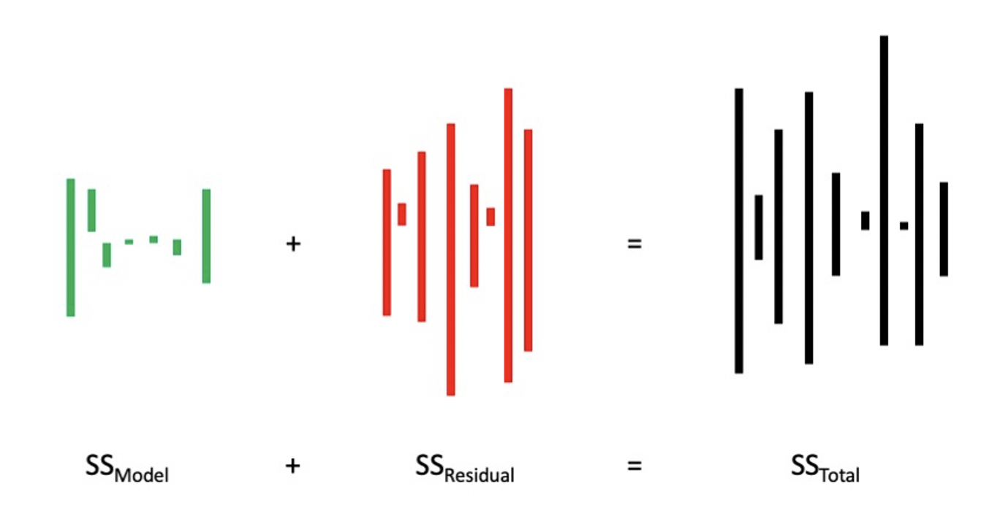{fig-align="center" width="50%" fig-alt="The green, red, and black bars together, which correspond to the sum of squares model, residuals, and total."}

The amount of variance we accounted for with our model PLUS the variance leftover is equal to the total amount of variance. That makes sense, right? By definition, the total amount of variance is composed of the variance that can be accounted for by the model plus anything left over (residual) that is not accounted for by the model.

**Sources of variance**

$$
\text{Model} + \text{Residual} = \text{Total}
$$

Now let's apply that idea to the sums of squares.

$$
SS_{Model} + SS_{Residual} = SS_{Total}
$$

With the GPA data we've been analyzing, this translates to: 0.52 + 3.46 = 3.98. In percentages, that's: (0.52/3.98) + (3.46/3.98) = (3.98/3.98). That's the same thing as 13% + 87% = 100%.

Is that a pie chart I smell?

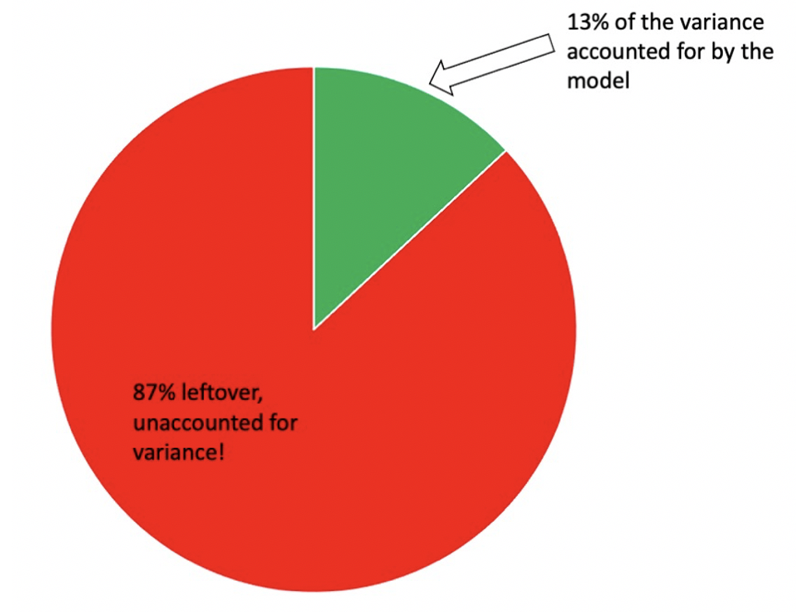{fig-align="center" width="50%" fig-alt="A pie chart showing the proportion of variance accounted for by the regression model versus unaccounted for."}

Another way to think about "variance accounted for" is to think of it as "the degree to which we have reduced uncertainty". Before using the regression model, we had 3.98 whole units of $SS_{Total}$ to work with. That's a whole lot of variance: a lot of room for guesswork and inaccurate predictions. However, once we've taken self-esteem (and our regression model) into account, we decrease the total amount of variance by 13%.

We call this "variance accounted for" in a model "$R^2$". You can derive $R^2$ from a simple correlation coefficient by squaring that coefficient. Remember when I said the correlation between GPA and self-esteem in our data was 0.36? $0.36^2 = 0.13$.

Another way to look at it is "the degree to which my model can be accurate is the degree to which it avoids being inaccurate". The fewer residuals (inaccuracy), the better! The higher $R^2$ is, the smaller ($1 - R^2$) will be: 13% of the variance is accounted for by the model, but 87% is left unaccounted for.
