# Differences between sample means

In this chapter, we're going to cover two new statistical tests. Both of them are used to test whether a collection of sample means are statistically different from one another. The first one, the independent samples *t*-test, is used to determine whether two sample means are different from one another. For instance, you could use an independent samples *t*-test to determine whether the control group experienced less pain on average compared to a group that used magic crystal healing. For analyses of variance (ANOVAs), you can do the same thing, but with more than just two groups. So, for instance, you could see which group experienced different levels of pain: a placebo group, a group that used magic crystal healing, and a group that took some pain medicine.

## Independent samples *t*-test

An independent samples *t*-test is used when you want to determine whether there's a difference between two sample means drawn from independent groups. You don't know the population mean of either group or the population standard deviation.

This contrasts with a one sample *t*-test. In a one sample *t*-test, you know the population mean and you want to determine whether a sample mean is significantly different from the population mean. In an independent samples *t*-test, you are comparing two sample means from two separate groups.

Examples of situations where you'd use an independent samples t-test:

* Math scores for a group of students given coffee before the math test versus a control group of students who had no coffee before the test.
* Beck Depression Inventory (BDI) scores for people who are currently receiving therapy versus BDI scores from people drawn from the same population but who are currently on a wait list to receive therapy.

In both of these examples, we don't know the population mean (or population standard deviations) for either group. We have no idea how people tend to score on this math test, let alone how widely dispersed the scores will be. We have no idea what the population average BDI score is. We're having to estimate two means and two standard deviations from two independent samples. Hence the name: "Independent samples *t*-test".

One thing I must emphasize is that the two groups must be ***independent*** for an ***independent*** samples *t*-test to be appropriate. The scores from one group can't be related to or correlated with scores in another group. If I asked the same group of students to take a math test without coffee and then take the same math test again but WITH coffee, those two sets of test scores wouldn't be independent. Each person's test score on the second test will be correlated with their test score on the first test.

### Hypothesis testing with independent samples *t*-test

The null hypothesis ($H_0$) for an independent samples *t*-test is that there is no difference between the two population means. In other words:

$$
H_0: \mu_1-\mu_2 = 0
$$

Where $\mu_1$ is the population mean for group 1 and $\mu_2$ is the population mean for group 2. We estimate these with the sample means, $\bar{x}_1$ and $\bar{x}_2$.

To test this hypothesis, we need a distribution representing the probabilities of observing differences between sample means. For this, we'll use the *t*-distribution.

$$
t=\frac{\bar{x}_1-\bar{x}_2}{SEDBM}
$$

The numerator for our *t*-value here is straightforward. It's the distance between the two sample means. The denominator (SEDBM) stands for "standard error of the differences between means." This is very similar to the standard error we met before with the sampling distribution of sample means. Here, though, we're asking, "What would happen if we kept drawing samples of the same size from these two distributions and looked at the difference between them over and over again?" If you kept sampling and kept recording the differences, you'd get a distribution of differences. If the real difference is zero, then our t values are going to tend to be close to zero. If there really is a difference between the two groups, then our t-values will tend to be greater than (or less than) zero.

$$
SEDBM= \sqrt{\frac{s^2_1}{n_1}+\frac{s^2_2}{n_2}}
$$

Where $n_1$ is the sample size for the first group and $n_2$ is the sample size for the second group. The numerators are the variances for groups 1 and 2. The variance is the standard deviation squared. A computer is probably going to crunch these numbers for you, but I just thought you'd like to see it : )

"SEDBM" is the standard deviation of the distribution of differences between the two means. This is a complicated idea, so I'll elaborate: You should already understand what a sampling distribution of sample means is. If you don't, go back and re-read that chapter or email me. It's a very important concept.

The sampling distribution of the sample mean is the distribution of sample means you'd get if you kept drawing random samples of the same size from the population distribution over and over again. Most of these sample means are going to be close to the population mean, but some are going to be slightly higher and slightly lower. With an independent samples *t*-test, we're talking about a sampling distribution of ***differences*** in sample means.

Imagine I kept drawing sample means from population distribution #1. I also kept drawing sample means from population distribution #2. For each of these sample means, I calculate the difference between them. I keep collecting two samples, calculating the sample means, and then calculating the difference between those two sample means over and over. All of these differences between sample means will have a distribution. Some differences are more common than others.

According to the null hypothesis, the most common difference between sample means should be 0, or something close to 0. A *t*-score of 0 means there's no difference between our sample means. Will we observe a difference between sample means so large that, when you assume the null hypothesis is true, the probability of observing our difference is less than 5%? If the answer's "yes", you reject the null hypothesis. If the answer's "no", then you have to retain the null hypothesis.

### A worked example

Let's say we have two groups of men, 5 men per group. They're all going to go through a gauntlet of speed dating. Afterwards, we're going to ask all of their "dates" to rate each man in the study for attractiveness on a scale of 0 to 100, 100 being the most attractive. Before each man goes into the gauntlet, we flip a coin. If it lands heads, we give him a cup of coffee to drink before speed dating. If it lands tails, we give him a can of Monster energy drink to drink before speed dating.

| Coffee drinkers | Monster drinkers (Unleash the beast!) |
|:----:|:--:|
| 72 | 91 |
| 38 | 100 |
| 61 | 69 |
| 50 | 67 |
| 28 | 100 |

: Attractiveness ratings

The sample mean of attractiveness ratings for the coffee drinkers was 49.8 (*SD* = 17.56). The sample mean of attractiveness ratings for the Monster drinkers was 85.40 (*SD* = 16.32). We're going to test whether this difference (with this small of a sample!) is large enough to reject the null hypothesis. The null hypothesis is that *t* = 0. *t* represents the distance between the two sample means (in standardized units).

$\bar{x}_1-\bar{x}_2$, in this sample = 49.8 - 85.40 = -35.6. So, there's a difference of 35.6 attractiveness points between our two sample means. These are just sample means though, and they come from a very small sample at that. Therefore, there's a lot of uncertainty associated with these estimates. There's a lot of room for sampling error. When there's a lot of room for sampling error, you're at risk for drawing incorrect conclusions.

That's part of the reason why we calculate SEDBM: How many standard deviations away from 0 is our observed difference in the sampling distribution of differences between means?

In the present sample, SEDBM comes out to 10.72. That means the sampling distribution of differences between sample means, with a sample of this size, has a standard deviation of 10.72. It's very spread out.

Our *t*-value is -35.6 / 10.72 = -3.32. That means our observed difference between sample means here is more than three standard deviations below the center of the null-hypothesized sampling distribution.

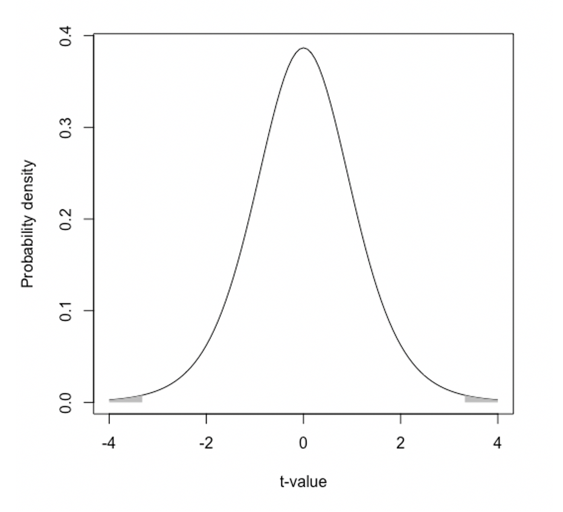{fig-align="center" width="50%" fig-alt="The t-distribution with values below -3.32 or above 3.32 shaded in."}

Above is a picture of the *t*-distribution with 8 degrees of freedom (Total sample size minus 2). The null hypothesis says that *t*-values around 0 are most common. The further away from zero you get, the less likely that *t*-score is. We observed a *t*-score of -3.32. The probability of observing a *t*-score that low (or lower) is 0.527%. That's less than 1%.

Since we need to do a two-tailed test, we also have to think about getting a score as high as 3.32 (or higher than that). That probability is also 0.527%. The total probability of observing a t value as high or higher (in absolute value) as the one we observed, when you assume the null hypothesis is true, therefore, is 0.527% x 2 = 1.05%. That's still less than 5%. We can reject the null hypothesis.

We would write up the results in APA style as follows. "There was a statistically significant difference between the attractiveness ratings of the coffee drinkers (*M* = 49.8, *SD* = 17.56) and the Monster drinkers (*M* = 85.40, *SD* = 16.32), *t*(8) = -3.32, *p* = .011."

## Cohen's *d*

If I tell you that graduating seniors have, on average, a 0.16 Kerplunk score compared to incoming freshman, would you be impressed? You have no idea what to make of this, actually. You don't know enough about Kerplunk scores to tell if 0.16 is a big difference. What if I told you there was a 16 point difference? That might sound bigger, but if "Kerplunk score" turned out to be some weird slang for "SAT score", then 16 points doesn't sound so big anymore. (SAT scores can range from 400 to 1600.)

That's why people developed things like *z*-scores. They're standardized. They have a uniform meaning across different measurement scales. For the difference between means, we report the size of the difference via Cohen's *d*:

$$
d= \frac{\bar{x}_1-\bar{x}_2}{s_{pooled}}
$$

In other words, it's the distance between the group means divided by the combined (or "pooled") standard deviation of the two groups. There are different ways to "pool" the data for this purpose, and it can get kind of hairy if the group sizes aren't the same.

Which values for Cohen's *d* are considered small, medium, or large? To answer this question, people traditionally cite a dusty old book written by Jacob Cohen himself, who Cohen's *d* is named after. He wrote that a Cohen's *d* of 0.2 is small, 0.5 is medium, and 0.8 is large. Cohen also stressed that people shouldn't take these values to be true in every context and they should work to make sure the units of measurement and variables they're using have some inherent meaning outside of themselves. We shouldn't just blindly trust some arbitrary numbers divorced from context to decide what's "big" or "small". No one listened.

It's a shame no one listened. A Cohen's *d* of 0.8 in a study on treatments for sudden, terminal diseases might be "small" because something much more effective is needed. And a Cohen's *d* of 0.2 might be huge if it's associated with a cheap, easily administered treatment that could save thousands of lives when we zoom out to a population scale.

## Familywise error rates

So far, we know how to test whether there's a statistically significant difference between two sample means. But what if we want to test whether there's a difference among 3 or more sample means? Let's say you have Group 1, Group 2, and Group 3. You might think it's okay to just do three *t*-tests: Group 1 vs. Group 2, Group 1 vs. Group 3, and Group 2 vs. Group 3.

There's a problem with this approach. Doing this many tests on the same data increases something called "familywise error rate." When you conduct a single test on your data set, you choose your probability of committing a type 1 error, 5%. When you do multiple tests on the same data, this error rate increases. Think of it like this. Every time you do a statistical test on your data, you're pulling the bar on a slot machine. There's always a 5% chance the slot machine is going to tell you that you have a statistically significant result when it shouldn't have. The theory and calculations behind our tests assume you're going to pull that arm once. But if you sat there and pulled it over and over again, you're not going to have a stable 5% chance of a type 1 error the whole time. You're increasing the chances of eventually getting a false positive.

Let's say you have a hypothesis: Honors students end up reporting greater satisfaction a few years after graduating college compared to non-honors students. This would usually be tested with a single independent samples *t*-test, comparing sample means of satisfaction between the two groups. What if your hypothesis isn't confirmed though, and there's no statistically significant difference between the two groups? Some researchers might be stubborn and say, "Well, business majors aren't really in it for the learning. They only joined honors to pad out their resume. If you do a t-test on satisfaction for honors vs. non-honors students only on non-business students, I bet you'll see a difference then." You just pulled the arm on the slot machine again, almost as if you're begging it to give you a type 1 error.

Reasoning like this can go on and on. You can keep trying the same test on different sub-groups in your data or use different statistical analyses altogether. Practices like these (multiple, improvised testing on the same data set) increase the familywise error rate. Think of all the tests you conduct on your data as a family. Usually, in simple cases like in all of the examples I've used in this book so far, there's only one member in this family: one statistical test. The probability that this member's going to deliver you a type 1 error is 5%. In other words, there's a 5% chance this one family member will say you can reject the null hypothesis when you shouldn't have. But if you keep doing multiple tests on the same data, that error rate increases.

The type one error rate is usually set to .05 (5%) and represented with the Greek letter "alpha" ($\alpha$).

$1 - \alpha$ = .95 (95%). When the null hypothesis is true, the probability of correctly retaining it is 95% when you're doing just one test on your data. We'll call this the "correct retention rate" (CR for short).

Let's say the number of tests you're going to run on your data set is represented by the variable *n*. Your type 1 error rate ($\alpha$) is...

$$
\alpha = 1 - (CR)^n
$$

When *n* = 1...

$$
\alpha = 1 - (.95)^1 = 1 - .95 = .05
$$

If you're going to do 2 tests (*n* = 2) on your data, then...

$$
\alpha = 1 - (CR)^2 = 1 - (.95 \times .95) = 1 - .9025 = .0975
$$

That's 9.75%. In other words, there's almost a 10% chance that you'll get a type 1 error when you perform 2 statistical analyses on the same data.

| Number of tests (*n*) | Type 1 error rate |
|:--:|:---:|
| 1 | 0.050 |
| 2 | 0.098 |
| 3 | 0.143 |
| 4 | 0.185 |
| 5 | 0.226 |
| 6 | 0.265 |
| 7 | 0.302 |
| 8 | 0.337 |
| 9 | 0.370 |
| 10 | 0.401 |

As you can see from the table above, your type 1 error rate gets bigger and bigger as you apply more tests on the same data set.

## One-way between subjects ANOVA

To solve this problem, we would conduct an Analysis of Variance (ANOVA). An ANOVA can actually take on very many different forms. For now, we're going to learn how to do the most basic kind: a one-factor (or "one-way"), between-subjects ANOVA. We say an ANOVA has one factor (or is "one-way") when there's only one independent variable. We say it's "between-subjects" because the sample means are based on separate groups of people. If we were to base our sample means on making multiple observations from the same group of people at different time points (like a "before" and "after" test), we would have to use a different kind of test.

Let's look at the speed dating example from earlier but with an extra group, some non-coffee drinkers.

| Non-coffee drinkers | Coffee drinkers | Monster drinkers (Unleash the beast!) |
|:--:|:----:|:--:|
| 67 | 92 | 73 |
| 89 | 58 | 83 |
| 45 | 81 | 51 |
| 55 | 70 | 49 |
| 78 | 48 | 84 |

: Attractiveness ratings

**Our ANOVA is going to tell us whether there is at least one statistically significant difference among these three groups.** It's not going to tell you which group is higher or lower than which other groups. It's only going to tell us whether there is at least one difference somewhere among the means. This is called an omnibus test: It's just a general, "There's at least one statistically significant difference among these group means" test.

To conduct an ANOVA, you need to know how much total variance in the dependent variable (attractiveness ratings) there is.

$$
SS_{Total} = \sum(x_i-\bar{x}_{Grand})^2
$$

Here $\bar{x}_{Grand}$ is the grand mean, the overall average across all groups in the data set. The grand mean for the current data set is 68.2.

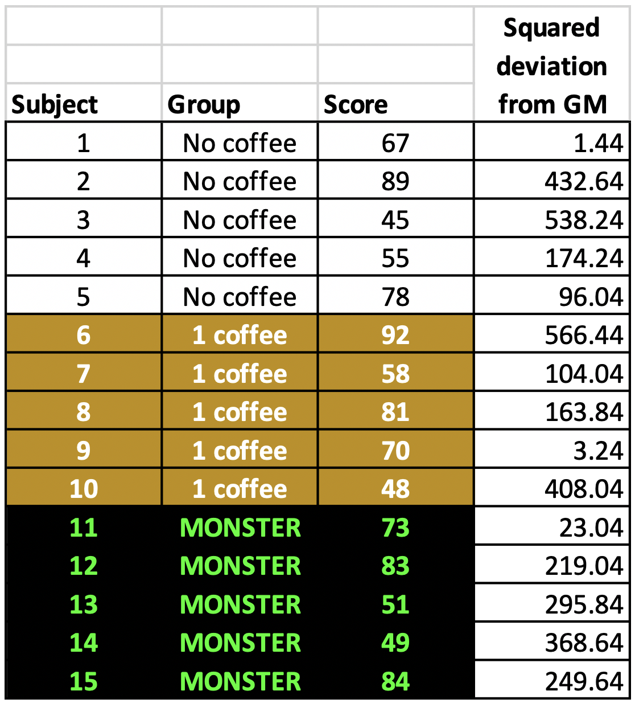{fig-align="center" width="50%" fig-alt="A table showing some hypothetical data."}

In the table above, we see the squared deviation of each score from the grand mean. When we add all of these together, we get $SS_{Total}$.

$$
SS_{Total} = \sum(x_i-\bar{x}_{Grand})^2 = 3644.4
$$

Just like with regression, $SS_{Total}$ represents the total amount of variation in the dependent variable that could possibly be accounted for.

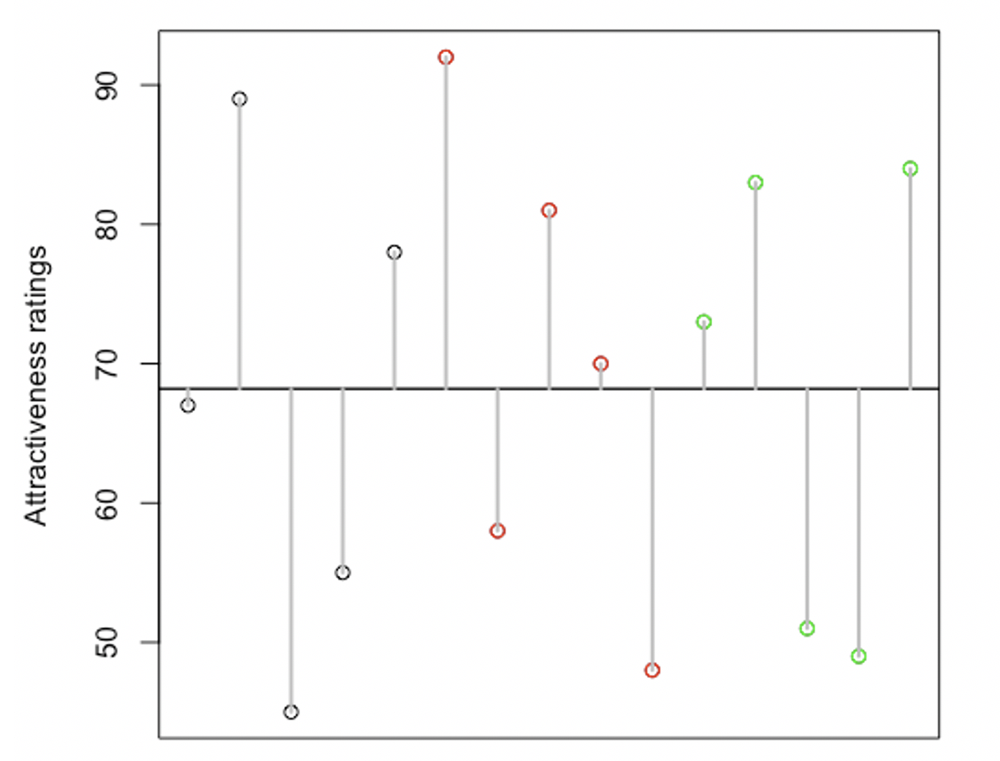{fig-align="center" width="50%" fig-alt="Data from the hypothetical coffee study plotted with their deviations from the grand mean marked in gray."}

In the figure above, I've got the 5 attractiveness ratings for non-coffee drinkers as black circles, the 5 attractiveness ratings for coffee drinkers as red circles, and the 5 attractiveness ratings for Monster drinkers as green circles. The distance between each data point and the grand mean (the horizontal black line) is marked with a gray line. If you square the distance of all these gray lines and add them up, you get the total sum of squares.

We want to know what's better, predicting someone's attractiveness rating based on the grand mean (disregarding which group they came from) or predicting someone's attractiveness rating based on which group they came from (non-coffee drinkers, coffee drinkers, or Monster drinkers).

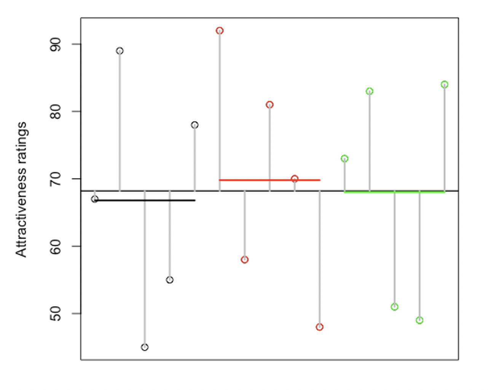{fig-align="center" width="50%" fig-alt="Same as before but with the group means marked with horizontal lines."}

I've placed the group mean for each group into the plot as colored horizontal lines. The average for non-coffee drinkers is 66.8. That's very close to the grand mean of 68.2. That's why the horizontal black line representing the group average for non-coffee drinkers is JUST below the grand mean. The group mean for the coffee drinkers is 69.8. That's why the red line representing the mean for just coffee drinkers is just above the grand mean. Finally, the group mean for the Monster group is 68, so the green line representing just that group mean is JUST below the grand mean.

Hopefully you can see that knowing which group someone is from (non-coffee, coffee, or Monster) doesn't give you much added information compared to the grand mean. All the group means are very close to the grand mean. Your predictions won't get much better if you considered group membership.

In regression, we calculated the amount of variation "accounted for" by the regression model by looking at the distance between the model's predictions and the actual data. Similarly, with ANOVA, we're going to look at the distance between each group and the grand mean.

$$
SS_{Model} = \sum n_k(\bar{x}_k-\bar{x}_{Grand})^2
$$

Here "k" is an index for each individual group. If we're talking about the first group in a series, then k = 1. If we're talking about the second group in a series, then k = 2, and so on. $\bar{x}_k$ is the group mean for a specific group.

In the current example, $SS_{Model}$ comes out to...

$$
5(66.8-68.2)^2 + 5(69.8-68.2)^2 + 5(68-68.2)^2 = 22.8
$$

That means 22.8 of the total 3644.4 is "accounted for" by knowing which group someone came from. That's only 0.63% of the overall variance! We're not even accounting for 1%!

To finish our ANOVA, we'll need to calculate $SS_{Residual}$, which is our "unaccounted for" or "leftover" variance. Since $SS_{Total} = SS_{Model}+SS_{Residual}$, we can do some simple re-arranging and deduce that $SS_{Residual} = SS_{Total} - SS_{Model}$. With our current data, this comes out to...

$$
3644.4 - 22.8 = 3621.6
$$

That's a lot of leftovers.

Here's a more labor-intensive way to calculate $SS_{Residual}$ just in case you like spending your time that way:

$$
SS_{Residual} = \sum_k \sum_i (x_{ik}-\bar{x}_{k})^2
$$

In other words, we want to know how much each individual data point ($x_{ik}$) deviates from their own group mean ($\bar{x}_k$).

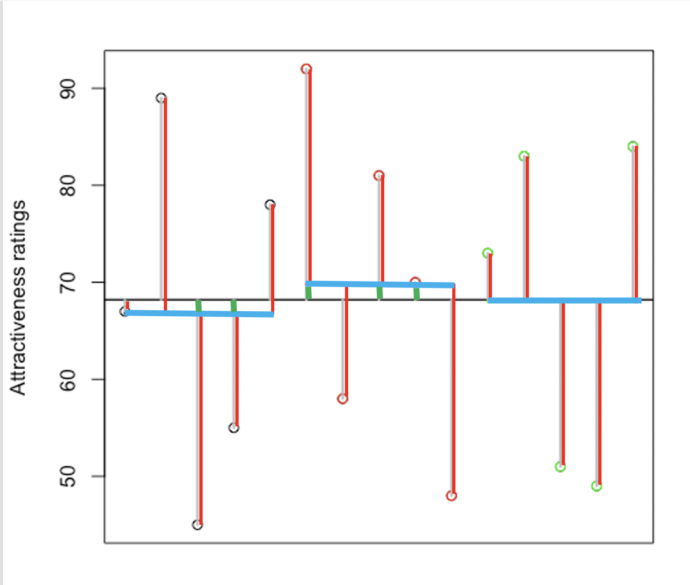{fig-align="center" width="50%" fig-alt="Same as before, but the difference between each group mean and each data point is marked in red."}

In the figure above, I've put all the group means (which the ANOVA model uses to make predictions) in blue. The horizontal black line running across the whole plot is the grand mean. Remember, each group mean in our data set ended up being very close to the grand mean, so knowing which particular group someone came from doesn't actually help that much with predicting how attractive they were in the speed dating gauntlet.

Each observation (attractiveness rating) deviates from the grand mean to some degree. I split each of these total deviations into two parts. The red part is missed by the model (residuals). The green part, which is hard to see, marks where the model improved predictions relative to just using the grand mean to make predictions. As you can see, using the ANOVA model to make predictions only slightly improved predictions in some cases, but actually made predictions worse in other cases. For some people, the grand mean was a closer prediction of their attractiveness than their group mean.

### Eta-squared

To report the effect size of a one-way ANOVA, we use Eta-squared ($\eta^2$) instead of Cohen's *d*. Thankfully, eta-squared is easier to calculate:

$$
\eta^2= \frac{SS_{Model}}{SS_{Total}}
$$

That's it! Eta-squared represents the proportion of variance "accounted for" by the model. You might be thinking, "Wait a minute! I thought $R^2$ from Chapter 4 is interpreted as the proportion of variance 'accounted for' by the model!" You're right. They both mean the same thing! Things get more complicated when you add more variables into the model, but for now (with only one IV and one DV) life is simple!

### ANOVA Tables

When you have your $SS_{Total}$, $SS_{Model}$, and $SS_{Residual}$ values calculated, you're ready to take the next steps towards that omnibus test: a test of whether there is at least one statistically significant difference among the 3+ group means you are analyzing.

We use an ANOVA table to break down the different sources of variation in our dependent variable:

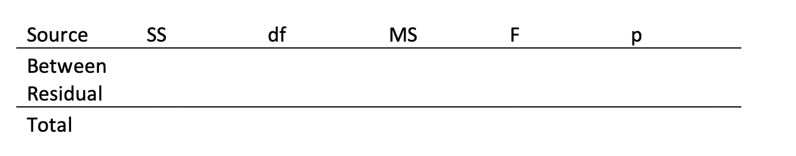{fig-align="center" width="50%" fig-alt="An empty ANOVA table."}

The column all the way to the left labels the source of variation. The rest of the columns are empty for now. The "SS" column stands for "Sum of squares." This will display how much variation in the dependent variable there is overall ($SS_{Total}$), how much of the variation can be accounted for by using the ANOVA model ($SS_{Model}$), and leftover variation that the ANOVA model didn't account for ($SS_{Residual}$). Note that I've called the "Model" part as "Between". I was following the traditional naming for ANOVA, but they're really the same thing.

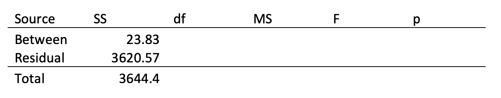{fig-align="center" width="50%" fig-alt="An ANOVA table with just the sum of squares filled in."}

Now I've added in the information we calculated above. Note that $SS_{Model}$ and $SS_{Residual}$ must always add up to $SS_{Total}$.

Next, we're going to divide each of these SSs by their respective degrees of freedom to obtain a "Mean square deviation" ("MS" for short). Degrees of freedom for $SS_{Model}$ is the number of groups minus 1. Here, we have 3 groups, so $df_{Between}$ = 2. The degrees of freedom for $SS_{Residual}$ is the number of observations in the sample minus the number of groups. We have 15 observations and 3 groups, so $df_{Residual}$ = 12. Finally, the degrees of freedom for $SS_{Total}$ is the total number of observations in the data minus 1. $df_{Total}$, therefore, will equal 14. Note that, like the sum of squares, the degrees of freedom for the between-group and residual variance add up to the total degrees of freedom.

To fill in the "MS" column, we simply divide each sum of squares by its degrees of freedom. We're not going to need the total mean squared deviations, though, so we'll leave that out.

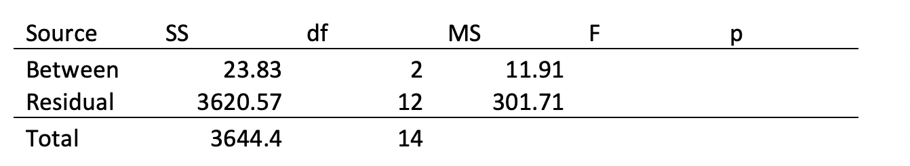{fig-align="center" width="50%" fig-alt="An ANOVA table with everything but the F and p-value filled in."}

The last two things we're going to calculate are the *F*-value and a *p*-value. The *F*-value is a test statistic much like a *z*-score or *t*-score. We're going to end up placing our observed *F*-value on an *F*-distribution to see how likely it is that we'd observe an *F*-value as high (or higher) as the one we did from our data when the null hypothesis is assumed to be true. The *F*-value represents how much of the total variation in the dependent variable is "accounted for" by knowing which group the observations came from. In other words, if there are large differences among at least some of the group means, then the *F*-value will be large. If all the group means are close together, then the *F*-value will be small. The *p*-value means the same thing it always has: It's the probability of observing an effect as large (or larger) as the one we did when you assume the null hypothesis is true.

Remember how *t*-distributions change their shape based on degrees of freedom? Well, *F*-distributions change shape too, but they have TWO separate degrees of freedom: one for the numerator ($MS_{Model}$ or $MS_{Between}$, same thing) and one for the denominator ($MS_{Residual}$). In our example, we want an *F*-distribution with a numerator degrees of freedom equal to 2 and a denominator degrees of freedom equal to 12. In APA style, we'd present this as: "*F*(2, 12)."

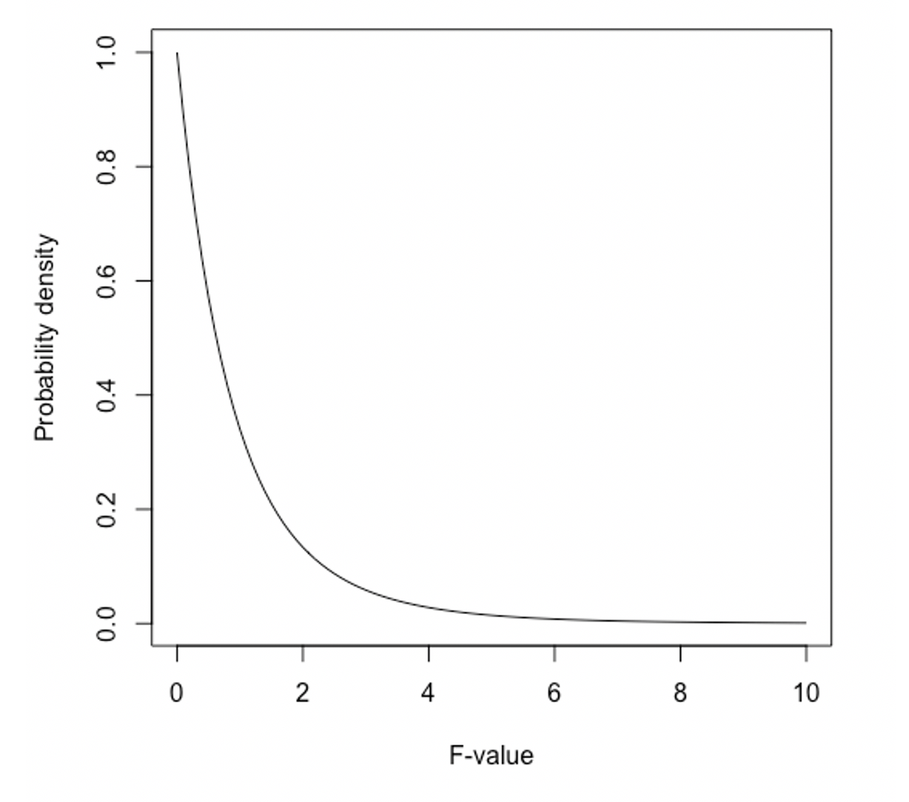{fig-align="center" width="50%" fig-alt="An example of the F-distribution"}

Here's what an *F*-distribution with 2 and 12 degrees of freedom looks like. Unlike the other distributions we've seen, the *F*-distribution only takes on positive values. An *F*-value of 0 is most likely, when you assume the null hypothesis is true. An *F*-value of 0 means there's no difference between the group means. The higher the difference between the means get, however, the higher the *F*-value gets. We can see from our distribution here that, according to the null hypothesis, *F*-values around 1 can sometimes be expected (while assuming the null hypothesis is true), but *F*-values of 4 (or more) are very unlikely... when you assume the null hypothesis is true. If the *F*-values get too high, we'll end up deciding that the null hypothesis just isn't plausible and reject it.

So, how do we calculate our own *F*-value for our data so we can see where it falls on this distribution? Easy.

$$
F = \frac{MS_{Model}}{MS_{Residual}}
$$

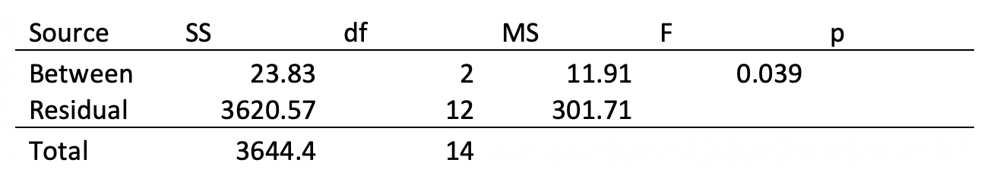{fig-align="center" width="50%" fig-alt="An ANOVA table with everything but the p-value present."}

In our ANOVA table, that's $\frac{11.4}{301.8} = 0.038$.

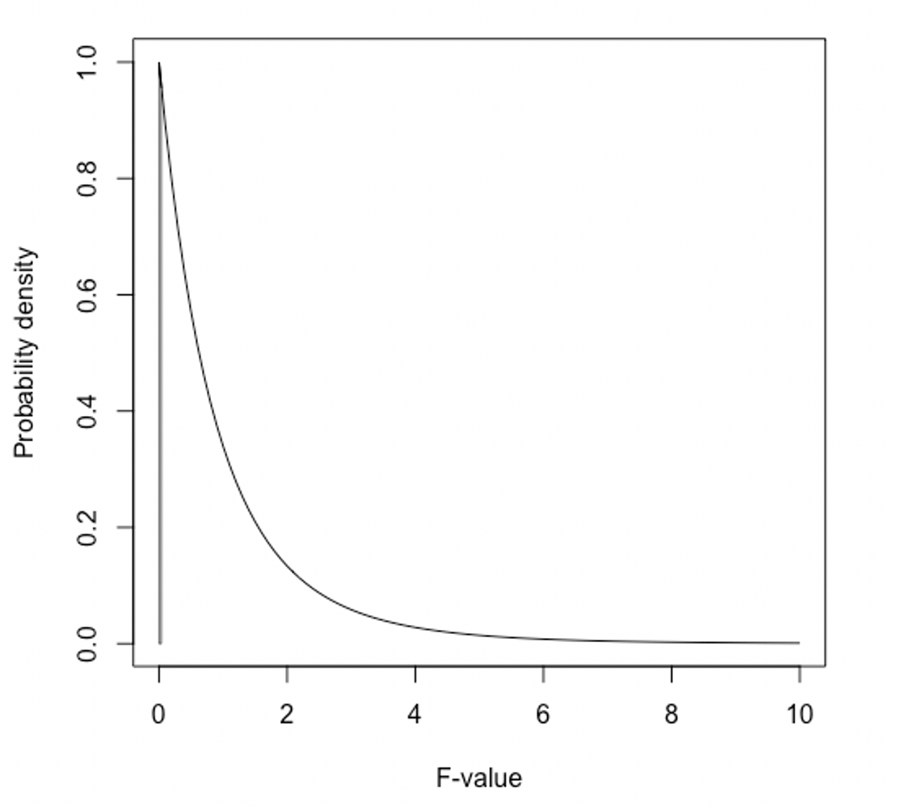{fig-align="center" width="50%" fig-alt="An example of an F-distribution with everything of 0.038 or below marked in gray."}

I shaded in the area under the curve on our F-distribution where *F* = 0.038 (or lower), but I don't know if you can even tell. An *F*-value of 0.038 only cuts off the bottom 4% or so of the F-distribution. The upper 96% of the distribution is untouched. In other words, there is about a 96% chance of observing an *F*-value as high as (or higher than) the one we observed when you assume the null hypothesis is true. And in this case, it definitely looks like the null hypothesis is true. We cannot reject it.

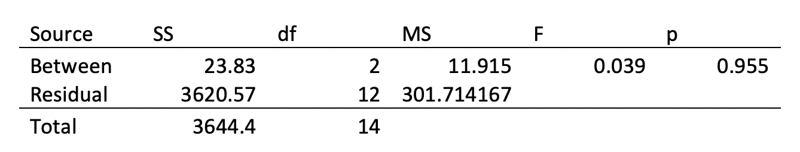{fig-align="center" width="50%" fig-alt="A full ANOVA table."}

### Another example

The example above with the three groups going on a speed dating gauntlet was all fine and good. But now we need to talk about what to do if your omnibus ANOVA *p*-value is actually less than .05. Let's take the same scenario but change the numbers.

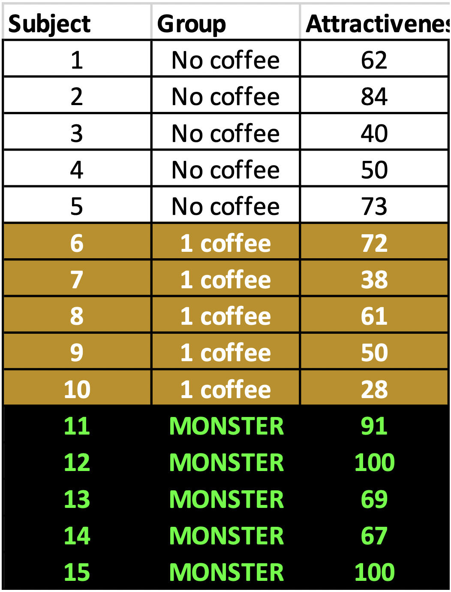{fig-align="center" width="50%" fig-alt="Some new hypothetical data, with the group means further apart this time."}

With these updated numbers all the sum squares, mean squares, *F*-, and *p*-values come out different. Here's an updated ANOVA table.

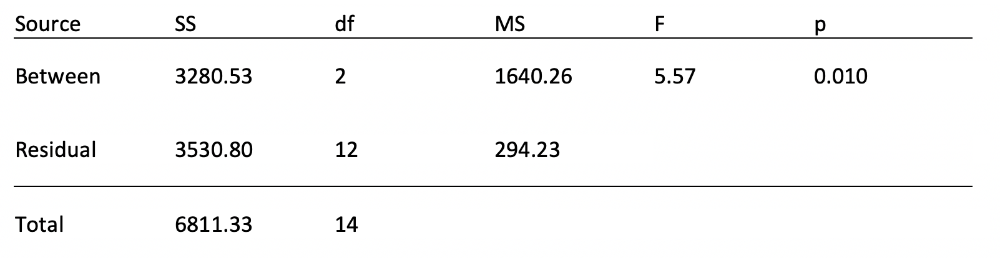{fig-align="center" width="50%" fig-alt="A new ANOVA table based on the new data."}

I made the differences between the groups more pronounced with this new data. Here's an updated plot showing how far each data point (and each group) deviates from the grand mean.

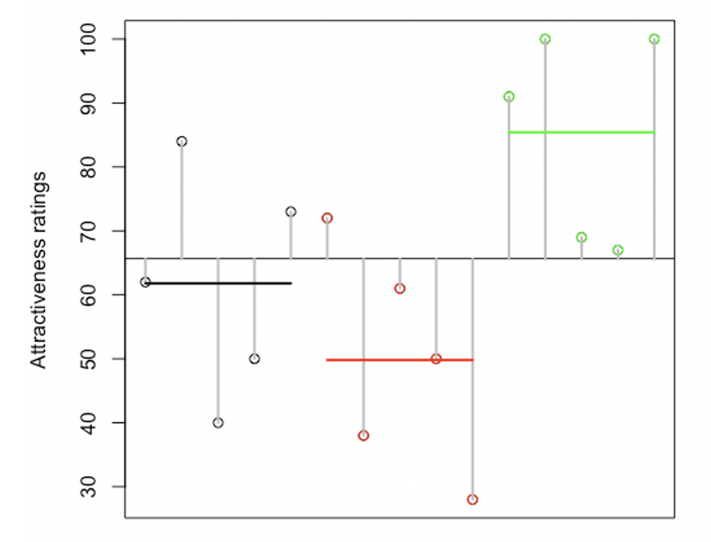{fig-align="center" width="50%" fig-alt="A new plot showing the new data, their deviations from the grand mean, and the group means."}

With these data, it would actually be useful to know what someone drank when predicting their attractiveness, compared to if you were only using the grand mean to make said predictions. With these new numbers, there is a large enough difference among the group means that our *F*-value is going to dramatically increase, so much so that the *p*-value for the overall ANOVA is .019. The results are therefore statistically significant. You can conclude that the null hypothesis is false. In other words, there probably is at least one statistically significant difference among all the sample means.

### Post-hoc, follow-up analyses

Once you've rejected the omnibus null hypothesis, you are allowed to do what are called "*follow-up*" or "*post hoc*" hypothesis tests. You can go and test which specific pairs of sample means are significantly different from one another. This could be done with *t*-tests, but we don't want to risk inflating our familywise error rates. That was one of the reasons we started talking about ANOVA in the first place.

I'm going to cover one method that tries to assess which of the sample means differ from one another while avoiding increased family-wise error rates. It's probably the simplest method out there, and it does have its problems.

Essentially, any method like this just makes the conditions for achieving statistical significance more stringent. In other words, they make the threshold for reaching statistical significance harder to get to.

The method I'm going to talk about here is the Bonferroni correction. Basically, it takes the old alpha level ($\alpha$), which is usually set at .05, and divides it by the number of tests you are going to run. In our case, we want 3 tests:

* Coffee-free people vs. coffee people
* Coffee-free people vs. Monster people
* Coffee people vs. Monster people.

So, our Bonferroni-corrected alpha level is $\frac{.05}{3} = .01667$. Therefore, each of the three t-tests have to reach a *p*-value of .01667 or lower to be considered statistically significant rather than the typical .05.

When using the Bonferroni correction, we end up finding that the coffee group is significantly lower in attractiveness ratings compared to the Monster group, but we can't conclude that there are any other differences between these groups. There is no statistically significant difference between the coffee group and no-coffee group.

The biggest issue with using the Bonferroni correction is that it unfairly punishes you for conducting lots of follow-up tests. You might have 6 very legitimate tests to run, but .05/6 = 0.008... That's a pretty stringent threshold for statistical significance. fMRI researchers have to do far more than just 6 tests on their data. Their threshold for significance would reach into the 1-in-a-trillion territory if they used the Bonferroni method. For simple studies, however, like the ones you'll probably be starting off with in your career, Bonferroni isn't too bad.

## Assumptions

I have mixed feelings about describing the assumptions of the independent samples t-test and one-way between-subjects ANOVA. This is because, later in the book, I'm going to introduce a framework that makes the statement of these assumptions redundant. Ultimately, all of the tests in this book (besides Chi-square and Fisher's Exact Test at the end) have the exact same assumptions. When you talk about all the different special cases of the general model, it can confuse people, make them wonder which assumptions go with which test.

Nevertheless, I will state the assumptions for these specific tests:

* **Independent samples:** Each observation is independent from every other observation. Only one observation per person (or whatever the unit of analysis is).
* **Population distributions are normally distributed:** Each observation used to create a sample mean is being drawn from a normal distribution. An independent samples t-test and ANOVA will actually be okay if this assumption is slightly violated.
* **Constant error variance (also known as "homogeneity of variance"):** All the variances (or standard deviations) are equal to one another, or at least nearly equal.

That last assumption is broken when you have one group that is widely dispersed and another group that isn't. Let's say you give an entrance exam to a sample of traditional college students who are fresh out of high school and another entrance exam to a sample of non-traditional students. Non-traditional students tend to be "all over the place" on tests like these. Some of them have been out of the formal education setting for a long time and need some time to remember a bunch of stuff. A lot of non-traditional students, though, have kept sharp on this stuff over the years, either because of what they do for a living or because they have intellectually stimulating hobbies. Either way, you're going to probably end up having unequal variances (standard deviations) in this scenario. The variance in the traditional student exam scores is not going to be as big as the variance in the non-traditional student scores.

There is a different version of the independent samples *t*-test called Welch's *t*-test. Welch's *t*-test corrects for differences in variances between two samples. Actually, it doesn't make any corrections if the samples are roughly equal in variance and it makes appropriate corrections when they ***are*** different. That's why R (a statistical programming language) always gives you the results of a Welch's t-test any time you ask for an independent samples *t*-test. It can't hurt. It can only help.

## Statistical tests learned so far

Below is a table of all the statistical tests/analyses we've learned so far. Notice that I've added a column for "Effect size". These are the statistics that researchers are typically expected to report alongside their analyses.

| Name | When to use | Distribution / Requirements | Effect size |
|-----|-------|---|---|
| Single observation *z*-score | You just want to know how likely (or unlikely) or how extraordinary (or average) a single observation is. | Normal distribution. Population mean and population SD are known. | N/A |
| Group *z*-test | You want to know whether a sample mean (drawn from a normal distribution) is higher or lower than a certain value (usually the population average) | Normal distribution. Population mean and population SD are known. | N/A |
| 1 sample *t*-test | You want to know whether a sample mean is different from a certain value (either 0 or the population average) | *t*-distribution. Population mean is known, but not the population SD | N/A |
| Correlation | Measuring the degree of co-occurrence between two continuous variables | Linear relationship between variables, no outliers, normally distributed residuals. | Pearson's *r* |
| Independent samples *t*-test | Determine whether there is a difference between two sample means | *t*-distribution, normally distributed samples with roughly equal variances | Cohen's *d* |
| One-way, between subjects ANOVA | Determine whether there is a difference among three or more sample means from independent groups | Normally distributed samples with roughly equal variances | Eta-squared ($\eta^2$) |
