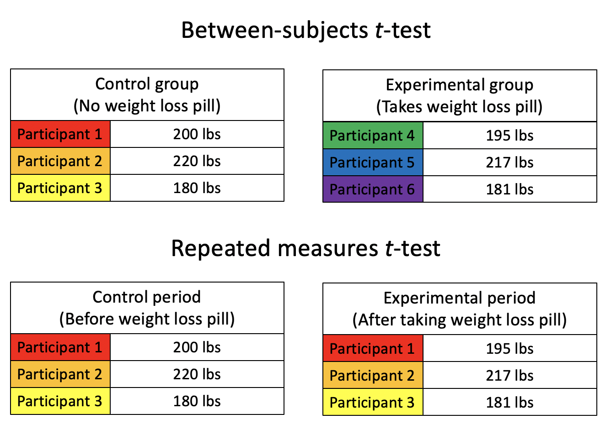
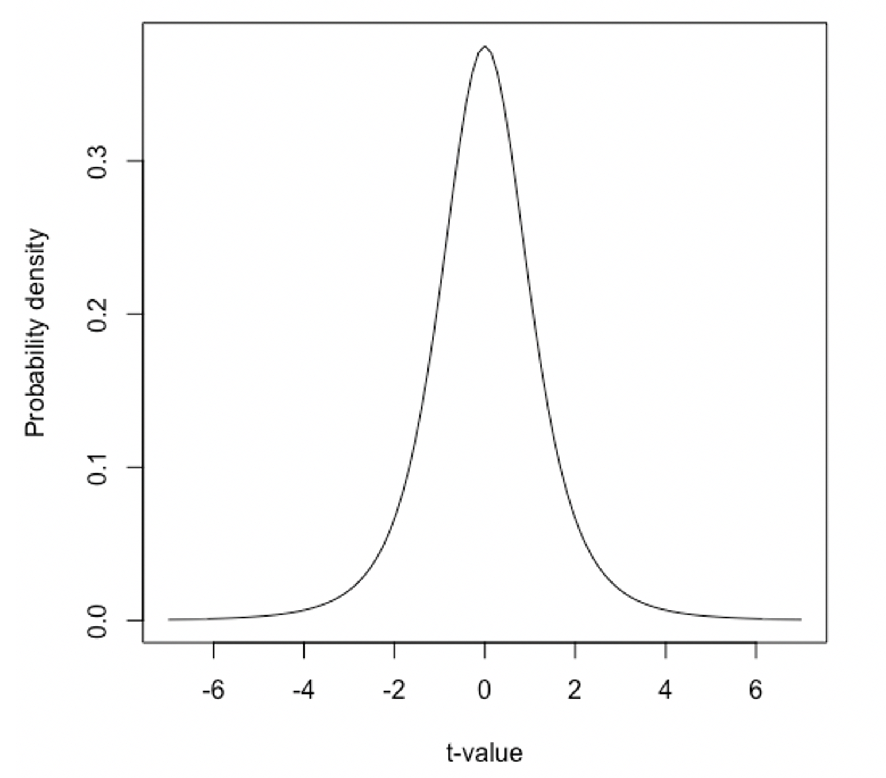
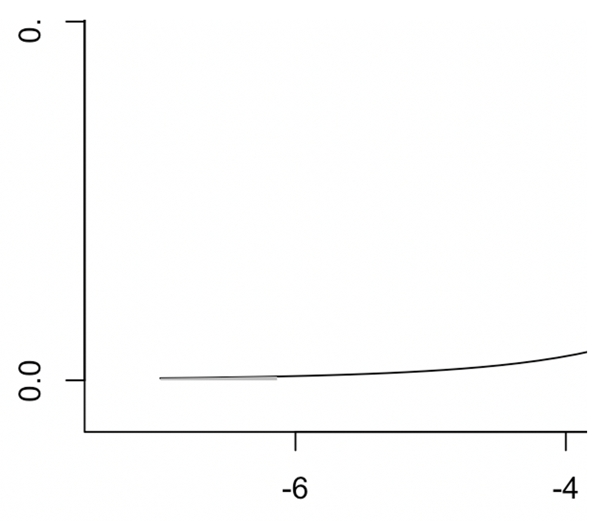
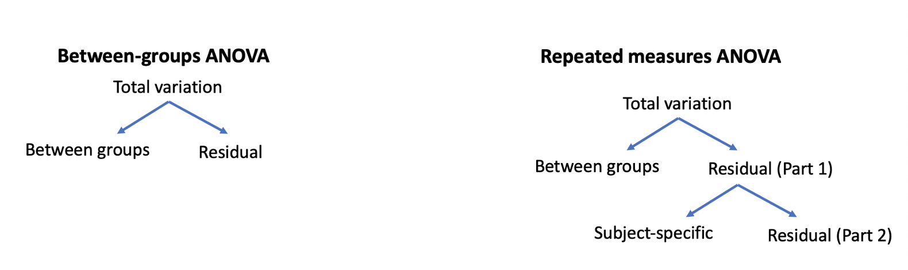
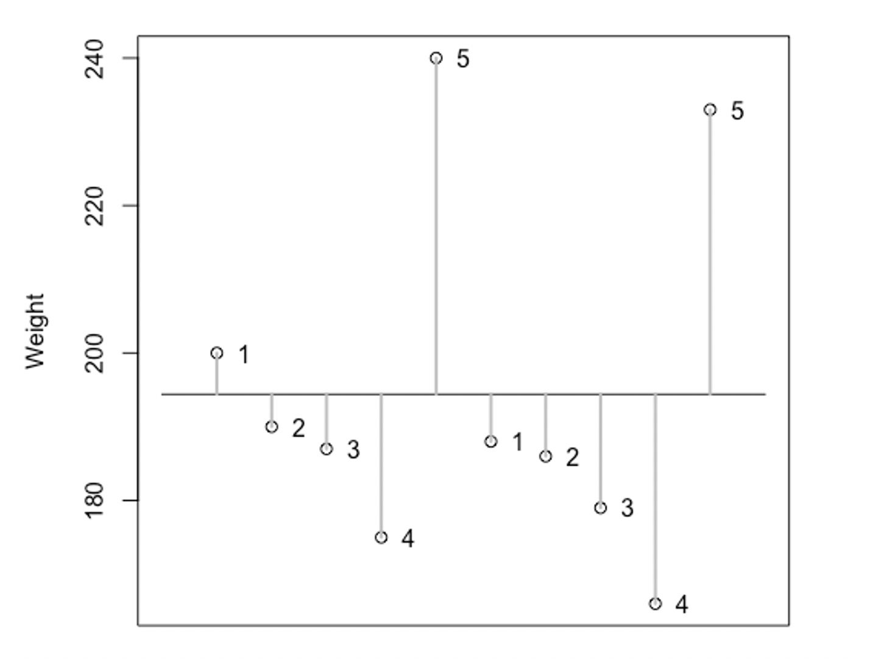
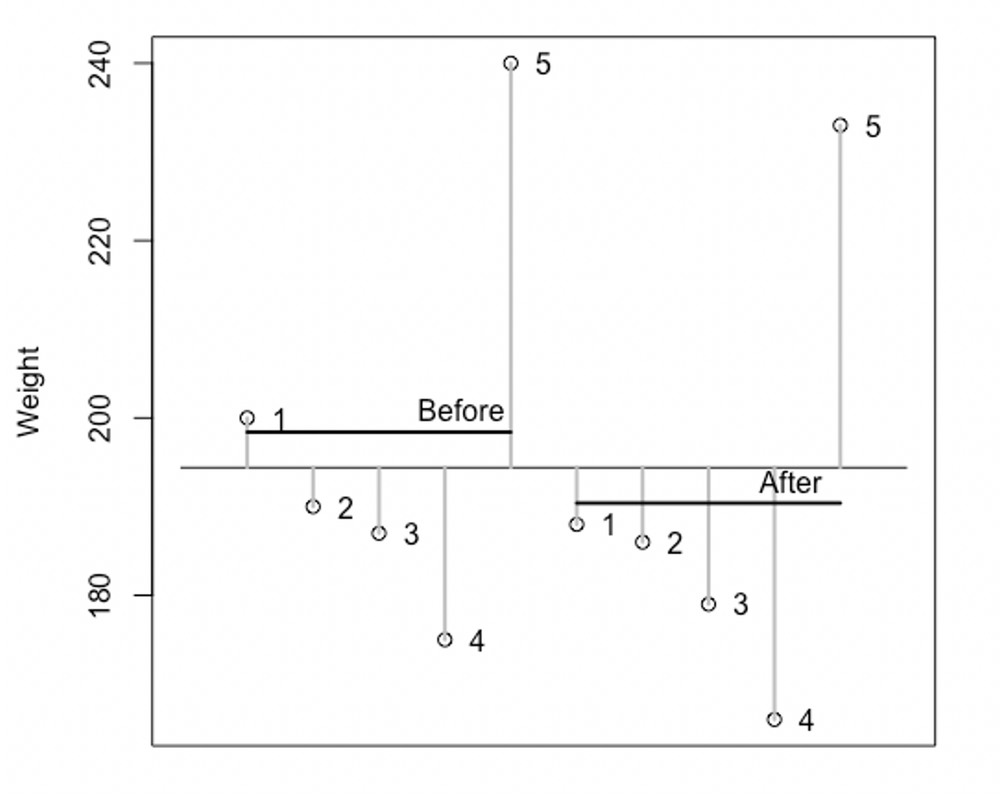
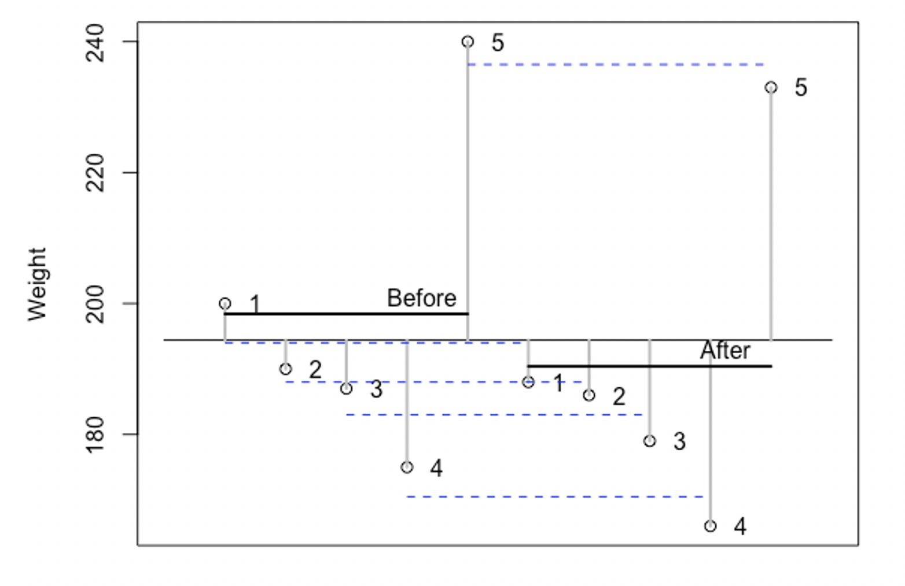
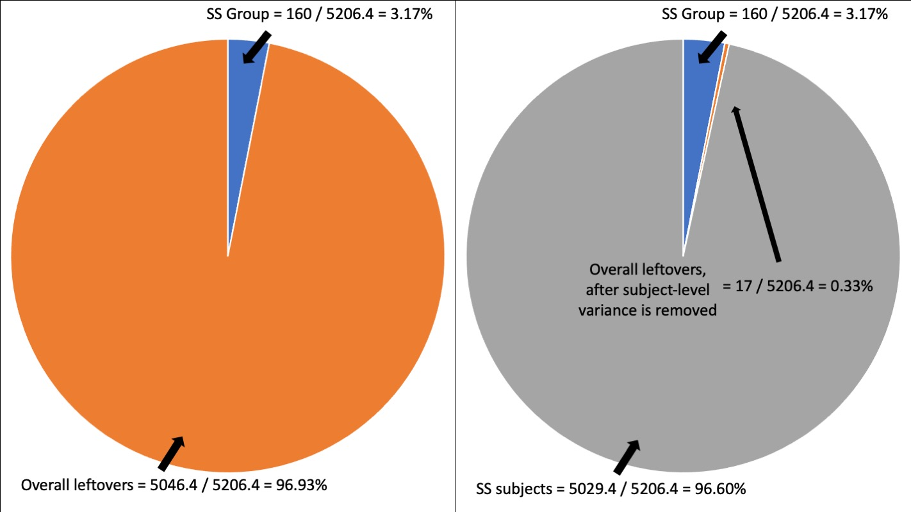

# Repeated measures

In this chapter, we'll learn basically the same stuff from the last chapter (testing for differences between means), but with a small twist. Instead of testing for differences in means between two or more distinct groups, we'll talk about how to test for differences between means when there are multiple observations per person (or whatever unit of analysis you're using).

## What is "repeated measures"?

"Repeated measures" (or within-subjects) designs involve more than 1 observation per person. Another way to look at this is that each participant is exposed to all levels of your independent variable.

Many repeated measures designs are "before" and "after" studies: You measure someone's depression levels before they start taking a drug and you measure someone's depression levels after taking a drug. Or you might measure someone's depression before and after therapy. Let's say the DV in your study is weight. How much did each participant weigh before the special "boot camp"? How much did they weigh afterwards? How much did they weigh immediately afterwards versus 6 weeks afterwards? If you take a sample mean of weight on these same people at different points in time, do these sample means differ from one another?

In an academic setting, you may see a pre-test and post-test design, examining how different classroom interventions affect academic performance.

Any study that involves analyzing a dependent variable observed from the same individuals at multiple time points is a "repeated measures" (i.e., "within-subjects") design/study.

{fig-align="center" width="50%" fig-alt="Tables demonstrating the difference between a between-subjects and repeated measures design."}

### Pros and cons of between-subjects and repeated measures designs

There are pros and cons associated with using a between-subjects or a repeated measures design for your study. **A repeated measures design has more statistical power than a between-subjects design.** I'll explain why in more detail below. For now, I'll just explain it this way: A repeated measures design is able to reduce the amount of residual ("leftover") variance in the data by taking into account person-level information. Each person provides at least 2 data points in a repeated measures design. Each person therefore has an "average" data point unique to themselves. With that information, you cut the total variation ($SS_{Total}$) into $SS_{Model}$ and $SS_{Residual}$, as usual. But you can also further divide $SS_{Residual}$ into $SS_{Subject}$ and $SS_{\text{Residual But For Real This Time}}$. (Note: Unfortunately, that last one's not what it's actually called.)

**The main drawback with repeated measures designs is the risk for carryover effects.** Basically, if you have someone perform the same task multiple times, this can affect how they perform the task. If I give an IQ test to a child before doing an enrichment program and then give them another IQ test afterwards, that IQ might go up, but not necessarily because of the program. People tend to get better at taking IQ tests with practice. (This specific instance of a carryover effect is called a "practice effect" because the students got better through practice.)

There are all kinds of reasons why getting 2+ observations per person can "contaminate" your research. If you have participants do something tedious or boring, they might find shortcuts or stop putting as much effort into it over time.

**The main advantage of between-subjects designs is that you can more easily infer causality.** If I measure the IQ scores for one group of students (a control group) and then measure the IQ scores of a different group of students (an experimental group who went through my program), I can more confidently say that any differences observed in IQ scores between the groups is due to the program. It's not a carryover effect because it couldn't be. These are two completely different groups of research participants.

## Repeated measures *t*-test

As far as the steps/calculations go, a repeated measures *t*-test is a lot like an independent samples *t*-test. With a repeated measures *t*-test, though, you have two sample means drawn from the same group of people.

Let's say we have 5 subjects who each signed up for a seminar on weight loss. You're hoping that they will start a healthier diet and exercise routine and stick with it.

| Subject # | Weight before | Weight after |
|:--:|:--:|:--:|
| 1 | 200 | 188 |
| 2 | 190 | 186 |
| 3 | 187 | 179 |
| 4 | 175 | 166 |
| 5 | 240 | 233 |

With an independent samples *t*-test, you would calculate the mean for the "before" group and the mean for the "after" group. You would then test whether the difference between these two sample means is statistically significant. With a repeated measures design, however, these are all the same people! With a repeated measures t-test, you instead calculate the differences between each person's first and second observation.

| Subject # | Weight before | Weight after | Difference |
|:--:|:--:|:--:|:--:|
| 1 | 200 | 188 | 12 |
| 2 | 190 | 186 | 4 |
| 3 | 187 | 179 | 8 |
| 4 | 175 | 166 | 9 |
| 5 | 240 | 233 | 7 |

(In most real data sets, you won't see all the observations going in the same direction. There'd be some people gaining weight and some people staying the same.) Next, we want the average of these differences:

$$
\frac{12+4+8+9+7}{5}=8
$$

The average difference in "before" and "after" weight is 8 pounds. The *t*-statistic for a repeated measures t-test is...

$$
t=\frac{\bar{D}}{SEM}
$$

Where $\bar{D}$ is the average difference between scores and "SEM" is the standard error of the mean. SEM, in this context, represents the standard deviation of the sampling distribution of differences between observation 1 and observation 2 for samples of this size. The equation for the SEM for repeated measures *t*-tests is...

$$
SEM=\frac{s_{D}}{\sqrt{n}}
$$

Where $s_{D}$ is the standard deviation of the differences and $\sqrt{n}$ is the square root of the sample size. In the present data, $s_{D} = 2.92$ and $\sqrt n = \sqrt5 = 2.24$. Therefore, $SEM = \frac{2.92}{2.24}=1.30$. So, our *t*-statistic is $\frac{8}{1.30} = 6.14$.

Now we want to place our t-statistic on the appropriate *t*-distribution so we can calculate the probability of seeing a difference between observations as large (or larger) when you assume the null hypothesis is true. Degrees of freedom is equal to the number of participants (not observations!) minus 1. Since we had 5 participants in this data set, we want a *t*-distribution with 4 degrees of freedom.

{fig-align="center" width="50%" fig-alt="A t-distribution with 4 degrees of freedom."}

Above is the *t*-distribution with 4 degrees of freedom. A *t*-value of 6.14 (and above) is shaded in gray. I've also shaded in *t*-values of -6.14 (and below). You probably can't even see it, so I'll zoom in on one of them.

{fig-align="center" width="50%" fig-alt="The very far, left end of a t-distribution with a nearly invisible section marked off."}

Can you see it now? That little gray area (and its cousin on the other side of the distribution) separately represent 0.179% of the area of the *t*-distribution. Combined, they represent 0.358%. That means the probability of observing a difference in observations ("before" and "after" weights) as large (or larger) as the one we observed, when you assume the null hypothesis is true, is much, much lower than 5%. We reject the null hypothesis. (Note I got this result because the effect of the program was so huge. Normally, with such a small sample size, you wouldn't see a statistically significant difference.)

## One-way repeated measures ANOVA

A one-way, repeated measures ANOVA is a lot like a one-way between-subjects ANOVA. They both only have one independent variable. The key difference is whether that independent variable is repeated across the same group of participants (making it "repeated measures") or whether each observation comes from a separate group (making it "between-subjects").

If there are only two levels in your independent variable (e.g., "before vs. after", "control vs. experimental"), then you have 2 sample means and you can use a repeated measures t-test. If there are more than 2 sample means, then you'll need to use a repeated measures ANOVA.

With a between-subjects (or "between-groups") ANOVA, we split the total variation in the dependent variable into two components:

* Between-groups (or "model-based") variance: Variance "accounted for" by knowing which group an observation comes from. If any of the groups are far from the grand mean, then knowing which group someone came from is informative enough to improve your predictions beyond just guessing the grand mean.
* Residual variance: Variance that's leftover.

{fig-align="center" width="50%" fig-alt="Two flow charts. The first, between-groups chart shows total variation breaking down into between groups and residual variation. The second, repeated measures chart shows the residuals breaking further down into subject-specific and second order residuals."}

With a repeated measures design (regardless of whether it's a *t*-test or ANOVA), you are able to split the residual variance into two parts: subject-specific variance and variance that's left over after you've accounted for group membership and subject-specific information. It's the leftovers of the leftovers.

{fig-align="center" width="50%" fig-alt="A chart of each participant's weight at two different time points. Deviations from the grand mean are marked with gray lines."}

Above is a plot for the data from the repeated measures *t*-test from before. Each point is one data point, but each subject (1 through 5) contributed two data points each. Each gray line represents the distance between each data point and the grand mean. The grand mean is the horizontal line. Remember, the grand mean averages across all data points. It doesn't matter if it came from the "before" group or the "after" group, from subject #1 or subject #3. If you sum all these gray distances together (the squared distances, that is), you get the $SS_{Total}$.

Normally, with a between-subjects ANOVA, you can only split these total distances into between-groups and leftovers (residuals).

{fig-align="center" width="50%" fig-alt="The same plot as before but the before mean and after mean are also marked with horizontal black lines."}

Overall, the group mean for the "before" data points is slightly above the grand mean. The group mean for the "after" group is slightly below the grand mean. With a between-subjects ANOVA, this is normally when we start dividing variances up. With a repeated measures ANOVA, though, we also have averages for each individual participant.

{fig-align="center" width="50%" fig-alt="Same plot as before but each subject's average weight is marked with a dotted blue line."}

Each of the blue, horizontal dashed lines in the plot above represents the average between two data points for the same participant. Each participant contributed 2 data points: a "before" and an "after". Therefore, each participant has a participant-level mean that averages their "before" and "after" data points together.

Participant 1's first data point is above the grand mean and their second data point is below the grand mean. If you average Participant 1's observations together (represented by a blue dashed line connecting the two), you see that, on average, they were pretty close to the grand mean. Participant 5 weighed the most in the "before" and "after" groups. They did, however, lose some weight. Their subject-level average is in between their "before" weight and "after" weight.

{fig-align="center" width="50%" fig-alt="Two pie charts. The left one splits the variance in weight into a small slice accounted for by before versus after and a large unaccounted slice. The right one splits that unaccounted slice into subject-specific variance and a tiny leftover residual."}

In the figure above, on the left, we see a pie chart. This pie chart shows that about 3.07% of the total variation in our DV (weight) is accounted for by knowing whether an observation is coming from the "before" group or the "after" group. That leaves 96.93% of the variation in weight completely unaccounted for. If this weren't a repeated measures design, we'd have a hard time inferring that there's a real effect. The signal-to-noise ratio (3.07 to 96.93) is not very high! However, in the right side, you see the same data, but with the subject-level variation in weight highlighted in gray. That 96.93% of unaccounted for weight has been divided into 96.60% subject-specific weight and 0.33% leftover weight. That remaining 0.33% represents weight data that is accounted for neither by group (before vs. after) nor by subject. Now the signal-to-noise ratio (3.07 to 0.33) looks a lot better! By taking into account data that is specific to each person, we were able to isolate group-level variation and truly unknown residual variation a lot more precisely.

## Statistical tests learned so far

Our arsenal of statistical tests keeps growing! There are two things that are a bit different about the repeated measures ANOVA we just added though. First, a repeated measures ANOVA assumes "sphericity" in the data. What does that mean? Well, for now, just pretend it means "constant error variance" just like before. For all intents and purposes, that's what it means. Just know that, *technically* it's different, and should be checked.

Second, instead of using eta-squared ($\eta^2$) as a measure of effect size, repeated measures ANOVAs use partial eta-squared ($\eta^2_{partial}$). Remember how eta-squared is just $SS_{Model}$ divided by $SS_{Total}$? Well, now that we've isolated subject-level variance from the rest of the variance, we can take it out of the denominator: $SS_{Model}$ divided by $SS_{Total}-SS_{Subject}$.

| Name | When to use | Distribution / Requirements | Effect size |
|-----|-------|---|---|
| Single observation *z*-score | You just want to know how likely (or unlikely) or how extraordinary (or average) a single observation is. | Normal distribution. Population mean and population SD are known. | N/A |
| Group *z*-test | You want to know whether a sample mean (drawn from a normal distribution) is higher or lower than a certain value (usually the population average) | Normal distribution. Population mean and population SD are known. | N/A |
| 1 sample *t*-test | You want to know whether a sample mean is different from a certain value (either 0 or the population average) | *t*-distribution. Population mean is known, but not the population SD | N/A |
| Correlation | Measuring the degree of co-occurrence between two continuous variables | Linear relationship between variables, no outliers, normally distributed residuals. | Pearson's *r* |
| Independent samples *t*-test | Determine whether there is a difference between two sample means | *t*-distribution, normally distributed samples with roughly equal variances | Cohen's *d* |
| One-way, between subjects ANOVA | Determine whether there is a difference among three or more sample means from independent groups | *F*-distribution, normally distributed samples with roughly equal variances | Eta-squared ($\eta^2$) |
| Repeated measures *t*-test | Determine whether there is a difference between two sample means when those derive from multiple observations from the same units (usually people) at different time points | *t*-distribution, the differences in observations are normally distributed | Cohen's *d* |
| One-way, repeated measures ANOVA | Determine whether there is a difference among three or more sample means when those derive from multiple observations from the same units (usually people) at different time points | *F*-distribution, normally distributed samples, sphericity | Partial eta-squared ($\eta^2_{partial}$) |
