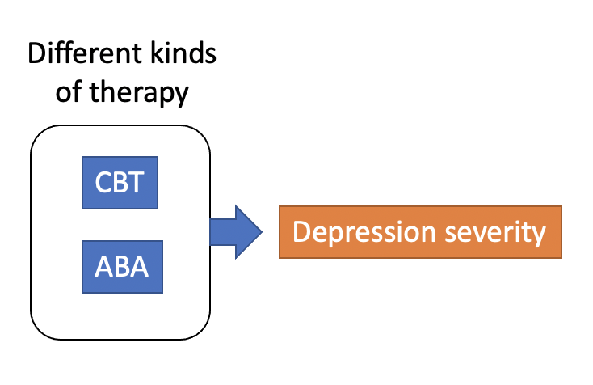
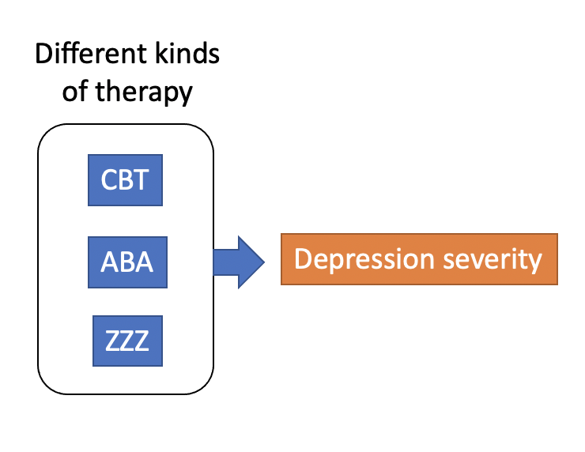
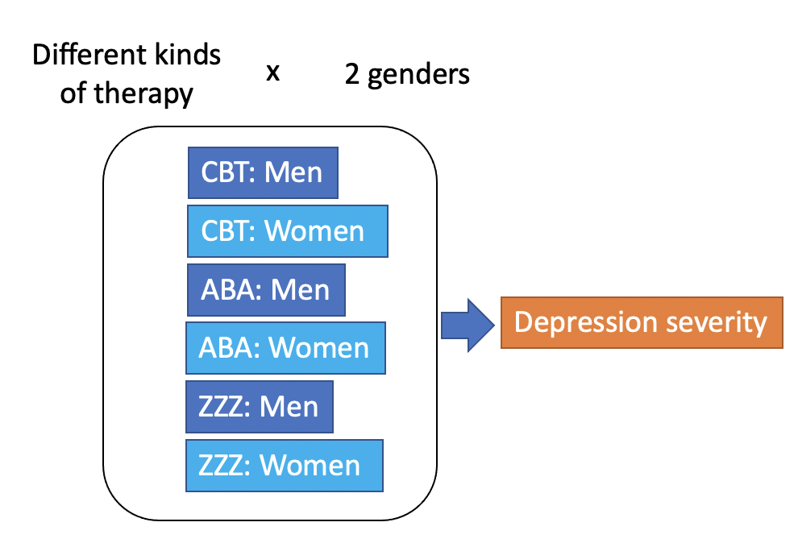
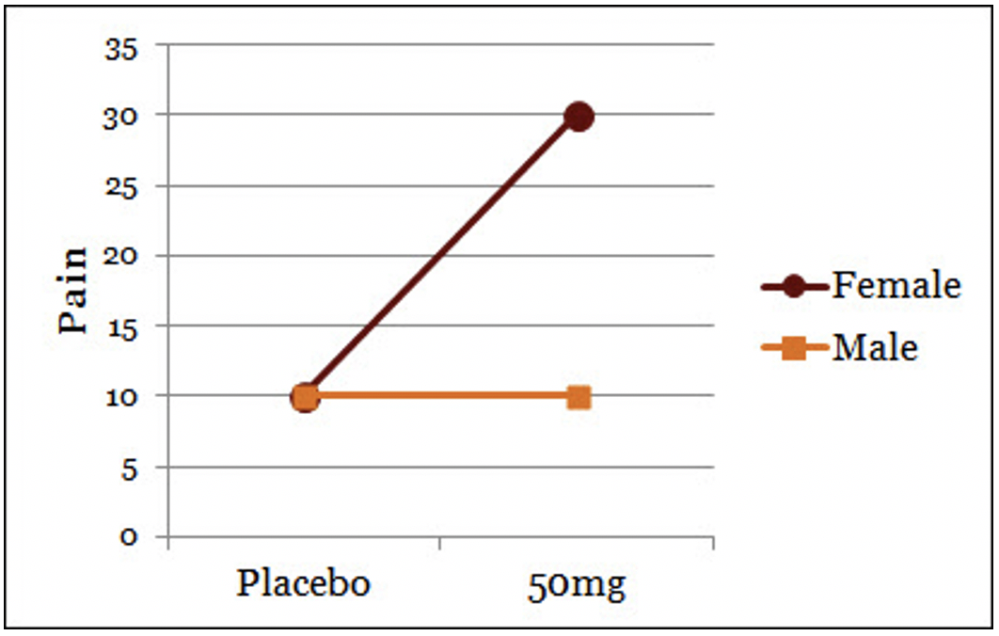
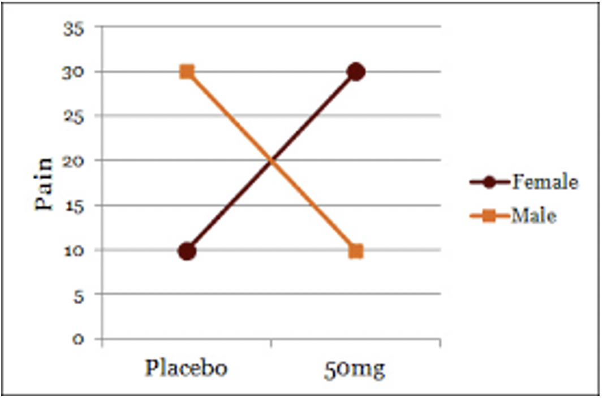
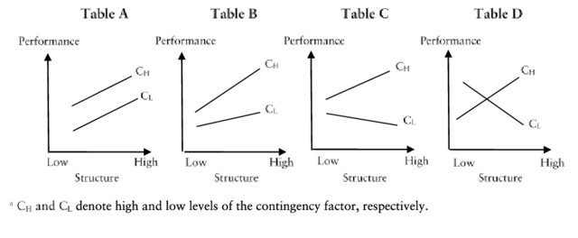
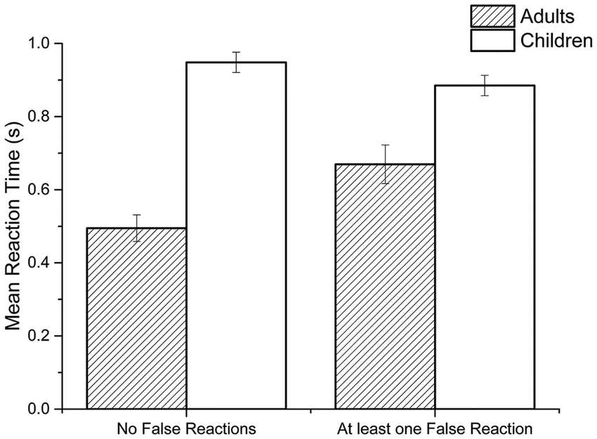
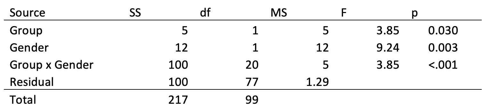

# Factorial ANOVA

A regular, one-way (or "single factor") ANOVA can compare sample means, but only if each of those sample means are from the same "factor" or "independent variable". Students often get confused when they're trying to figure out if they are dealing with multiple factors and when they are not. This is an important issue to be clear on because the answer to questions like these determines whether you need to be using a one-way ANOVA or a multi-factor (or "factorial") ANOVA.

## Factors and levels of factors

So far, we've looked at *t*-tests and ANOVAs that can handle only one factor at a time. Want to compare GPAs between STEM majors and non-STEM majors? That's a *t*-test because there are two sample means, the average GPA of STEM majors and the average GPA of non-STEM majors. The independent variable is a factor called "college major." This factor has two levels: STEM and not STEM.

What if you wanted to compare average GPAs between STEM majors, education majors, and everyone else? Now you need to use an ANOVA because there are three (or more) levels to the factor. In other words, you want to compare three or more sample means and determine whether any of them are statistically different from one another. Now the same factor from before ("college major") has three levels: STEM, Education, and Everyone Else (or more groups, if you want to add them).

In a multi-factor ANOVA, you have two or more factors in play at the same time. For instance, what if I want to compare the average GPA between STEM majors and non-STEM majors? ***In addition to that***, I want to compare (genetic) men and (genetic) women. Now we have two factors, college major and genetic sex. Each of these factors has two levels. College major has two levels: "STEM major" and "not a STEM major". The (genetic) sex factor has two levels: "male" and "female". Adding sex into the research question multiplied the number of total sample means.

(As I've noted before, while there are a substantial number of people that don't fit into the typical gender binary, there doesn't always end up being enough people in these categories in a data set to produce reliable estimates of, e.g., average GPA. If you're a researcher specifically interested in these groups, you usually have to consciously seek out and recruit specific people for your study.)

{fig-align="center" width="50%" fig-alt="A diagram showing how adding a second factor multiplies the number of groups being compared"}

If you have two different types of therapy (CBT and ABA), that's one factor with two levels. If you add a third type of therapy, that doesn't *multiply* the number of groups, but merely adds one:

{fig-align="center" width="50%" fig-alt="A diagram of one factor with three levels: three different types of therapy"}

However, if you want to determine whether different therapies affect depression for people of different sexes, this *doubles* the number of group means, rather than just adding another group:

{fig-align="center" width="50%" fig-alt="A diagram crossing three types of therapy with two sexes, giving six groups"}

Taking one factor with three levels (three different therapies) and multiplying that by a factor with two levels (men and women) gives you 6 groups altogether.

## Main effects and interactions

When you have more than one factor, i.e., more than one independent variable, you have to ask yourself: How does factor A affect the DV overall? How does factor B affect the DV overall? And trickiest of all: Does the effect of factor A on the DV change depending on factor B?

That last question concerns interactions between factors. You could also ask, "Does the effect of factor B on the DV change depending on factor A?" It's the same thing. Another way of saying it is, "There is an interaction between factors A and B if the effects of A and B on the DV are dependent on each other" or "There is no interaction between factors A and B if the effects of A and B on the DV are independent from each other."

The interaction is tricky, but the main effect can be tricky too. If you are assessing whether there's a main effect of factor A, you have to completely ignore everything about factor B. The same thing goes for when you are assessing whether there's a main effect of factor B. You have to completely ignore what's going on with factor A.

Here's an example of an interaction plot:

{fig-align="center" width="50%" fig-alt="An interaction chart where the placebo group has the same mean for men and women, but the 50mg group has different means for the men and women groups."}

Each point in the plot represents a sample mean from one of the four groups. There are two factors (Placebo/medicine and male/female). Each factor has two levels. This makes the study a 2 x 2 ("two by two") factorial design.

The DV is pain. Factor A is (let's say) Group (Placebo vs. 50mg). Factor B is gender (Male vs. Female). Is there a main effect of factor A? Yes. Overall, the group mean for both placebo groups (the men AND the women combined) looks very different from the overall group mean for the 50mg group (the men AND the women combined).

Actually, the difference between the two combined Placebo means and the two combined 50mg means is due entirely to the women reacting differently to the drug than men. Men react the same in both groups. However, a main effect focuses ***ONLY*** on one factor and aggregates over the levels of the other factor. The levels of the other factor are ignored. The Placebo groups are lower in pain than the 50mg groups. Therefore, there is a main effect of Group.

Is there a main effect of Gender? Yes. If you combine the two male groups (Placebo and 50mg), their mean is about 10. If you combine both female groups (Placebo and 50mg), the mean is about 20. When assessing whether there is a main effect of gender, you completely disregard the effects of Placebo vs. 50mg.

Is there an interaction between Group and Gender? Yes. The drug (or Group) affects pain levels for men differently than it does for women. Another way of saying this is that the effect of gender on pain levels depends on whether they're in the placebo group or the 50mg group. The effects of gender and group are not independent. They interact.

Here's another example, one that's tripped up a lot of people:

{fig-align="center" width="50%" fig-alt="An X-shaped interaction."}

Is there a main effect of group? No. If you combine the Male and Female placebo groups into one, the overall mean is about 20. Same for the 50mg group. If there's no difference between the Placebo and 50mg groups overall, then there's no main effect of group. The overall effect of placebo versus the 50mg groups (ignoring gender) doesn't change. When you average over gender, there is no overall difference in pain levels between the placebo group and the 50mg group.

Is there a main effect of gender? No. The overall average for women, when you combine the placebo and 50mg women groups together is about 20. Same for men. When you ignore Placebo versus 50mg, there's no difference between men and women. Therefore, there is no main effect of gender.

Is there an interaction between group and gender? Yes. In this figure, the drug group affects pain levels differently depending on whether it's a man or a woman. Another way of saying this is that the way that gender affects pain levels depends on what group they were in: Placebo or 50mg. The effects of gender and group are not independent. Therefore, there is an interaction between these two factors.

## The "parallel lines" heuristic

One "rule of thumb" (or "heuristic") you can use to determine whether there is an interaction between two factors is to ask whether the lines on an interaction chart are parallel. If they're parallel, then there's (usually) no interaction. If they *aren't* parallel, then there *is* (usually) an interaction.

{fig-align="center" width="70%" fig-alt="Four interaction plots labeled Table A through Table D, each with Low and High Structure on the x-axis and separate lines for two contingency levels. Table A's lines are parallel; the lines in Tables B through D are increasingly non-parallel."}

In the figure above, for instance, the plot marked "Table A" has no interaction. The effect of Structure (Low vs. High) is independent of the effect of contingency factor ($C_H$ vs. $C_L$). In Table B, however, the gap between $C_H$ and $C_L$ is small for Low Structure and large for High structure. That means there's an interaction between the two factors, albeit a small one. Tables C and D show some more pronounced examples of interactions.

I can't promise this rule of thumb will always hold up. A student came up with it once, the rest of the class found it very useful, and I couldn't think of a counter-example in the moment. However, you should be familiar enough with the concept of a statistical interaction to generalize the concept outside of just interaction plots.

{fig-align="center" width="50%" fig-alt="A bar plot comparing adults and children in conditions with at least one false reaction versus no false reactions"}

In the bar plot above, for example, there is an interaction between age (Adults vs. Children) and False Reactions (At least one vs. none). I can see this because the gap between adults and children is smaller for the "at least one" conditions compared to the "No False Reaction" conditions.

Honestly, interaction plots make interactions easiest to assess, but I'm seeing them less and less in the scientific literature. Most researchers seem to prefer presenting their data in alternative ways. That's why it's important to understand the concept underneath the picture rather than learning cheap tricks to tell an interaction from a specific kind of picture: An interaction between factors occurs when the effect of one factor on the DV changes depending on levels of the other factor.

## ANOVA tables

Just like with any ANOVA, you will usually see the output of the model in the form like the following:

{fig-align="center" width="50%" fig-alt="An ANOVA table."}

This ANOVA table reads a lot like the ANOVA tables you've seen before. Each source of variation is listed in the left-most column. The effect of being in a particular group (e.g., Placebo vs. 50mg) is the first one at the top: "Group". This row represents the amount of variation in the dependent variable (pain) that is accounted for by knowing which group people were in. This represents the main effect of Group.

The next source (or row) underneath is "Gender". This represents the amount of variation in the dependent variable accounted for by knowing which Gender/sex someone was. This is the main effect of gender.

"Group x Gender" represents the interaction between the two factors of Group and Gender. It is read as "Group by gender". Finally, the "Residual" source represents all the leftover variation in the dependent variable that is not accounted for by either of the main effects or the interaction. And, as always, "Total" represents the total amount of variation in the dependent variable that could've possibly been accounted for.

The main effects and the interaction have *p*-values listed in the right-most column. These *p*-values represent whether any of these factors are statistically significant. In this table, all the *p*-values are below .05. This means that both main effects and the interaction are statistically significant. In other words,

* Null hypothesis: You assume that being in the Placebo group or 50mg group makes no difference in pain levels. The two overall means for those groups are so far apart, however, that there would only be less than a 5% chance of observing means that far apart (or more far apart) when you assume the null hypothesis is true. Therefore, the null hypothesis is probably false.
* Null hypothesis: You assume that men and women don't experience pain levels any differently from each other. The two overall means for those groups are so far apart, however, that there would only be less than a 5% chance of observing means that far apart (or more far apart) when you assume the null hypothesis is true. Therefore, the null hypothesis is probably false.
* Null hypothesis: You assume that the effect of Group and Gender are independent (i.e., they don't interact). You observe a dependency (i.e., interaction) between these effects so large, however, that the probability of observing an interaction that large (or larger) has a less than 5% chance of occurring when you assume the null hypothesis is true. Therefore, the null hypothesis is probably false.

## Post hoc tests

Just like with any ANOVA, the overall results only give you basic information. If there are only two levels for a factor, and that factor is statistically significant (i.e., there's a significant main effect for that factor), then you know that at least those two groups, overall, are (probably) different from one another. But if there's a statistically significant interaction, then main effects can be misleading. If you want to know whether any specific group (or set of groups) statistically differ from another group (or set of groups) you'll have to do a post hoc test. For more information on post hoc tests, go back and review the chapter on *t*-tests and basic between-subjects ANOVAs.

## Statistical tests learned so far

Effect sizes start to get a little tricky with factorial ANOVAs. You can isolate an effect/factor (e.g., $SS_{A}$, $SS_{B}$, $SS_{A \times B}$) and divide it by $SS_{Total}$. This will give you an eta-squared value. In other words, this'll give the proportion of variance in the dependent variable "accounted for" by that one effect/factor *out of the total variation*. You could also divide any of the factors/effects by itself and the residuals (e.g., $SS_{A} / (SS_{A}+SS_{Residual})$). This would give you a partial eta-squared value for that effect/factor. To be honest, I'm personally unsure how useful partial eta-squared is in this context.

| Name | When to use | Distribution / Requirements | Effect size |
|-----|-------|---|---|
| Single observation *z*-score | You just want to know how likely (or unlikely) or how extraordinary (or average) a single observation is. | Normal distribution. Population mean and population SD are known. | N/A |
| Group *z*-test | You want to know whether a sample mean (drawn from a normal distribution) is higher or lower than a certain value (usually the population average) | Normal distribution. Population mean and population SD are known. | N/A |
| 1 sample *t*-test | You want to know whether a sample mean is different from a certain value (either 0 or the population average) | *t*-distribution. Population mean is known, but not the population SD | N/A |
| Correlation | Measuring the degree of co-occurrence between two continuous variables | Linear relationship between variables, no outliers, normally distributed residuals. | Pearson's *r* |
| Independent samples *t*-test | Determine whether there is a difference between two sample means | *t*-distribution, normally distributed samples with roughly equal variances | Cohen's *d* |
| One-way, between subjects ANOVA | Determine whether there is a difference among three or more sample means from independent groups | *F*-distribution, normally distributed samples with roughly equal variances | Eta-squared ($\eta^2$) |
| Repeated measures *t*-test | Determine whether there is a difference between two sample means when those derive from multiple observations from the same units (usually people) at different time points | *t*-distribution, the differences in observations are normally distributed | Cohen's *d* |
| One-way, repeated measures ANOVA | Determine whether there is a difference among three or more sample means when those derive from multiple observations from the same units (usually people) at different time points | *F*-distribution, normally distributed samples, sphericity | Partial eta-squared ($\eta^2_{partial}$) |
| Factorial ANOVA | Determine whether a set of group means differ from one another, while taking into account that these means result from separate (possibly interacting) factors | *F*-distribution, all sample distributions are normally distributed with roughly equal variances. | Eta-squared ($\eta^2$) or partial eta-squared ($\eta^2_{partial}$) for each factor of interest |
