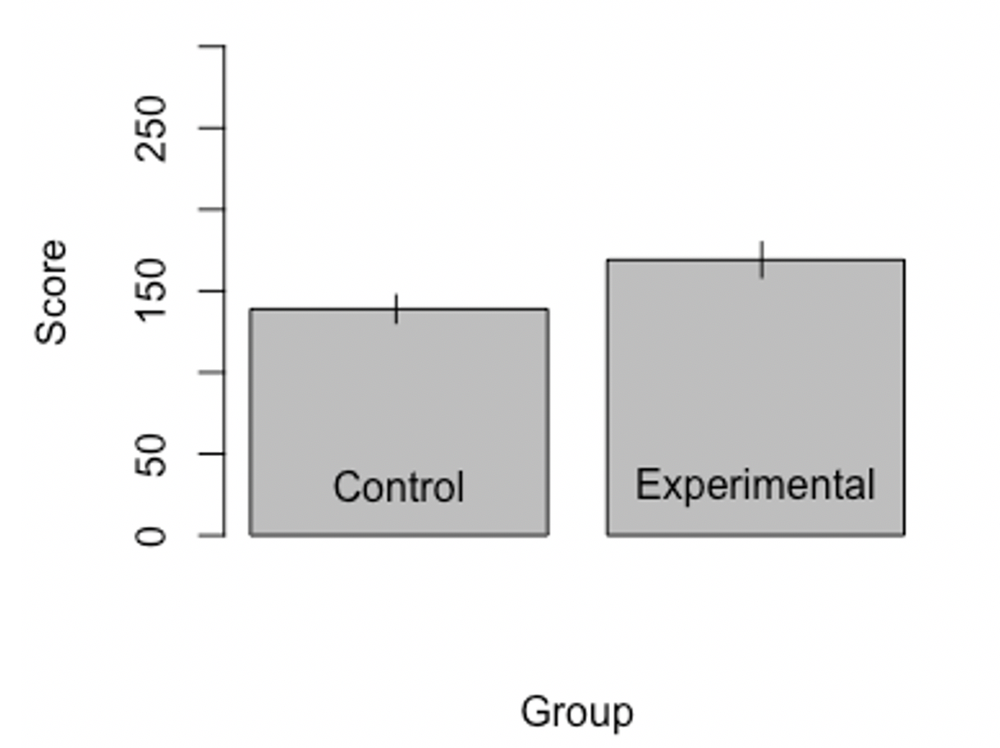
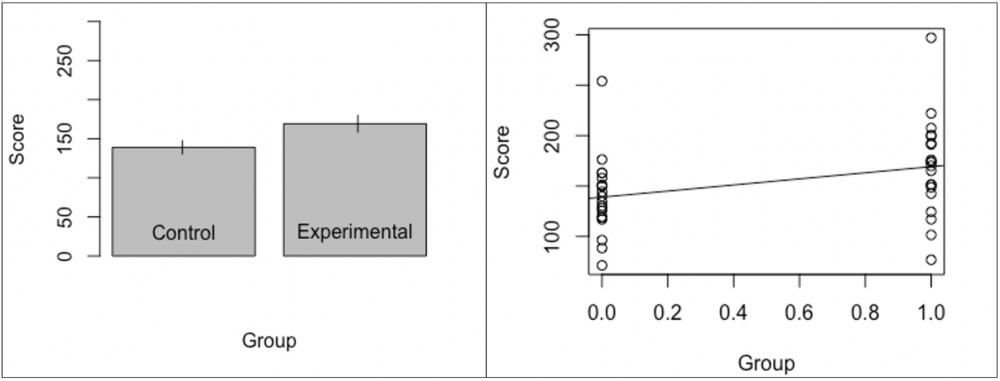
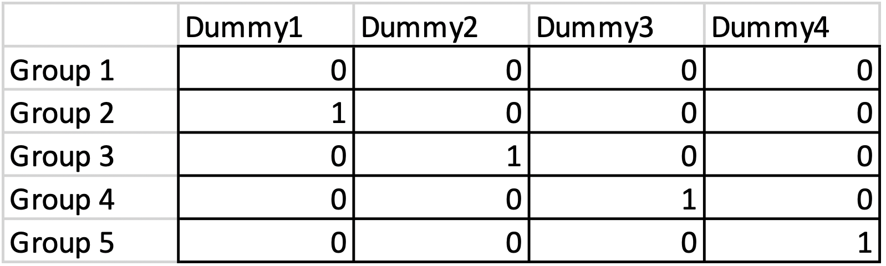
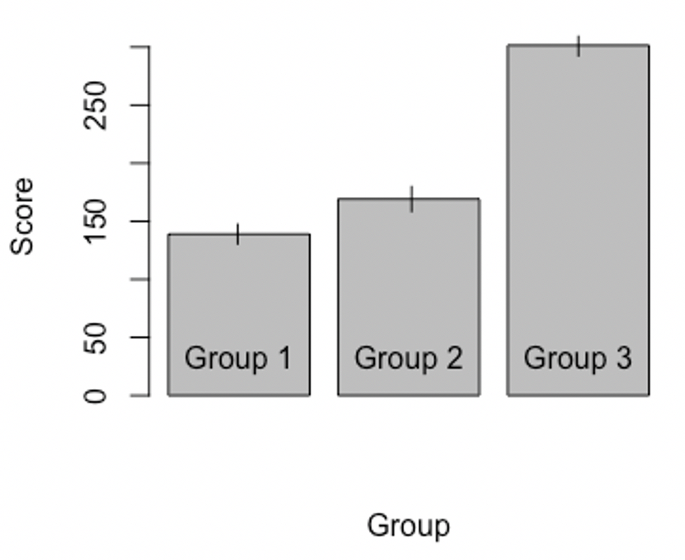
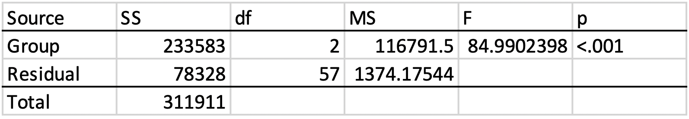
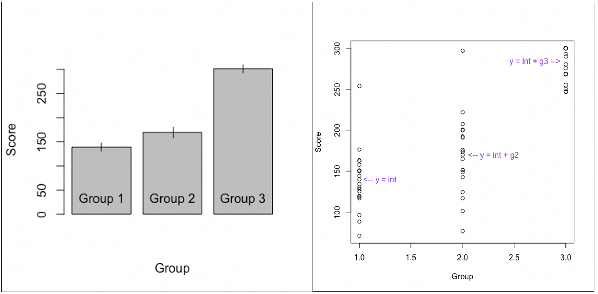
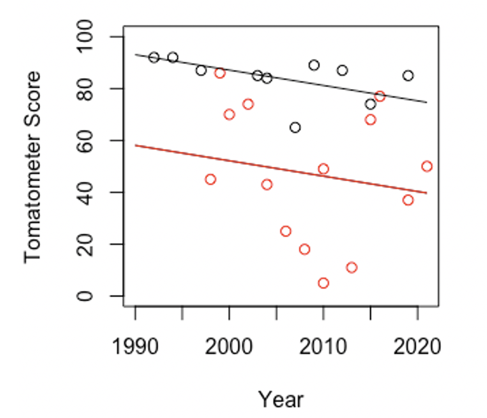
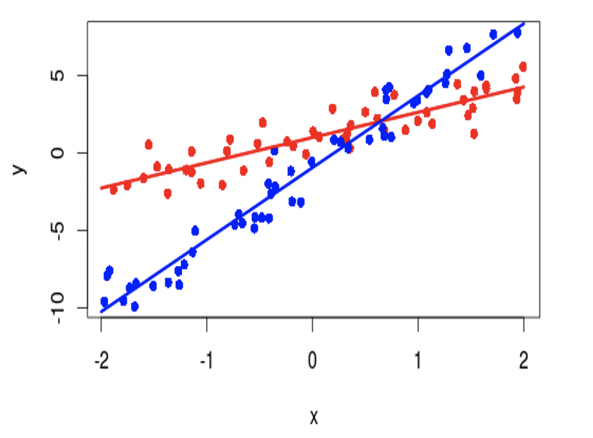
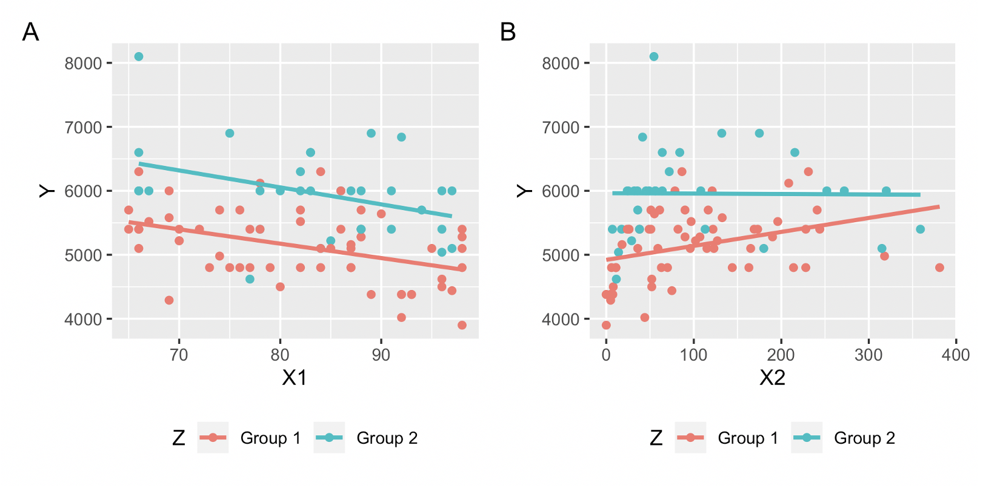

# The General Linear Model

This is always my favorite part of an undergrad stats course. It feels like a big plot twist at the end of a movie or a big reveal. I’ve already teased it a bit, but here it goes: correlation, regression, *t*-tests, and ANOVAs are all... the same thing!

{fig-align="center" width="10%" fig-alt="Shocked face emoji."}

Yes, it’s true. Almost every analysis we’ve learned so far is secretly the same model. This model has different disguises. Sometimes it’s wearing its “correlation mask”. Other times it’s wearing its “ANOVA mask” or "*t*-test mask". But it’s always the same model underneath the mask. You might even say it’s... the model with a thousand faces? We call her the “General Linear Model."

The general format of the model is as follows:

$$
\hat{y}=b_0+b_1X_1+\ldots+b_nX_n
$$

Here, $\hat{y}$ is the predicted value for the dependent variable. $b_0$ is an “intercept”. It gets added to every prediction. $b_1$ is the first coefficient. If there is only one independent variable, then you can call $b_1$ the slope of the regression line. Later, though, we'll see that you can keep adding independent variables. But you don't really add "slopes" (plural!) to a line. A line only has one slope. Not to be pedantic, but I'm going to start calling $b_1$, $b_2$, and so on regression "coefficients" rather than regression "slopes".

$X_1$ is the value of the first independent variable. Just like in Chapter 4, you plug in an x, the equation churns out a $\hat{y}$. If there is only one independent variable in your model, then this is where you stop. If there are two independent variables, then you would add “$+\ b_2X_2$” to the model. If there are three IVs, you’d add “$+\ b_3X_3$” to the model. That’s why the formulation I put above has the “$\ldots+\ b_nX_n$” at the end. This signifies that you can keep adding coefficients and independent variables to your model.

I’m going to work through the math on a few simple examples throughout this chapter, but you might want to re-read the correlation/regression chapter (Chapter 4) if you find this stuff confusing.

## Recreating a *t*-test in a regression model

Let’s say you have two independent groups, a control group and an experimental group. There are 20 people in each group, so there are 40 participants overall. I have participants in each group complete a test. The average test score in the control group is 138.95 and the average test score for the experimental group is 169.14.

{fig-align="center" width="50%" fig-alt="A bar graph showing the mean for a control and experimental group."}

This is usually where you’d conduct an independent samples *t*-test. If you did this, you’d observe a *t* value of 2.22 and a *p*-value of .033. You would reject the null hypothesis.

## Dummy variables

But what if I said I want you to try and predict a random person’s test score based on knowing whether they came from the control group or the experimental group? Let’s say, for each observation, we have a variable called $X_1$ that is equal to 0 if that observation came from the control group and equal to 1 if that observation came from the experimental group.

If you did that, and created a regression analysis, you’d get...

$$
\hat{y}=\bar{x}_{Control}+(\bar{x}_{Experimental}-\bar{x}_{Control})X_1
$$

Since $(\bar{x}_{Experimental}-\bar{x}_{Control})$ is just the difference between the sample means, we could de-clutter the above equation by replacing it with $D_{Groups}$. This'll stand for "Difference between groups".

$$
\hat{y}=\bar{x}_{Control}+D_{Groups}X_1
$$

$\hat{y}$ is our predicted test score. $\bar{x}_{Control}$ is the sample mean for the control group. $D_{Groups}$ is the difference between the mean of the experimental group and the mean of the control group. If we plugged in the numbers from our current example, $D_{Groups}$ would be...

$$
169.14 - 138.95 = 30.19
$$

There’s a 30.19 difference between the Experimental group (169.14) and the Control group (138.95).

$X_1$ equals 0 if an observation is from the control group and it equals 1 if an observation is from the experimental group. So, if a new observation came from the control group, our regression equation translates to...

$$
\hat{y}=\ 138.95\ +\ 30.19(0)
$$

This comes out to 138.95. Anything multiplied by 0 equals 0. So, anytime $X_1$ equals 0, the “difference” between groups isn’t added into our prediction. Only the sample mean for the control group remains, so our prediction is just the average for the control group.

Now what if we have a new observation and it came from the experimental group? Then...

$$
\hat{y}= 138.95 + 30.19(1)
$$

This comes out to 169.14. Because $X_1$ is equal to 1, the difference between groups (30.19) stays in the equation and gets added to the mean of the control group. The mean of the control group plus the difference between the groups equals the mean of the experimental group.

{fig-align="center" width="70%" fig-alt="A bar graph showing the mean of a control and experimental group. Beside it, a scatterplot shows the same information, along with a regression line relating the two groups."}

In the figure above, we have a bar plot showing the sample means on the left. On the right, we have a strange looking scatter plot. Each circle represents a data point. The X-axis (the horizontal axis) represents which group the data points came from. They only come from group 0 (control group) or group 1 (the experimental group). There’s no in-between. That’s because the independent variable is categorical. You’re either in the control group or the experimental group.

We call these categorical (0 or 1) variables "dummy variables". Dummy variables tell you whether an observation comes from a specific group or not. If an observation came from a specific group that a dummy variable is in charge of marking, then the dummy variable is equal to 1. If an observation is *not* from that group, the dummy variable is equal to 0.

The line on the scatter plot represents the best fitting regression line. It’s the line whose equation minimizes the squared distance between each data point and the line. (Another way of saying this is that it’s the line that minimizes the squared residuals.) The line runs through (or "intersects") the mean of the control group when the independent variable (group) equals 0. The line also runs through the average of the experimental group when the independent variable (group) equals 1.

The equation of this line is...

$$
\hat{y}= 138.95 + 30.19(X_1)
$$

(Remember, $X_1$ is a dummy code set to 1 if an observation's from the experimental group and set to 0 otherwise.)

The intercept is 138.95. That’s our prediction for when $X_1$ = 0. It’s the same as the mean for our control group. The "slope" is 30.19. For every increase in $X_1$, our predicted Y value ($\hat{y}$) goes up by 30.19. In this case, $X_1$ can only be 0 or 1. An observation's either in the control group or the experimental group.

Let’s look at the statistical tests for the intercept and slope. The intercept is equal to 138.95. The null hypothesis is that the intercept equals 0. When we run a *t*-test on this hypothesis, we get *t*(38) = 14.44, *p* < .001. We reject the null hypothesis. The intercept is probably not 0. In this case, that just means that our predicted test score for an observation coming from the control group is not equal to zero.

It's more interesting to test the slope. The null hypothesis says that the slope is equal to 0. In other words, the null hypothesis says that, as X changes value (being in the experimental group rather than the control group), Y *does not* change value. Therefore, the null hypothesis states that the line should be flat or statistically indiscernible from being flat.

The *t*-value associated with this hypothesis is *t*(38) = 2.22, *p* = .033. You reject the null hypothesis. You conclude that the predicted value of Y actually ***does*** change whenever $X_1$ changes. 

Did you notice that the *t*-value and *p*-value for the slope of the regression equation is the same as for the independent samples *t*-test above that was used to determine whether there’s a difference between the control and experimental group?

Think about that for a moment. An independent samples *t*-test is used to test whether there’s a difference between two sample means. In the example above, the results were: *t*(38) = 2.22, *p* = .033. The statistical test for the regression slope has a *t*-value of *t*(38) = 2.22, *p* = .033.

How could this be!?

Well, the regression slope is testing whether the difference in Y that results from changing $X_1$ is statistically different from zero. It’s testing whether the difference between the control group and experimental group is greater than (or just different from) zero. When you think about it, independent samples *t*-test and the statistical test used on the regression slope for a dummy variable are asking the same question.

## Recreating an ANOVA in a regression model with dummy coding

An ANOVA can also be recreated with a regression model. (By "re-created", I mean they're fundamentally the same thing.) First, you have an intercept that represents the mean of a “baseline” group. It doesn’t have to be a control group. It can be any group. You just have to set one of them aside to represent the intercept in the model. Next, for each group added afterwards (any group beyond that first one), you assign that group its own dummy variable.

A dummy variable is set to 1 if an observation comes from a particular group and set to 0 if an observation did not come from that particular group. So, let’s say we have 3 groups. The first of those 3 groups is represented by the intercept. We use two dummy variables to represent the other two groups. The first dummy variable represents the difference in group means between group 1 and group 2. The second dummy variable represents the difference in group means between group 1 and group 3. Here’s what our regression equation would look like:

$$
\hat{y}\ =\ \text{intercept}\ \color{red}{+\ b_{dummy1}X_1} \color{blue}{+b_{dummy2}X_2}
$$

The intercept represents the mean of the first group. $b_{dummy1}$ is equal to the difference between the mean of the first group and the mean of the second group. $b_{dummy2}$ represents the difference between the mean of the first group and the mean of the third group. The black part of the equation gets added to every prediction. The red part only gets added if $\color{red}{X_1}$ equals 1. If $\color{red}{X_1}$ equals 0, then the entire red part drops out. Similarly, if $\color{blue}{X_2}$ equals 1, then the blue part of the equation gets added. Otherwise, when $\color{blue}{X_2}$ equals 0, the blue part drops out.

If a new observation came from the first group, we set both dummy variables ($X_1$ and $X_2$) to 0.

$$
\hat{y}\ =\ \text{intercept}\ \color{red}{+\ b_{dummy1}(0)}\color{blue}{+b_{dummy2}(0)}
$$

Anything multiplied by zero is zero, so our prediction just becomes the intercept with nothing added.

$$
\hat{y}\ =\ \text{intercept}\ 
$$

In other words, our prediction is just the mean for the first group.

If a new observation came from the second group, then $\color{red}{X_1}$ would be set to 1. $\color{blue}{X_2}$, however, would remain 0 because the second dummy variable equals 1 when an observation comes from the third group and otherwise equals 0. Our regression equation would become...

$$
\hat{y}\ =\ \text{intercept}\ \color{red}{+\ b_{dummy1}(1)}\color{blue}{+b_{dummy2}(0)}
$$

This simplifies to...

$$
\hat{y}\ =\ \text{intercept}\ \color{red}{+\ b_{dummy1}}
$$

Our prediction is the group mean for the first group (i.e., the intercept) plus the difference between the means of the first and second group (i.e., $\color{red}{b_{dummy1}}$).

If a new observation comes from the third group, then we set $\color{red}{X_1}$ to 0. Remember, the first dummy variable ($\color{red}{X_1}$) equals 1 if an observation came from the second group but otherwise equals zero. We would set $\color{blue}{X_2}$ to equal 1. This is because the second dummy variable is set to 1 if an observation came from the third group and otherwise equals 0. Our regression equation would become...

$$
\hat{y}\ =\ \text{intercept}\ \color{red}{+\ b_{dummy1}(0)}\color{blue}{+b_{dummy2}(1)}
$$

This simplifies to...

$$
\hat{y}\ =\ \text{intercept}\ \color{blue}{+b_{dummy2}}
$$

In other words, our prediction is the mean of the first group (i.e., the intercept) plus the difference between the mean of the first group and the mean of the third group (i.e., $\color{blue}{b_{dummy2}}$).

In general, you can have as many groups as you want in your regression model. You just need a number of dummy variables equal to the number of groups minus 1.

{fig-align="center" width="50%" fig-alt="A table showing how one would create 4 dummy codes for 5 groups."}

If all the dummy codes are set to 0, that means the observation came from the first group and your prediction is equal to just the intercept. Everything else gets multiplied by 0 and cancels out of the equation.

{fig-align="center" width="50%" fig-alt="A barplot showing the means for three groups."}

Let’s say you have the same two groups from earlier in the chapter but with an extra third group. The mean of group 1 is still equal to 138.95. The mean for group 2 is still equal to 169.14. The new mean for group 3 is equal to 283.80.

If you conducted an ANOVA on these three sample means, your results would look like this.

{fig-align="center" width="50%" fig-alt="An ANOVA showing a statistically significant main effect for the three group means in the current example data."}

Hopefully, you can tell from the *p*-value less than .05 that there is a significant main effect of group membership. In other words, at least one pair of group means are significantly different from one another. You’d have to do follow-up (aka. post-hoc) tests to determine exactly which pairs of means are different from one another and which ones aren’t.

This ANOVA is equivalent to a regression model with two dummy variables. The first dummy variable we’ll call “Group2”. It’s equal to 1 if an observation came from group 2 and otherwise it's equal to 0. The second dummy variable we’ll call “Group3”. It’s equal to 1 if an observation came from group 3 and otherwise equals 0.

Here are the results for each parameter of the regression model:

* Intercept = 138.95, *t*(57) = 16.76, *p* < .001
* Group2 = 30.19, *t*(57) = 2.58, *p* = .013
* Group3 = 144.85, *t*(57) = 12.36, *p* < .001

The intercept is our predicted value when both dummy variables are set to 0. It’s equal to the mean of group 1, 138.95. It is statistically significant, meaning that it is probably not equal to 0. The regression coefficient “Group2” is equal to the difference between the mean of group 1 and the mean of group 2 (169.14 – 138.95 = 30.19). It is statistically significant, meaning that the difference between the mean of group 1 and the mean of group 2 is probably not 0. Finally, the regression coefficient “Group3” is equal to the difference between the mean of group 1 and group 3 (283.80 – 138.95 = 144.85). It’s statistically significant, meaning that the difference between the means of group 1 and group 3 is probably not zero.

{fig-align="center" width="70%" fig-alt="A barplot showing three sample means. Beside it, a scatterplot shows the same information. Equations written on the scatterplot show how the regression equation predicts each group mean."}

Above, I’ve got a bar graph representing the means for each group on the left. On the right, I have a scatter plot representing all of the data points. There is one cluster of data points where the independent variable (Group) equals 0 (it says "1" on the plot. I need to fix that.). These are all the test scores for the first group. If we were to predict the next test score for someone and we only knew that they were from group 1, we’d predict the intercept of our regression model (i.e., the mean of group 1), which is 138.95. Where “Group” equals 2 on the x-axis, we have all the data points from the second group. If we were to try and predict the next person’s test score and all we knew was that they came from group 2, we’d predict the intercept plus the coefficient “Group2”. This is equal to the mean of group 1 (138.95) plus the difference between the mean of group 1 and 2. That difference is 30.19. Add those together and you get the mean for group 2 (138.95 + 30.19 = 169.14). That’s our best prediction.

This logic can keep going forward with however many groups you want!

## Two regression lines in the same regression model!?

You can also have two regression lines in the same regression model. This is called "multiple regression". Let’s say you want to predict Quentin Tarantino Tomatometer scores and M. Night Shyamalan Tomatometer scores based on the year of a film’s release, but all with the same model. In this scenario, your dependent variable would be continuous (Tomatometer score). One of your independent variables would be categorical (Director: Quentin Tarantino, M. Night Shyamalan). The second independent variable (year of release) would be continuous.

Here’s what our regression equation would look like:

$$
\hat{y}=intercept_{M.Night}+b_{year}X_{year}+b_{Tarantino}X_{Tarantino.Dummy}
$$

$\hat{y}$ is our predicted Tomatometer score, our dependent variable. “$intercept_{M.Night}$” is the intercept for the model. I labelled it as “M.Night” because I chose M. Night’s movies to be the “baseline” group. $b_{year}$ is the regression coefficient for year. For each increase in $X_{year}$, our predicted Tomatometer score will change by $b_{year}$, whatever $b_{year}$ ends up being in our regression results. $b_{Tarantino}$ is the regression coefficient for Tarantino movies. You change your predicted Tomatometer scores by $b_{Tarantino}$ if $X_{Tarantino.Dummy}$ is equal to 1. $X_{Tarantino.Dummy}$ is a dummy variable equal to 1 if the observation is a Tarantino movie and equals 0 otherwise.

{fig-align="center" width="50%" fig-alt="A scatterplot showing two regression lines for two separate groups of data."}

The above figure shows the actual data and the regression lines for our model. The black circles represent Tarantino movies. The red circles represent M. Night Shyamalan movies. The red regression line represents our predicted Tomatometer scores when $X_{Tarantino.Dummy}$ is equal to 0. In other words, it’s our predictions for the baseline category, M. Night Shyamalan movies. When $X_{Tarantino.Dummy}$ is equal to 1, that regression line is raised. The slope doesn’t change. The same line is just raised by $b_{Tarantino}$, whatever that number ended up being.

Let’s look at the regression output.

* Intercept = 56.86, *t*(22) = 5.45, *p* < .001
* $b_{year}$ = -0.59, *t*(22) = -1.11, *p* = .281
* $b_{Tarantino}$ = 34.96, *t*(22) = 4.04, *p* < .001

The intercept is equal to 56.86. That’s our predicted Tomatometer score for our baseline category (M. Night Shyamalan movies) when the year of release is equal to “zero”. (Actually, the “year” variable is the number of years since either of them started releasing movies, which is 1991). So, really, 56.86 is our predicted Tomatometer scores for M. Night Shyamalan movies in the year 1991. The intercept is statistically significant, meaning that it is probably not equal to zero. That just means that M. Night Shyamalan didn’t start off making movies that couldn’t possibly get any worse (0 out of 100 on Rotten Tomatometers). There was room to go down. 

The regression coefficient $b_{year}$ is equal to -0.59. This means that, for each increase in $X_{year}$, our predicted Tomatometer scores for M. Night Shyamalan movies changes by -0.59 units. This regression coefficient is not statistically significant. This means that, while there seems to be a downward trend in Tomatometer scores in our sample, we can’t conclude that there is a true downward trend. We cannot reject the null hypothesis that $b_{year}$ is equal to zero.

The last coefficient is $b_{Tarantino}$, which is equal to 34.96. This is the amount that our predicted Tomatometer score increases when $X_{Tarantino.Dummy}$ changes from 0 to 1. In other words, it’s the amount we increase our Tomatometer score predictions when we’re predicting Tomatometer scores for Tarantino instead of M. Night Shyamalan. The coefficient is statistically significant. This means that the difference in Tomatometer scores between M. Night Shyamalan and Quentin Tarantino’s movies is probably not zero.

## Interactions in multiple regression

You can have two regression lines in the same model and you can also have an interaction between those two regression lines! This basically just means that the slope is not the same at each level of the categorical variable. In the above example, with the Tomatometer scores, the regression lines were parallel. This means that, when we’re predicting Tomatometer scores based on year of release for Quentin Tarantino and M. Night Shyamalan, the overall trend between Tomatometer scores and year of release doesn’t really change, just the elevation of the line.

With an interaction, the two lines would ***not*** be parallel. I’ve got some pictures of examples below for illustrative purposes and I’m going to leave the math involved with doing an interaction for another day.

{fig-align="center" width="50%" fig-alt="Two regression lines for two sets of data. The lines have different slopes."}

In the above picture, Y changes depending on X at a different rate for the red group compared to the blue group. That’s because there’s an interaction between the groups and the X variable.

{fig-align="center" width="70%" fig-alt="Two scatterplots showing two regression lines each. The first plot shows no interaction, while the second one does."}

There’s ***no*** interaction for the data on the left, but there is an interaction for the data on the right. Notice that the lines for the teal (is that teal?) and red groups are parallel for the data on the left but not parallel for the data on the right.

