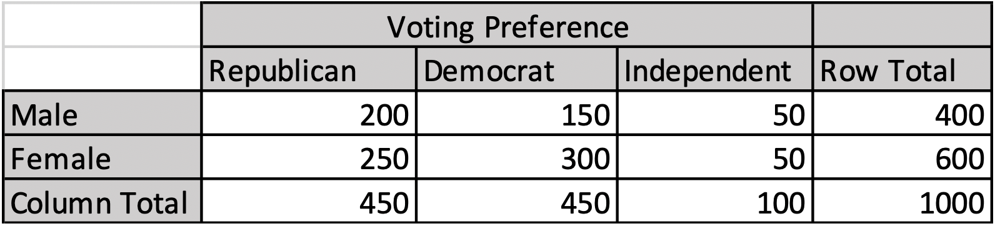
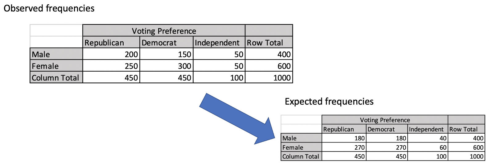
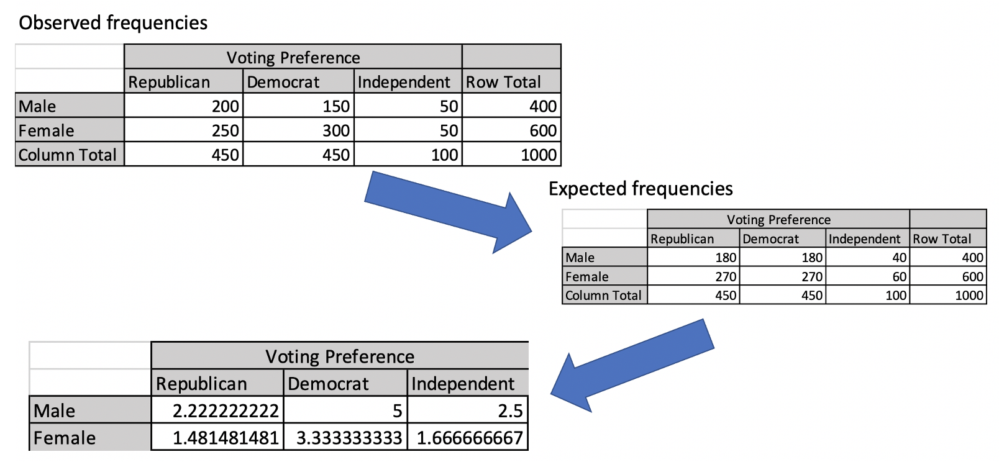
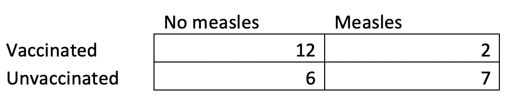

# Chi-square and Fisher's Exact Test

How would you analyze this data?

{fig-align="center" width="70%" fig-alt="A frequency table showing the number of male and female Republican, Democrat, and independent voters."}

In every statistical analysis we’ve learned so far, we have examined characteristics of people. Someone’s weight, height, GPA, or their level of depression can be quantified (turned into a number). Once you have numbers representing those characteristics, you can ask questions like, “Does this group have a higher GPA than this other group?”

In the above data, we have characteristics of people (sex and political affiliation). But we don’t have any continuous variables. There’s no degree to which someone is male or female. There’s no degree to which someone’s republican, democrat, or independent. We just have two sets of categorical variables. One set (or factor) has two levels (male, female) and the other set (or factor) has three levels (republican, democrat, independent). And we have frequency counts for how many people in a sample fall within each of these categories.

When you have data like this, you’ll typically want to use a chi-square test. (Note: the "chi" in "chi-square" is a stand-in for the Greek letter $\chi$, which is pronounced like "Kai" as in "Cobra Kai"). You are seeking to find out whether some people are over-represented or under-represented within certain groups. For instance, are men more likely to be Republicans compared to women?

## Chi-square tests

The null hypothesis for a chi-square test is kind of complicated at first glance. You’re assuming that no one is under-represented or over-represented in any of the categories. There is no tendency for someone in one category of factor A (e.g., gender) to be over-represented (or under-represented) in some category of factor B (e.g., voting preference). For the data above, the null hypothesis could be stated as...

* $H_0$: There is no association between Gender and voting preference (i.e., gender and voting preferences are independent)

As usual, once you have a null hypothesis in place, we can calculate the probability of your data (or more extreme data). This allows us to test this null hypothesis. With a chi-square test, **we want to calculate the distance between what our data should look like (if the null hypothesis were true) and what our data ACTUALLY looks like.** Just like before, it is possible that there is some minor over-representation or under-representation among the categories in our data without this trend being large enough to reject the null hypothesis.

Let’s focus on the first step for now: What category / frequency counts would you expect to see if the null hypothesis were true?

{fig-align="center" width="70%" fig-alt="The frequency table from before with an arrow pointing to a new table, which instead shows the expected frequencies one would see if the null hypothesis is true."}

To calculate this, you go through each cell in our data. There are six cells in our data. 2 rows for male/female and 3 columns for republican/democrat/independent. So there are 6 categories someone can fall into. For each of these cells (or categories) you multiply the total number of people for that row (overall) by the total number of people in that column (overall), then divide that product by the total number of people in the data.

$$
N_{Expected}=\frac{N_{Row}N_{Column}}{N_{Total}}
$$

So, for male republicans, you have 400 males times 450 republicans divided by 1000 people overall. That comes out to 180. That’s the number of male republicans you’d expect to see in that cell if the null hypothesis were true.

Next, we need to calculate how much discrepancy there is between our observed frequency counts and our expected frequency counts (expected by the null hypothesis).

{fig-align="center" width="70%" fig-alt="The same image as before, but a second arrow points to a third table, which displays the difference between the observed and expected cell frequencies."}

In a perfect world, we could just subtract the observed frequencies from the expected frequencies and that would be our measure for how far apart the observed and expected frequencies were. We actually have to use a slightly different calculation though:

$$
N_{Residual}=\frac{(N_{Observed}-N_{Expected})^2}{N_{Expected}}
$$

For each cell, you square the difference between the observed and expected frequencies and divide that by the expected frequencies. So, for male republicans we observed 200 people and expected 180. $\frac{(200 - 180)^2}{180} = 2.222$

For each cell, we end up with a number corresponding to the difference between each of our actual observations and the observations we’d expect to see if the null hypothesis were true.

Our test statistic is chi-square (aka $\chi^2$). The chi-square test statistic is equal to the sum of all the discrepancies (all the $N_{Residual}$). In the current example, this would be...

$$
\chi^2=2.22+5+2.5+1.48+3.33+1.67 = 16.20
$$

I did a bit of rounding, but hopefully you get the idea.

The chi-square distribution has one parameter: degrees of freedom. This degrees of freedom is equal to the number of rows minus 1 times the number of columns minus 1. In the current example, there are 2 levels of gender and 3 levels of voting preference, so we have (2 - 1) * (3 - 1) = 2 degrees of freedom.

When you have a chi-square distribution with 2 degrees of freedom, the probability of observing a chi-square test statistic as high as (or higher than) 16.20 is .0003 (.03%). That’s below .05 (5%), so we would reject the null hypothesis. In other words, we would conclude that there is some over- or under-representation in these data.

Sometimes you'll be able to stop the formal analysis here. It depends on how clear the results turned out to be. Sometimes, however, it might not be clear exactly where the under- or overrepresentation is coming from.

## What comes after a significant chi-square test?

There are a number of follow-up analyses you might want to perform if your chi-square test is statistically significant. In some situations, though, you might be content with just saying, "Hey, factor A and factor B are *not* independent! Wouldja look at that! How neat!" If that's an interesting conclusion, all power to you.

Some people recommend doing a second chi-square test on the same data, applying a Bonferroni correction. So, if you got an omnibus (i.e., "overall") *p*-value < .05, you might then want to say, "Okay, I know sex is not independent of voting preference, but I now want to know if women are more likely to be democrat than men, excluding independents." You would reduce the data down to a 2 x 2 table: Male Republicans, Male Democrats, Female Republicans, and Female Democrats. And you'd do an all new chi-square test on just this data.

Personally, I'm not crazy about this approach... it makes me sick.

I much prefer to calculate the *standardized* residuals for each cell. We already have the normal, non-standardized residuals for each cell. But this can be a misleading metric for how much each cell deviates from what would be expected if the null hypothesis were true. Standardizing them helps to address that:

$$
\frac{N_{Observed}-N_{Expected}}{\sqrt{N_{Expected}}}
$$

For the current data, this comes out to:

```{r}
#| label: analysis
#| echo: false
data=matrix(c(200,150,50,250,300,50),nrow=2,byrow=T)
colnames(data)=c("Republican","Democrat","Independent")
rownames(data)=c("Male","Female")
test=chisq.test(data)
```

```{r}
#| label: table
#| echo: false
library(knitr)
kable(test$stdres)
```

Large, positive numbers indicate a large overrepresentation in a cell, relative to what the null hypothesis says it should be. So, there are way more female democrats in our actual data, relative to what the null-hypothesis would have predicted. Likewise, male democrats are underrepresented in the data, relative to what the null hypothesis would have predicted.

## Fisher's exact test

Sometimes frequency/count data can’t be analyzed with a chi-square test. This is usually because there just isn’t enough data. Take the following as an example.

{fig-align="center" width="70%" fig-alt="A frequency table of measles cases among vaccinated and unvaccinated children."}

This made up data was inspired by a measles outbreak that occurred at Disney World a while back. Vaccine skeptics around the world were quick to point out that some of the children who had been vaccinated against measles still contracted measles. Plus, some of the kids who ***weren’t*** vaccinated against measles did not contract measles. "What’s the point of a measles vaccine", they said, "if you can still get measles with a vaccine (or not even catch measles if you’re ***not*** vaccinated)?"

Normally, we could use a chi-square test to show that vaccinated kids were underrepresented in the measles category. However, with so little data, it’s unlikely that the sum of $N_{Residuals}$ between observed and expected data will follow a chi-square distribution. The biggest problem is the mere 2 children in the measles+vaccinated category. A rule of thumb is that every cell must have at least 5 members in it for a chi-square test to still be appropriate.

To get around this, you can calculate Fisher’s Exact Test. This test is fascinating because it calculates the actual probability of observing an outcome as extreme (or more extreme) compared to a hypothetical scenario where all the categories are completely independent. I won’t go through the math here because it’s a little advanced for what I’m going for in this “book.” But many websites can calculate a Fisher’s Exact Test for you. I used [GraphPad's free calculator](https://www.graphpad.com/quickcalcs/contingency1/) to analyze the measles data.

The *p*-value came out to .0461. That means that the probability of seeing so many vaccinated kids get over-represented in the “no measles” category when you assume vaccines don’t affect whether you have measles or not is less than 5%.

## Statistical tests learned so far

Our final table! It was a little tricky to think of what to put in the "Effect size" column for the chi-square test. You can either say something like "50% of men were Republicans compared to about 42% of women, a difference of about 8 percentage points" or "men were 1.2 times more likely to be Republican compared to women." You could also examine the standardized residuals and infer how much each cell in the data contributes to rejecting the null hypothesis.

| Name | When to use | Distribution / Requirements | Effect size |
|-----|-------|---|---|
| Single observation *z*-score | You just want to know how likely (or unlikely) or how extraordinary (or average) a single observation is.| Normal distribution. Population mean and population SD are known. | N/A |
| Group *z*-test | You want to know whether a sample mean (drawn from a normal distribution) is higher or lower than a certain value (usually the population average) | Normal distribution. Population mean and population SD are known. | N/A |
| 1 sample *t*-test | You want to know whether a sample mean is different from a certain value (either 0 or the population average) | *t*-distribution. Population mean is known, but not the population SD | N/A |
| Correlation | Measuring the degree of co-occurrence between two continuous variables | Linear relationship between variables, no outliers, normally distributed residuals. | Pearson's *r* |
| Independent samples *t*-test | Determine whether there is a difference between two sample means | *t*-distribution, normally distributed samples with roughly equal variances | Cohen's *d* |
| One-way, between subjects ANOVA | Determine whether there is a difference among three or more sample means from independent groups | *F*-distribution, normally distributed samples with roughly equal variances | Eta-squared ($\eta^2$) |
| Repeated measures *t*-test | Determine whether there is a difference between two sample means when those derive from multiple observations from the same units (usually people) at different time points | *t*-distribution, the differences in observations are normally distributed | Cohen's *d* |
| One-way, repeated measures ANOVA | Determine whether there is a difference among three or more sample means when those derive from multiple observations from the same units (usually people) at different time points | *F*-distribution, normally distributed samples, sphericity | Partial eta-squared ($\eta^2_{partial}$) |
| Factorial ANOVA | Determine whether a set of group means differ from one another, while taking into account that these means result from separate (possibly interacting) factors | *F*-distribution, all sample distributions are normally distributed with roughly equal variances. | Eta-squared ($\eta^2$) or partial eta-squared ($\eta^2_{partial}$) for each factor of interest |
| Chi-square test of independence | Determine whether any frequency counts over- or underrepresent certain groups | Chi-square distribution | Odds, percentages, or standardized residuals |
| Fisher's exact test | Do a chi-square test when the assumptions of a chi-square haven't been met | No distribution! No assumptions! | Odds ratio |

