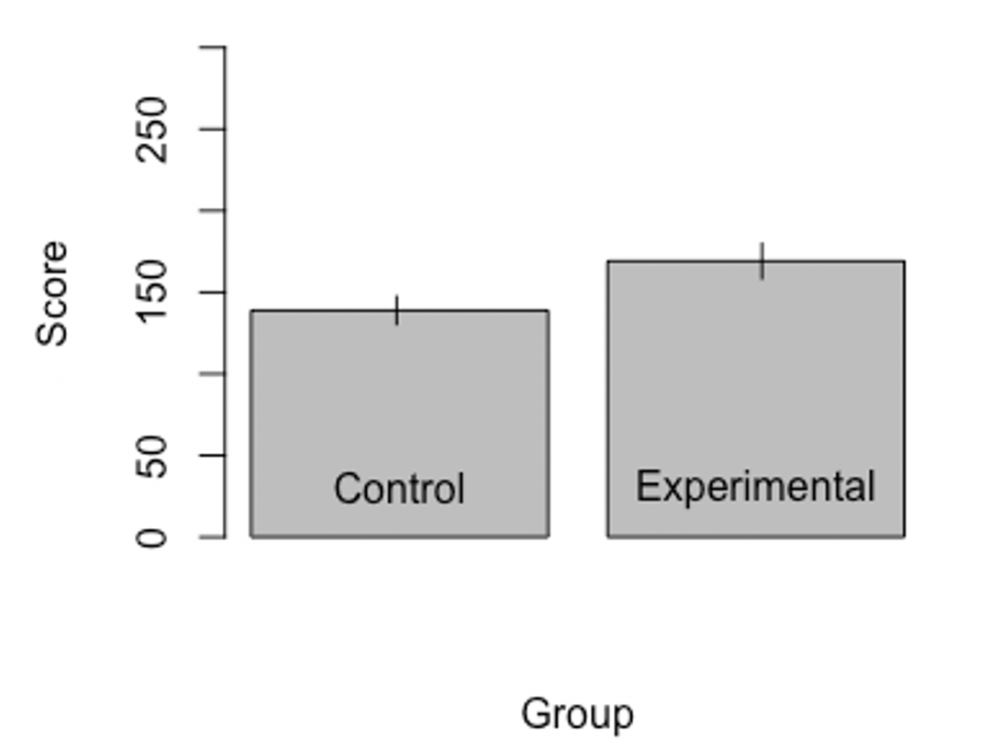
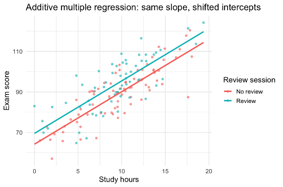
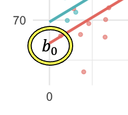
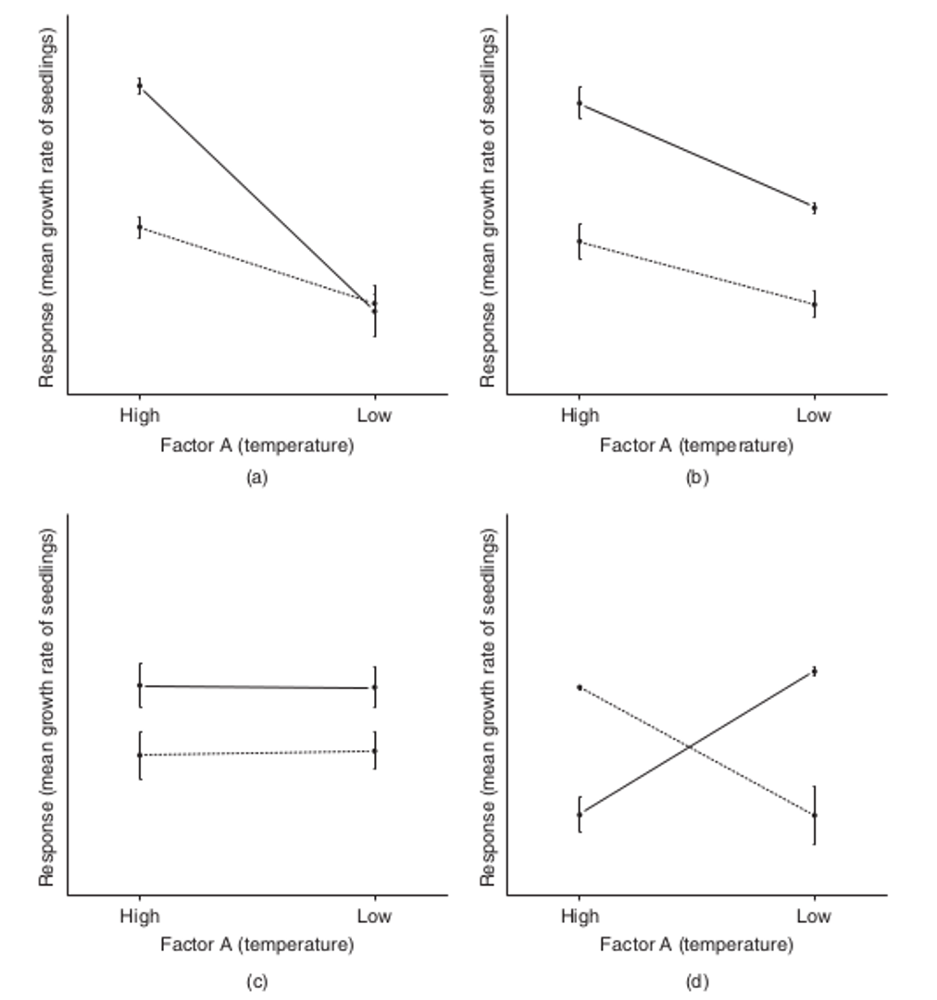
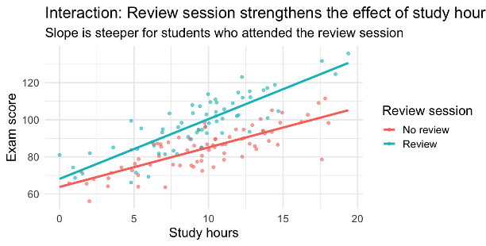
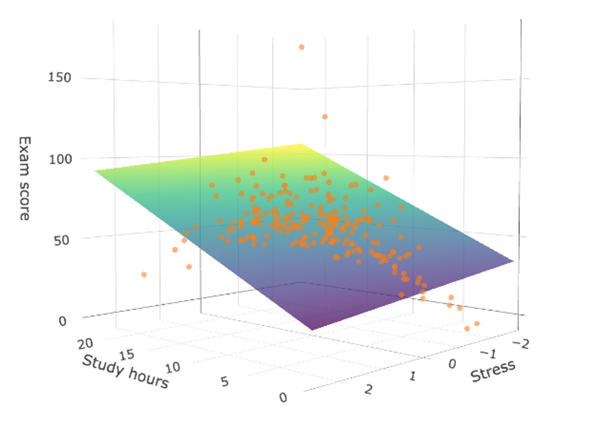
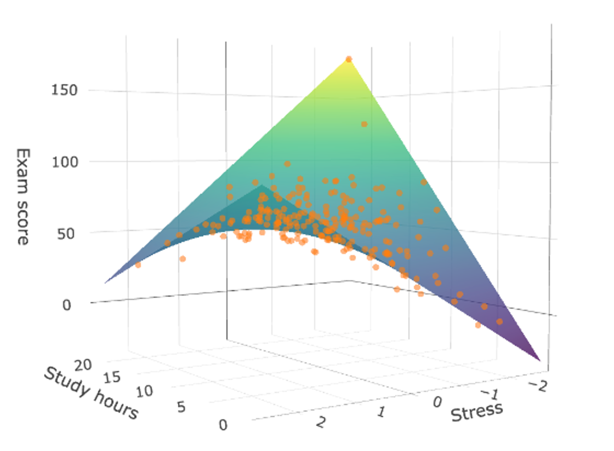

# The General Linear Model and "Moderation"

## What if I told you... all these models are the same 😱

That's right. Independent samples *t*-tests, ANOVA, regression, correlation, and even more advanced statistical frameworks like multilevel modeling and structural equation modeling are all ultimately the same model "under the hood." They're all manifestations of the General Linear Model (GLM), the namesake of this book!

Here's what it looks like:

$$
\hat{y} = b_0 + b_1 X_1 + \ldots + b_nX_n
$$

We have $\hat{y}$, which is our predicted value for the dependent variable. We have $b_0$, which is the intercept. It's the value that is added to all predictions. Then we have a sequence of predictor values and their coefficients, $b_nX_n$. These are just values multiplied by weights.

That's it!

...well, as you'll find out later, there's quite a bit more to the GLM, but in a certain sense, everything really does boil down to $\hat{y} = b_0 + b_1 X_1 + \ldots + b_nX_n$.

## "But *t*-tests are for differences between means and regression is for continuous variables!"

True, but *t*-tests are also just regression models "under the hood".

Let's say we have two groups of people, a control group and experimental group, 20 apiece. The control group has an average score of 138.95 and the experimental group has 169.14.

{fig-align="center" width="70%" fig-alt="A bar graph showing the mean of a control and experimental group."}

If you run an independent samples *t*-test on these data, you'd get *t*(38) = 2.22, *p* = .033. 

### Want to see a magic trick?

Now let's build the bridge between this simple *t*-test example and the GLM. Let's create a "dummy variable", X. Each participant has a bowling score and an X value. This value = 0 if they're in the control group and it equals 1 if they're in the experimental group.

Sometimes I like to be a little "extra" (💅) and show this in a fancy "piecewise function":

$$
X_i =
\begin{cases}
1 & \text{if participant } i \text{ is in experimental group} \\
0 & \text{if participant } i \text{ is in control group}
\end{cases}
$$

Now let's say we want to create a regression model that predicts someone's bowling score based on whether they were in the control group or the experimental group. The model would look something like this:

$$
\hat{y} = \bar{x}_{Control} + (\bar{x}_{Experimental}-\bar{x}_{Control})X
$$

In this model, we predict someone's bowling score by adding two terms together. The first term is the average of the control group ($\bar{x}_{Control} = 138.95$). This represents your best guess (or prediction) for anyone bowling in the control group. 

The second term isn't always added to our predictions. It starts with "$(\bar{x}_{Experimental}-\bar{x}_{Control})$", the difference of the averages between the two groups, ($169.14 - 138.95 = 30.19$). Crucially, though, this difference is multiplied by our dummy variable, X. If someone's in the control group, then X = 0. Anything times zero is zero, so our prediction is $\hat{y} = \bar{x}_{Control} + 0$.

But if someone's from the experimental group, then $(\bar{x}_{Experimental}-\bar{x}_{Control})$ gets multiplied by 1, so our prediction becomes $\hat{y} = \bar{x}_{Control} + (\bar{x}_{Experimental}-\bar{x}_{Control})$.

We could simplify a little bit this way:

$$
\hat{y} = 138.95 + 30.19 (X)
$$

There we go: Our best prediction for someone's bowling score is the average of the control group (138.95) and either stop there or add the difference between groups if we know someone's in the experimental group.

The regression output would look like this:
* $b_0 = 138.95$, *t*(38) = 14.44, *p* < .001
* $b_{difference} = 30.19$, *t*(38) = 2.22, *p* = .033.

Do you recognize the inferential statistics for the slope? *t*(38) = 2.22, *p* = .033 were the same results we got for the independent samples *t*-test from before.

{fig-align="center" width="70%" fig-alt="A bar graph showing the mean of a control and experimental group. Beside it, a scatterplot shows the same information, along with a regression line relating the two groups."}

In the figure above, we have a bar plot showing the sample means on the left. On the right, we have a strange looking scatter plot. Each circle represents a bowling score. The X-axis (the horizontal axis) represents which group the bowling score came from. They only come from group 0 (control group) or group 1 (the experimental group). There’s no in-between. That’s because the independent variable is categorical.

The line on the scatter plot represents the best fitting regression line. It’s the line whose equation minimizes the squared distance between each data point and the line. (Another way of saying this is that it’s the line that minimizes the squared residuals.) The line runs through (or "intersects") the mean of the control group when X = 0. The line also runs through the average of the experimental group when X = 1.

Let’s look at the statistical tests for the intercept and slope. The intercept is equal to 138.95. The null hypothesis is that the intercept equals 0. When we run a *t*-test on this hypothesis, we get *t*(38) = 14.44, *p* < .001. We reject the null hypothesis. The intercept is probably not 0. In this case, that just means that our predicted test score for an observation coming from the control group is not equal to zero.

It's more interesting to test the slope. The null hypothesis says that the slope is equal to 0. In other words, the null hypothesis says that, as X changes value (being in the experimental group rather than the control group), Y *does not* change value. Therefore, the null hypothesis states that the line should be flat or statistically indiscernible from being flat.

The *t*-value associated with this hypothesis is *t*(38) = 2.22, *p* = .033. You reject the null hypothesis. You conclude that the predicted value of Y actually ***does*** change whenever $X$ changes. 

Think about that for a moment. An independent samples *t*-test is used to test whether there’s a difference between two sample means. In the example above, the results were: *t*(38) = 2.22, *p* = .033. The statistical test for the regression slope has a *t*-value of *t*(38) = 2.22, *p* = .033.

How could this be!?

Well, the regression slope is testing whether the difference in Y that results from changing $X$ is statistically different from zero. It’s testing whether the difference between the control group and experimental group is greater than (or just different from) zero. When you think about it, independent samples *t*-test and the statistical test used on the regression slope for a dummy variable are asking the same question.

### Recreating an ANOVA in a regression model with dummy coding

An ANOVA can also be recreated with a regression model. (By "re-created", I mean they're fundamentally the same thing.) First, you have an intercept that represents the mean of a “baseline” group. It doesn’t have to be a control group. It can be any group. You just have to set one of them aside to represent the intercept in the model. Next, for each group added afterwards (any group beyond that first one), you assign that group its own dummy variable.

A dummy variable is set to 1 if an observation comes from a particular group and set to 0 if an observation did not come from that particular group. So, let’s say we have 3 groups. The first of those 3 groups is represented by the intercept. We use two dummy variables to represent the other two groups. The first dummy variable represents the difference in group means between group 1 and group 2. The second dummy variable represents the difference in group means between group 1 and group 3. Here’s what our regression equation would look like:

$$
\hat{y} =\ \text{intercept}\ \color{red}{+\ b_{dummy1}X_1} \color{blue}{+b_{dummy2}X_2}
$$

The intercept represents the mean of the first group. $b_{dummy1}$ is equal to the difference between the mean of the first group and the mean of the second group. $b_{dummy2}$ represents the difference between the mean of the first group and the mean of the third group. The black part of the equation gets added to every prediction. The red part only gets added if $\color{red}{X_1}$ equals 1. If $\color{red}{X_1}$ equals 0, then the entire red part drops out. Similarly, if $\color{blue}{X_2}$ equals 1, then the blue part of the equation gets added. Otherwise, when $\color{blue}{X_2}$ equals 0, the blue part drops out.

If a new observation came from the first group, we set both dummy variables ($X_1$ and $X_2$) to 0.

$$
\hat{y} =\ \text{intercept}\ \color{red}{+\ b_{dummy1}(0)}\color{blue}{+b_{dummy2}(0)}
$$

Anything multiplied by zero is zero, so our prediction just becomes the intercept with nothing added.

$$
\hat{y} =\ \text{intercept}\ 
$$

In other words, our prediction is just the mean for the first group.

If a new observation came from the second group, then $\color{red}{X_1}$ would be set to 1. $\color{blue}{X_2}$, however, would remain 0 because the second dummy variable equals 1 when an observation comes from the third group and otherwise equals 0. Our regression equation would become...

$$
\hat{y} =\ \text{intercept}\ \color{red}{+\ b_{dummy1}(1)}\color{blue}{+b_{dummy2}(0)}
$$

This simplifies to...

$$
\hat{y} =\ \text{intercept}\ \color{red}{+\ b_{dummy1}}
$$

Our prediction is the group mean for the first group (i.e., the intercept) plus the difference between the means of the first and second group (i.e., $\color{red}{b_{dummy1}}$).

If a new observation comes from the third group, then we set $\color{red}{X_1}$ to 0. Remember, the first dummy variable ($\color{red}{X_1}$) equals 1 if an observation came from the second group but otherwise equals zero. We would set $\color{blue}{X_2}$ to equal 1. This is because the second dummy variable is set to 1 if an observation came from the third group and otherwise equals 0. Our regression equation would become...

$$
\hat{y} =\ \text{intercept}\ \color{red}{+\ b_{dummy1}(0)}\color{blue}{+b_{dummy2}(1)}
$$

This simplifies to...

$$
\hat{y} =\ \text{intercept}\ \color{blue}{+b_{dummy2}}
$$

In other words, our prediction is the mean of the first group (i.e., the intercept) plus the difference between the mean of the first group and the mean of the third group (i.e., $\color{blue}{b_{dummy2}}$).

In general, you can have as many groups as you want in your regression model. You just need a number of dummy variables equal to the number of groups minus 1.

{fig-align="center" width="50%" fig-alt="A table showing how one would create 4 dummy codes for 5 groups."}

If all the dummy codes are set to 0, that means the observation came from the first group and your prediction is equal to just the intercept. Everything else gets multiplied by 0 and cancels out of the equation.

{fig-align="center" width="50%" fig-alt="A barplot showing the means for three groups."}

Let’s say you have the same two groups from earlier in the chapter but with an extra third group. The mean of group 1 is still equal to 138.95. The mean for group 2 is still equal to 169.14. The new mean for group 3 is equal to 283.80.

If you conducted an ANOVA on these three sample means, your results would look like this.

{fig-align="center" width="50%" fig-alt="An ANOVA showing a statistically significant main effect for the three group means in the current example data."}

Hopefully, you can tell from the *p*-value less than .05 that there is a significant main effect of group membership. In other words, at least one pair of group means are significantly different from one another. You’d have to do follow-up (aka. post-hoc) tests to determine exactly which pairs of means are different from one another and which ones aren’t.

This ANOVA is equivalent to a regression model with two dummy variables. The first dummy variable we’ll call “Group2”. It’s equal to 1 if an observation came from group 2 and otherwise it's equal to 0. The second dummy variable we’ll call “Group3”. It’s equal to 1 if an observation came from group 3 and otherwise equals 0.

Here are the results for each parameter of the regression model:

* Intercept = 138.95, *t*(57) = 16.76, *p* < .001
* Group2 = 30.19, *t*(57) = 2.58, *p* = .013
* Group3 = 144.85, *t*(57) = 12.36, *p* < .001

The intercept is our predicted value when both dummy variables are set to 0. It’s equal to the mean of group 1, 138.95. It is statistically significant, meaning that it is probably not equal to 0. The regression coefficient “Group2” is equal to the difference between the mean of group 1 and the mean of group 2 (169.14 - 138.95 = 30.19). It is statistically significant, meaning that the difference between the mean of group 1 and the mean of group 2 is probably not 0. Finally, the regression coefficient “Group3” is equal to the difference between the mean of group 1 and group 3 (283.80 - 138.95 = 144.85). It’s statistically significant, meaning that the difference between the means of group 1 and group 3 is probably not zero.

{fig-align="center" width="70%" fig-alt="A barplot showing three sample means. Beside it, a scatterplot shows the same information. Equations written on the scatterplot show how the regression equation predicts each group mean."}

Above, I’ve got a bar graph representing the means for each group on the left. On the right, I have a scatter plot representing all of the data points. There is one cluster of data points where the independent variable (Group) equals 0 (it says "1" on the plot. I need to fix that.). These are all the test scores for the first group. If we were to predict the next test score for someone and we only knew that they were from group 1, we’d predict the intercept of our regression model (i.e., the mean of group 1), which is 138.95. Where “Group” equals 2 on the x-axis, we have all the data points from the second group. If we were to try and predict the next person’s test score and all we knew was that they came from group 2, we’d predict the intercept plus the coefficient “Group2”. This is equal to the mean of group 1 (138.95) plus the difference between the mean of group 1 and 2. That difference is 30.19. Add those together and you get the mean for group 2 (138.95 + 30.19 = 169.14). That’s our best prediction.

This logic can keep going forward with however many groups you want!

## Mixing continuous and categorical variables with ~~regression~~ the GLM

Let's say we want to predict people's final exam score based on how many hours they spent studying (a continuous variable) and whether they attended the review session (binary, 1 = yes, 0 = no):

$$
\hat{y} = b_0 + b_1(Hours)+b_2(Review)
$$

You might get parameter estimates that look like this:

$$
\hat{y} = 65 + 2.5(Hours)+5(Review)
$$

* The intercept, 65, represents the expected score for someone who did no studying and did not attend the review session.
* The hours slope, 2.5, represents the predicted change in final exam score for every hour studied. Every hour studied will tend to result in about 2.5 more points on the exam.
* The review "slope" isn't really a "slope" at all, but a flat bonus of about 5 final exam points students will receive from attending the review session.

{fig-align="center" width="70%" fig-alt="Scatterplot of final exam scores by hours studied, with orange points and line for students who skipped the review session and teal for those who attended. The two lines are parallel."}

The figure above shows our final exam data. People who skipped the review session show up in orange, and those who did attend are teal. The two lines with those same colors represent the predicted hours-to-exam-score relationship.

{fig-align="center" width="70%" fig-alt="The same scatterplot, highlighting where the orange line crosses the y-axis at zero hours studied"}

The intercept represents the point on this graph where hours studied = zero and the dummy code variable for "did attend the review session" = 0. In other words, it's where the orange line crosses the y-axis, where x = 0.

The "hours slope" corresponds to the steepness of the orange line. Really, it represents the steepness of both lines in this model.

The review coefficient is represented by the vertical gap between the orange and teal lines. That's because this model treats the effect of attending the review session as an across-the-board change in predicted exam scores. No consideration is given to how attending the review session might change how people study.

## Interactions in the GLM

Hayes (2017) defined an interaction between three variables, X, Y, and W, as, "The effect of X on some variable on Y is moderated by W if its ***size, sign, or strength*** depends on or can be predicted by W. In that case, W is said to be a moderator of X's effect on Y, or that W and X interact in their influence on Y."

As you can tell from this quote (from a very authoritative source, mind you!), the terms "moderation" and "interaction" are synonymous. They are synonymous as far as the math is concerned, though, in practice, people tend to use them in slightly different ways. This is unfortunate, in my opinion, because this can create the false impression that "moderation analysis" warrants some kind of conclusion that "an interaction" doesn't. More on that later though.

{fig-align="center" width="70%" fig-alt="Four panels (a through d) of interaction plots with Response on the y-axis, High and Low temperature on the x-axis, and solid and dashed lines for two groups"}

The figure above shows a couple of interaction (or lack thereof) patterns you might observe in a 2 x 2 factorial ANOVA. The dependent variable is "Response". One of the independent variables is temperature with discrete values of "High" and "Low". A third variable is represented by solid and dashed lines. Let's pretend these represent weight, maybe "overweight" and "underweight".

In panel a, we see that average response gets lower with lower temperatures, but not equally so for those who are overweight or underweight. That means the effect of temperature on response *depends on weight*. There is a temperature by weight interaction.

In panel b, there is an effect of temperature on response, *but this effect changes based on people's weight*. This means that there is a temperature by weight interaction.

In panel c, there's no effect of temperature on response overall, *nor does the effect of temperature change based on weight*. Therefore, we see *no interaction between temperature and weight*.

Panel d shows a cross-over interaction. The effect of temperature on response is opposite for overweight and underweight people.

### Interactions as products

Let's go back to our earlier example, where we're predicting people's final exam scores based on how many hours they studied (continuous) and whether they attended a review session (binary, yes = 1, no = 0). This is what that model looked like:

$$
\hat{y} = b_0 + b_1(Hours)+b_2(Review)
$$

Recall, too, that this model did not allow for review session attendance to impact the relationship between hours studied and exam score. In other words, there was no interaction in the model. We call this an "additive model" because predictor variables are merely added together without consideration for how they might interact.

In this scenario, an additive model is unrealistic because there's a chance that people who attend the review session learn how to more effectively use their study time so that study hours result in *even more* boosts in exam scores than before.

To add an interaction term, we're going to add a coefficient in the model that will impact our predictions, $b_3$. Rather than multiply it by hours spent studying ($Hours$) or whether they attended the review session ($Review$), we're going to multiply ($Hours$) and ($Review$) together:

$$
\hat{y} = b_0 + b_1(Hours)+b_2(Review)+b_3(Hours)(Review)
$$

Adding an interaction term to your model will almost always change what the coefficients for the other predictors were in the additive model. It also changes how you interpret the coefficients. You might end up with coefficient estimates like these:

$$
\hat{y} = 65 + 2(Hours)+3(Review)+1.2(Hours)(Review)
$$

* The intercept, 65, represents the predicted exam score for people who did not study and did not attend the review session. Notice that 1.2 will not be added to the equation because if you multiply a bunch of stuff together and *a single one of those things is zero* the product of everything is zero.
* The hours "slope", 2, indicates that, overall, we predict that each additional hour spent studying will result in 2 more points on the exam.
* The review "slope", 3, indicates that attending the review session will result in 3 additional points on the final exam, on average.
* The interaction "slope", 1.2, indicates that study hours have more of an effect on exam scores for people who went to the review session.

That last point is worth additional unpacking. You see, the effect of hours on exam scores for non-attendees is $b_1$ = 2. The effect of hours on exam scores for attendees is $b_1 + b_3 = 2 + 1.2 = 3.2$.

In other words, you normally get a 2 point bonus, on average, for each additional hour studied, but you get a 3.2 bonus, on average, for every hour spent when you also went to the review session.

{fig-align="center" width="70%" fig-alt="Scatterplot of final exam scores by hours studied, with separate regression lines for attendees and non-attendees that diverge as hours increase"}

Adding an interaction in the model allowed the two regression lines for attendees and non-attendees to diverge. In other words, it allowed for the effect of study hours on exam scores to differ depending on review session attendance.

In this situation, with one continuous predictor and one binary predictor, both of which interact with each other, you can think of the interaction term as a gear shift in a car. Without the interaction, both groups are driving in the same gear. With a positive interaction, one group has shifted into a higher gear and each hour spent studying moves them faster along (in terms of predicted exam scores).

For non-attenders, each hour increased predicted scores by $b_1$ points, on average. For attenders, each hour increased predicted scores by $b_1+b_3$ points.

### What if both predictors are continuous though?

It's easier to visualize a "moderator" or "interaction" in a GLM if there is one continuous predictor and one binary (often dummy-coded) predictor interacting with each other. You can always have multiple categorical predictors, ones with more than just 2 levels, as well as 3 or more continuous variables. You can have two of your 7 predictors interacting and 5 that are additive.

The math stays the same throughout all these scenarios. The interpretation and intuition just gets a little more challenging. There are a couple of analogies I'll run by you first, then go into the math.

{fig-align="center" width="70%" fig-alt="A dimmer light switch"}

People often use a dimmer switch metaphor when describing moderation analysis, especially when the moderator variable is continuous. In the previous example, when we had review session attendance as a binary moderator, it was like we were flipping a light switch: There are only two states, you attended the review session or you didn't. Likewise, there are only two possible effects of hours spent studying: one rate for non-attenders and another, higher rate for those who did attend.

With the dimmer switch, our moderator variable has many states: Completely dark, kind of dark, etc. Likewise, stress has many states: Completely stressed, kind of stressed, etc. The concept's still the same though: Degrees of stress change the relationship between study time and exam score.

Here's what an additive regression model in this situation might look like:

$$
\hat{y} = b_0 + b_1(Hours) + b_2(Stress)
$$

You might get coefficient estimates like these:

$$
\hat{y} =  58.68 + 3.30(Hours) - 3.03(Stress)
$$

* The intercept, 58.68, is the predicted exam score for people who didn't study at all and have no stress whatsoever.
* Each hour studied tends to result in 3.30 more exam points, while adjusting for stress.
* Each unit increase in stress results, on average, in 3.03 fewer points on the exam, while adjusting for hours studied.

Recall that, when we have two continuous predictors in a regression model, we are using a plane in a 3d space to make predictions rather than a line in a 2d space.

{fig-align="center" width="70%" fig-alt="A 3D scatterplot of exam scores by hours studied and stress, with a flat regression plane through the orange data points"}

The figure above shows a 3d space with the data points plotted in orange and our regression model as a multi-color flat shape running through it. Since 3d spaces are hard to see on 2d computer screens, paper, or whatever you're reading this on, you might want to use [this webpage](https://rpubs.com/mslacour/add-vs-int-continuous) to explore different angles.

Now let's see what happens when you add the interaction term in:

$$
\hat{y} = b_0 + b_1(Hours) + b_2(Stress) + b_3(Hours)(Stress)
$$

Mathematically, we're just adding a third coefficient that is multiplied by the product of the two predictors, literally multiplying $Hours$ and $Stress$ together and giving that quantity its own weight in predictions.

You might get coefficient estimates like this:

$$
\hat{y} = 59.46 + 2.93(Hours) + (-1.26)(Stress) + (-2.49)(Hours)(Stress)
$$

The intercept and the slopes for hours are interpreted much the same way as before. I won't crowd your brain right now with the subtle changes. The real focus is the -2.49. This can be interpreted in a couple of different, but equivalent, ways:

* Focusing on study hours as a “moderator”
  * For each additional hour of studying, the effect of stress on score becomes 2.49 points more negative.
  * Each additional hour of studying reduces the stress-score slope by 2.49 points.
* Focusing on stress as a “moderator”
  * For each one-unit increase in stress, the effect of study hours on score decreases by 2.49 points.
  * Each unit increase in stress reduces the hours-score slope by 2.49 points.

{fig-align="center" width="70%" fig-alt="The same 3D scatterplot with a curved, twisted regression plane through the data points"}

Adding the interaction term amounts to using a curvy plane instead of a flat one to make predictions (see figure above). The additive and interaction models can both be explored from different angles on [this webpage](https://rpubs.com/mslacour/add-vs-int-continuous). After some examination, you'll see that acknowledging the study hours by stress interaction gets the prediction model, on average, closer to each data point.
